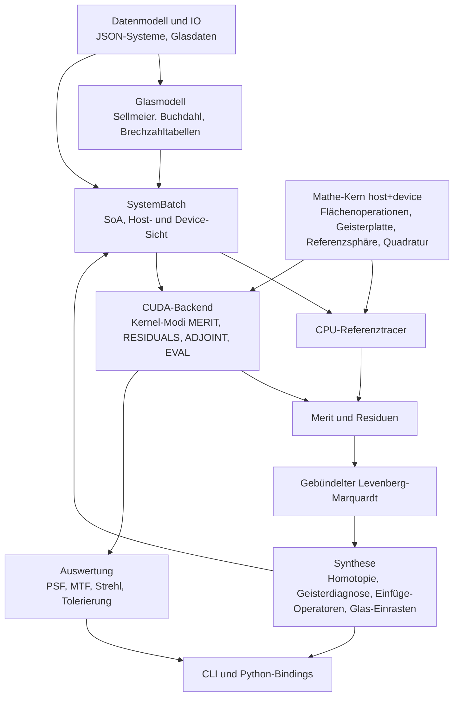

# Architektur

## Schichten



## Module und geplante Pfade

| Modul | Header | Quellen | Meilenstein |
|---|---|---|---|
| Mathe-Kern | `include/mikroptim/math/`, `include/mikroptim/trace/` | header-only | M0, M1, M4 |
| Datenmodell und IO | `include/mikroptim/model/`, `include/mikroptim/io/` | `src/model/`, `src/io/` | M1 |
| Glasmodell | `include/mikroptim/glass/` | `src/glass/` | M1, M6 |
| Pupillenquadratur | `include/mikroptim/pupil/` | header-only | M1 |
| Paraxialoptik | `include/mikroptim/paraxial/` | `src/paraxial/` | M1 |
| SystemBatch | `include/mikroptim/batch/` | `src/batch/` | M2 |
| CPU-Tracer, Lader | `include/mikroptim/cpu/` | `src/cpu/` | M1 |
| CUDA-Backend | `include/mikroptim/cuda/` (reines C++) | `src/cuda/` | M2–M8 |
| Merit (ab M1-T7: Wellenfront) | `include/mikroptim/merit/` | `src/merit/` | M1, M3, M4 |
| Optimierer | `include/mikroptim/optim/` | `src/optim/`, `src/cuda/` | M3, M5 |
| Synthese | `include/mikroptim/synth/` | `src/synth/` | M6 |
| Auswertung | `include/mikroptim/eval/` | `src/eval/`, `src/cuda/` | M8 |
| CLI | – | `src/cli/` | M1 ff. |
| Python | – | `python/` | M9 |

## Datenmodell und IO

Statische Host-Bibliothek `mikroptim_model` (Alias `Mikroptim::model`), gelinkt in CLI und Tests:

- `include/mikroptim/model/system.hpp`: `mko::SystemDescription` mit `Spectrum`, `Source`, `Target`, `Surface` (Typen `SurfaceType`, `SourceType`), Validierung `validate_system` und `validate_materials`.
- `include/mikroptim/model/material.hpp`: `mko::MaterialSpec` (Medium nach einer Fläche; gemeinsam mit dem Glasmodell).
- `include/mikroptim/model/format_error.hpp`: `mko::FormatError` mit JSON-Pfad.
- `include/mikroptim/io/system_json.hpp`: Einlesen und Schreiben von `mikroptim.system/1`, Auflösung der Glaskatalog-Pfade (Details: [dateiformat.md](dateiformat.md#einlesen-und-validierung)).

nlohmann/json (v3.12.0, FetchContent) wird nur in Quellen unter `src/` eingebunden und privat gelinkt; öffentliche Header bleiben frei von JSON-Typen.

## Mathe-Kern

Alle Rechnungen, die pro Strahl laufen, liegen header-only im Mathe-Kern, sind `MKO_HD` und über den Zahlentyp `R` templatisiert (ADR-0005). CPU-Tracer und CUDA-Kernel rufen dieselben Funktionen auf. Der sequenzielle Trace über ein System ist eine Funktion

```cpp
template <class R, class SurfaceTable>
MKO_HD TraceStatus trace_ray(const SurfaceTable& sys, int wavelength_index, Ray<R>& ray,
                             TraceRecord<R>* record, int* failed_surface = nullptr);
```

`SurfaceTable` ist eine schlanke Sicht (Zeiger und Längen) auf die Flächendaten einer Variante, im Kernel auf Shared Memory. `record` ist optional und speichert Zwischenzustände für den adjungierten Modus und für Strahlhöhen-Reduktionen. Details im folgenden Abschnitt.

## Sequenzieller Trace (M1-T5)

Ablauf, Start- und Endzustand und Statuscodes: [numerik.md](numerik.md#sequenzieller-trace-m1-t5).

### Mathe-Kern (header-only, `MKO_HD`)

`include/mikroptim/trace/surface_table.hpp`:

```cpp
inline constexpr int kMaxSurfaces = 64;                     // inkl. Blende; Host prüft beim Aufbau
enum class SurfaceKind : std::uint8_t { Stop = 0, Plane = 1, Sphere = 2, GhostPlate = 3 /* M4-T5 */ };
template <class R> struct SurfaceTableView {                // trivial kopierbar
    int surfaces, wavelengths;                              // S, L
    const SurfaceKind* type; const R* curvature; const R* thickness;  // [S]
    const R* index;                                         // [S·L], index[s·L + l] = Medium nach Fläche s
};
```

`trace_ray` greift nur über die Namen `surfaces`, `wavelengths`, `type[s]`, `curvature[s]`, `thickness[s]` und `index[s * wavelengths + l]` auf die Tabelle zu. Jeder Typ mit diesen Namen ist eine gültige Tabelle, z. B. feste Felder im Shared Memory oder (M2) eine Batch-Sicht, deren Zeiger um v·S bzw. v·S·L versetzt sind. Der CUDA-Prüfkernel `src/cuda/trace_check.cu` lädt die Tabelle pro Block in den Shared Memory (dynamisch, (2S + S·L)·8 + S Byte) und baut die Sicht darauf.

`include/mikroptim/trace/trace.hpp`:

```cpp
template <class R> struct TraceRecord {          // optional, z. B. Local Memory im Kernel
    int count;                                   // gültige Einträge; bei Versagen an Fläche s: count = s
    Vec3<R> p[kMaxSurfaces], d[kMaxSurfaces];    // Schnittpunkt (lokal) und Richtung nach Fläche s
    R opl[kMaxSurfaces];                         // Eintrag 0 = Startzustand
};
template <class R> MKO_HD Ray<R> collimated_ray(R a, R theta, R rho, R phi);        // OPL₀ = p₀·d₀
template <class R> MKO_HD Ray<R> point_source_ray(Vec3<R> q, R sin_max, R rho, R phi); // OPL₀ = 0
template <class R> MKO_HD TraceStatus propagate_surface(Ray<R>&, R t, SurfaceKind, R c, R n_before, R n_after);
template <class R, class T> MKO_HD TraceStatus trace_ray(const T& sys, int l, Ray<R>&, TraceRecord<R>*, int* failed_surface = nullptr);
template <class R, class T> MKO_HD TraceStatus transfer_to_image_plane(const T& sys, int l, Ray<R>&);
```

Erweiterungspunkte: Ein neuer Flächentyp (Geisterplatte, M4-T5) bekommt einen Zweig in `propagate_surface` und seine Daten als zusätzliche Felder der Tabelle. Der adjungierte Modus (M5) liest Schnittpunkte und Richtungen aus `TraceRecord` (die Richtung vor der Brechung an Fläche s ist `d[s − 1]`). Strahlhöhe und Einfallswinkel pro Fläche (M4-T3) folgen aus `p[s]`, `d[s − 1]` und der Flächennormale.

### Host-Schicht (Bibliothek `Mikroptim::cpu`, `src/cpu/`)

Statische Bibliothek `mikroptim_cpu`, linkt `Mikroptim::model` und `Mikroptim::glass`.

- `include/mikroptim/cpu/host_surface_table.hpp`: `HostSurfaceTable` (FP64-Vektoren `type`, `curvature`, `thickness`, `index`, zusätzlich `semi_diameter`; `view()` liefert die `SurfaceTableView<double>`) und `make_surface_table(SystemDescription, IndexTable)`. Krümmungen von Stop und Plane werden 0; mehr als `kMaxSurfaces` Flächen oder unpassende Tabellen werfen `std::invalid_argument`.
- `include/mikroptim/cpu/load_system.hpp`: `load_system(path)` verbindet `read_system_file`, `resolve_glass_catalogs` (relativ zum Verzeichnis der Datei), `GlassCatalog::from_file` + `merge`, `validate_materials`, `make_index_table` und `make_surface_table` zu einem `LoadedSystem { system, catalog_files, catalog, index, table, warnings }`. `prepare_system(description, base_dir)` macht dasselbe für eine bereits eingelesene Beschreibung.
- `include/mikroptim/cpu/cpu_trace.hpp`: `trace_system_cpu(system, table, quadrature)` traced alle Felder × Wellenlängen × Pupillenstützstellen (eine Quadratur für alle Felder) und liefert `CpuTraceResult` mit Endzustand (Schnittpunkt der letzten Fläche), Status und versagender Fläche pro Strahl, abgelegt unter `(f · L + l) · N + k` wie die Blöcke und Threads im Kernel. `source_ray(system, table, f, l, sample)` erzeugt den Startstrahl (kollimiert mit a = Halbdurchmesser der Blende, Punktquelle mit sin ϑ_max = NA / index[0][l]); `source_field_count` liefert die Zahl der Felder (1 bei der Punktquelle).

## Wellenfront (M1-T7)

Referenzsphäre, Kolbenabzug und RMS-Wellenfront pro Feld und Wellenlänge. Formeln, Wahl des Schnittpunkts, Versagensbehandlung, f_soll-Regel, Summationsreihenfolge und Einheiten: [numerik.md, Abschnitt 7](numerik.md#7-referenzsphäre-und-opd).

### Mathe-Kern (header-only, `MKO_HD`)

```cpp
// include/mikroptim/trace/reference_sphere.hpp
template <class R> MKO_HD TraceStatus reference_sphere_step(Ray<R>&, Vec3<R> center, R n_image,
                                                            R* s_ref = nullptr);   // Missed bei Versagen
template <class R, class T> MKO_HD TraceStatus trace_to_reference_sphere(const T& sys, int l, Ray<R>&,
                                                            Vec3<R> center, int* failed_surface = nullptr);
// include/mikroptim/merit/opd.hpp
template <class R> struct OpdStatistics { R valid_weight, piston, rms; int failed; };
template <class R> MKO_HD OpdStatistics<R> opd_statistics(const R* opl, const R* weight,
                                const TraceStatus* status, int count, R* opd /* oder nullptr */);
```

`trace_to_reference_sphere` ist der Pro-Strahl-Teil (Thread im Kernel): `trace_ray`, dann der Schritt auf die Sphäre um **M**_f im Medium index[S−1][l]; versagt die Referenzsphäre, ist `*failed_surface = S`. `opd_statistics` ist die sequenzielle Referenz der Block-Reduktion (Kolben, OPD, RMS über die Stützstellen eines Blocks); M2-T2 baut sie als Baumreduktion nach.

### Host-API (Bibliothek `Mikroptim::merit`, `src/merit/`)

Statische Bibliothek `mikroptim_merit`, linkt `Mikroptim::cpu` und `Mikroptim::paraxial`. Die Wellenfrontauswertung gehört zum Modul Merit, weil M3/M4 aus denselben OPD-Werten die Residuen bilden; der CPU-Tracer bleibt reiner Strahltransport.

```cpp
struct WavefrontOptions { int rings = 10, spokes = 8; std::optional<PupilMode> pupil_mode; };
struct WavefrontMap {                        // ein Tupel (Feld f, Wellenlänge l)
    int field, wavelength; double wavelength_nm; Vec3<double> image_point;   // M_f
    PupilQuadrature<double> quadrature; std::vector<PupilSample<double>> pupil;
    std::vector<double> opl, opd, opd_waves; // [k]; NaN bei versagten Strahlen
    std::vector<TraceStatus> status; std::vector<int> failed_surface;       // S = Referenzsphäre
    double piston, rms, rms_waves, valid_weight; int failed;
    int samples() const; bool valid() const; // valid: mindestens ein gültiger Strahl
};
struct WavefrontResult { int fields, wavelengths; double reference_nm, focal_length;
                         std::vector<WavefrontMap> maps;          // maps[f · L + l]
                         const WavefrontMap& at(int f, int l) const; std::size_t failed_count() const; };

double target_focal_length(const SystemDescription&, const GlassCatalog&);   // f_soll
std::vector<Vec3<double>> ideal_image_points(const SystemDescription&, const HostSurfaceTable&,
                                             double focal_length);           // (0, f tan θ_f, w)
PupilMode wavefront_pupil_mode(const SystemDescription&, int field, const WavefrontOptions& = {});
WavefrontResult evaluate_wavefront(const SystemDescription&, const HostSurfaceTable&,
                                   std::span<const Vec3<double>> image_points, const WavefrontOptions& = {});
WavefrontResult evaluate_wavefront(const LoadedSystem&, const WavefrontOptions& = {});
```

Jedes Feld hat eine eigene Quadratur (Achsfächer auf der Achse, sonst halbe Pupille), daher die Ablage pro Tupel statt eines gemeinsamen Arrays wie in `CpuTraceResult`. Fehler: `std::invalid_argument` (Tabelle passt nicht, falsche Zahl von Bildpunkten, afokales System ohne `target.focal_length`, ungültige Quadratur), `std::out_of_range` (Feld), `GlassError` (Brechzahl bei `reference_nm`). Die Ausgabe in der CLI folgt mit M1-T8.

## SystemBatch und Datenlayout

Ein Batch enthält V Varianten mit derselben Topologie (Flächenzahl und Flächentypen). Varianten mit anderer Topologie gehören in einen anderen Batch.

Structure of Arrays im globalen Speicher, Index `[v][s]` bzw. `[v][s][l]`:

| Feld | Typ | Bedeutung |
|---|---|---|
| `type[s]` | uint8 | Flächentyp (gemeinsam für den Batch): Plane, Sphere, GhostPlate |
| `curvature[v][s]` | R | Krümmung c = 1/R |
| `thickness[v][s]` | R | Abstand zum nächsten Scheitel |
| `index[v][s][l]` | R | Brechzahl nach der Fläche bei Wellenlänge l (vorab aus dem Glasmodell) |
| `ghost_coeff[v][g][k]` | R | Koeffizienten der Geisterplatte g |
| `ghost_index[v][g][l]` | R | Brechzahl des virtuellen Glases der Geisterplatte |
| `ghost_norm_radius[g]` | R | Normierungsradius des Dickenprofils |
| `image_distance[v]` | R | Arbeitsabstand (Dicke der letzten Fläche) |
| `field_target[v][f]` | R | ideale Bildhöhe h_f = f_soll · tan θ_f |

Brechzahlen werden pro Variante und Wellenlänge auf dem Host (oder einem kleinen Kernel) berechnet; der Trace-Kernel rechnet keine Dispersionsformeln.

## Brechzahltabelle

Modul Glasmodell (`include/mikroptim/glass/`, Bibliothek `Mikroptim::glass`):

- `dispersion.hpp` – header-only, `MKO_HD`, templatisiert über `R`: `sellmeier_index`, `buchdahl_omega`, `buchdahl_index` (λ in µm) und `nm_to_um` als einzige Umrechnungsstelle nm → µm.
- `catalog.hpp` – `GlassCatalog` (Host), Einlesen siehe [dateiformat.md](dateiformat.md#glasdaten).
- `index_table.hpp` – `material_index` und `make_index_table`.
- `buchdahl_fit.hpp` – Kleinste-Quadrate-Fit des Buchdahl-Modells (Verfahren: [numerik.md](numerik.md#10-glasmodelle)):

```cpp
struct BuchdahlFitOptions { double lambda_min_nm = 400, lambda_max_nm = 700; int samples = 301;
                            BuchdahlFitNodes nodes = Chebyshev; int check_samples = 3001; };
struct BuchdahlFit { int dispersion_terms; double n0; std::array<double, 3> nu;
                     double max_abs_error, rms_error; BuchdahlFitOptions options;
                     double index(double lambda_nm) const; };
BuchdahlFit fit_buchdahl(const Glass& glass, int dispersion_terms /* 2 oder 3 */,
                         const BuchdahlFitOptions& = {});
BuchdahlFit fit_buchdahl(const IndexFunction& index_nm, int dispersion_terms,
                         const BuchdahlFitOptions& = {}); // beliebiges n(lambda_nm)
MaterialSpec to_buchdahl_material(const BuchdahlFit& fit);   // kind = Buchdahl
```

```cpp
struct IndexTable { int surfaces; int wavelengths; std::vector<double> n; double at(int s, int l) const; };
IndexTable make_index_table(std::span<const MaterialSpec> media,
                            std::span<const double> wavelengths_nm, const GlassCatalog& catalog);
```

`media[s]` ist das Medium **nach** Fläche s (`mko::MaterialSpec` aus `include/mikroptim/model/material.hpp`), das Medium vor Fläche 0 ist Luft. Die Tabelle ist zeilenweise abgelegt: `n[s * wavelengths + l]`, also dasselbe Layout wie `index[v][s][l]` für eine Variante. Air → 1, `constant` → n, Katalogname → Sellmeier mit Prüfung von `range_nm`, `buchdahl` → Formel aus numerik.md, Abschnitt 10. Fehler (unbekanntes Glas, Wellenlänge außerhalb des Gültigkeitsbereichs) sind `GlassError` mit Fläche, Wellenlänge und Glasname.

## Paraxialoptik

Modul `include/mikroptim/paraxial/`, Bibliothek `mikroptim_paraxial` (Alias `Mikroptim::paraxial`, linkt `model` und `glass`). Definitionen und Vorzeichen: [numerik.md, Abschnitt 9](numerik.md#9-paraxialoptik).

- `ynu_trace.hpp` – header-only, `MKO_HD`, templatisiert über `R`: `ParaxialRay<R>{y, u}`, `surface_power`, `paraxial_refract`, `paraxial_transfer`, `paraxial_trace(c, t, n, count, ray, at_surface)` und `petzval_sum(c, n, count)` über nackte Arrays (Layout wie eine Variante im SystemBatch). Für Paraxialdaten vieler Varianten (M3-T3, M4-T4) auf Host oder GPU.
- `paraxial.hpp` – Host-API:

```cpp
struct ParaxialData {
    std::array<double, 4> abcd;          // Systemmatrix {A, B, C, D}, reduzierte Winkel
    double power; bool afocal;
    double focal_length, back_focal_distance, front_focal_distance;
    double front_principal_plane, rear_principal_plane, image_defocus;
    double petzval_sum, petzval_curvature, petzval_radius;
    bool exit_pupil_at_infinity;
    double exit_pupil_position, exit_pupil_magnification, exit_pupil_semi_diameter;
};
ParaxialData compute_paraxial(std::span<const double> curvatures, std::span<const double> thicknesses,
                              std::span<const double> indices, double stop_semi_diameter);
ParaxialData compute_paraxial(const SystemDescription&, const IndexTable&, int wavelength_index);
ParaxialData compute_paraxial(const SystemDescription&, const GlassCatalog&, double wavelength_nm);
ParaxialData compute_paraxial(const SystemDescription&, const GlassCatalog&);   // reference_nm
```

Fehler: `std::invalid_argument` (leere oder ungleich lange Arrays, nicht endliche Werte, n ≤ 0, Blendenradius ≤ 0, Brechzahltabelle passt nicht zum System), `std::out_of_range` (Wellenlängenindex), `GlassError` (Brechzahl nicht bestimmbar). Geisterplatten kommen in M4 als zusätzliche dünne Elemente hinzu (eigene Überladung); `ParaxialData` bleibt dabei unverändert.

## Kernel-Abbildung

- **Grid:** ein Block pro Tupel (Variante v, Feld f, Wellenlänge l), linearisiert.
- **Block:** 128 Threads (zu tunen in M7). Threads iterieren über die Pupillenstützstellen der Quadratur.
- **Shared Memory:** Flächentabelle der Variante (ca. 1 KB bei 30 Flächen) plus Reduktionspuffer.
- **Pupillenstützstellen** werden im Thread aus dem Index berechnet (Ring i, Speiche j, Gewicht).
- **Versagen:** Strahlen, die eine Fläche verfehlen oder totalreflektieren, laufen maskiert weiter; im Optimierungsmodus erzeugen sie Strafresiduen (weiches Versagen, siehe numerik.md).

## Kernel-Modi

| Modus | Ausgabe | Zweck | Meilenstein |
|---|---|---|---|
| `MERIT` | gewichtete Quadratsumme pro Variante | Liniensuche, Multistart-Screening | M2 |
| `RESIDUALS` | Residuenvektor pro Variante | finite Differenzen, LM | M2 |
| `ADJOINT` | Residuen plus Gradientenzeilen | analytische Jacobi-Matrix | M5 |
| `EVAL` | OPD-Karten auf dichtem Raster, Spotdaten | PSF, MTF, Tolerierung | M8 |

Zusätzlich liefern alle Modi optional pro Variante und Fläche die maximale Strahlhöhe und den maximalen Einfallswinkel (Max-Reduktion) für mechanische Nebenbedingungen.

## Reduktionen

Deterministisch: Baumreduktion im Block mit `__shfl_down_sync` und Shared Memory, Ergebnis pro Block in den globalen Speicher, danach Summation in fester Reihenfolge (zweiter Kernel oder Host). Keine Gleitkomma-Atomics für Ergebniswerte (ADR-0007).

## Speicherbedarf

Residuenmatrix für finite Differenzen: Läufe × (P+1) × Residuen × 8 Byte. Beispiel 1.000 × 91 × 2.500 × 8 B ≈ 1,8 GB. Die Batchgröße wird zur Laufzeit aus `cudaMemGetInfo` bestimmt; reicht der Speicher nicht, werden Läufe in Tranchen verarbeitet.

## Host-API (Skizze)

```cpp
namespace mko::cuda {
class TraceEngine {
public:
    explicit TraceEngine(int device);
    void upload(const SystemBatchHost& batch);                 // Topologie + Varianten
    void run(Mode mode, const TraceSettings& s, TraceOutput& out);
    std::size_t max_variants(const TraceSettings& s) const;    // aus freiem Speicher
};
}
```

Der Header ist reines C++, damit CLI, Optimierer und Python-Bindings ohne nvcc kompilieren.

## Mehrere GPUs (M7)

Varianten werden nach gemessenem Durchsatz auf die Geräte verteilt (P100 und RTX 3090 im selben Rechner oder getrennt). Ergebnisse pro Variante müssen unabhängig von der Verteilung bitgleich sein.

## Verhältnis zu Raytatouille

Mikroptim ist ein eigenständiges Projekt mit eigenem Dateiformat. Ein Adapter zwischen `*.rtt.json` (Raytatouille) und `mikroptim.system/1` ist für M9 vorgesehen (ADR-0008).
