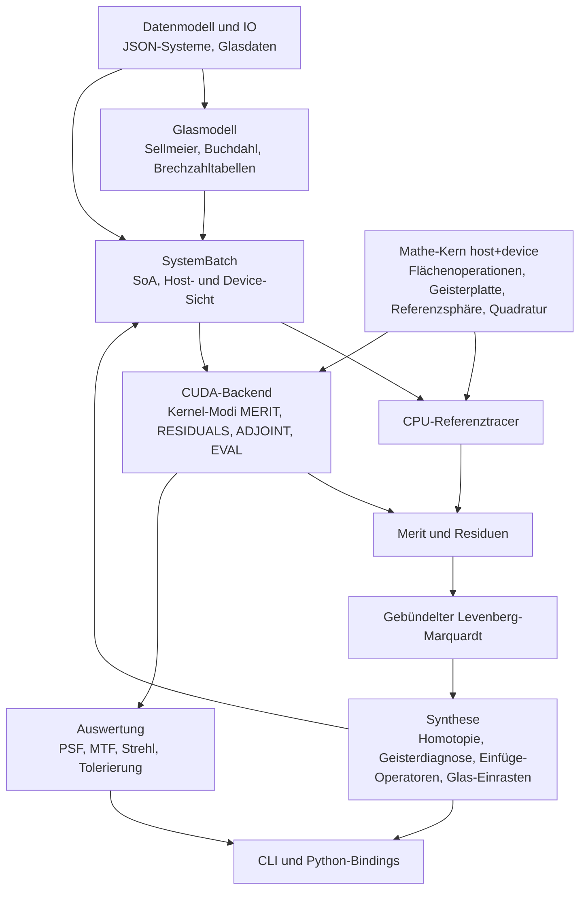

# Architektur

## Schichten



## Module und geplante Pfade

| Modul | Header | Quellen | Meilenstein |
|---|---|---|---|
| Mathe-Kern | `include/mikroptim/math/`, `include/mikroptim/trace/` | header-only | M0, M1, M4 |
| Datenmodell und IO | `include/mikroptim/model/`, `include/mikroptim/io/` | `src/model/`, `src/io/` | M1 |
| Glasmodell | `include/mikroptim/glass/` | `src/glass/` | M1, M6 |
| Pupillenquadratur | `include/mikroptim/pupil/` | header-only | M1 |
| Paraxialoptik | `include/mikroptim/paraxial/` | `src/paraxial/` | M1 |
| SystemBatch | `include/mikroptim/batch/` | `src/batch/` | M2 |
| CPU-Tracer, Lader | `include/mikroptim/cpu/` | `src/cpu/` | M1 |
| CUDA-Backend | `include/mikroptim/cuda/` (reines C++) | `src/cuda/` | M2–M8 |
| Merit (ab M1-T7: Wellenfront) | `include/mikroptim/merit/` | `src/merit/` | M1, M3, M4 |
| Optimierer | `include/mikroptim/optim/` | `src/optim/`, `src/cuda/` | M3, M5 |
| Synthese | `include/mikroptim/synth/` | `src/synth/` | M6 |
| Auswertung | `include/mikroptim/eval/` | `src/eval/`, `src/cuda/` | M8 |
| CLI ([cli.md](cli.md)) | – (intern `src/cli/trace_command.hpp`) | `src/cli/` | M1 ff. |
| Python | – | `python/` | M9 |

## Datenmodell und IO

Statische Host-Bibliothek `mikroptim_model` (Alias `Mikroptim::model`), gelinkt in CLI und Tests:

- `include/mikroptim/model/system.hpp`: `mko::SystemDescription` mit `Spectrum`, `Source`, `Target`, `Surface` (Typen `SurfaceType`, `SourceType`), Validierung `validate_system` und `validate_materials`.
- `include/mikroptim/model/material.hpp`: `mko::MaterialSpec` (Medium nach einer Fläche; gemeinsam mit dem Glasmodell).
- `include/mikroptim/model/format_error.hpp`: `mko::FormatError` mit JSON-Pfad.
- `include/mikroptim/io/system_json.hpp`: Einlesen und Schreiben von `mikroptim.system/1`, Auflösung der Glaskatalog-Pfade (Details: [dateiformat.md](dateiformat.md#einlesen-und-validierung)).

nlohmann/json (v3.12.0, FetchContent) wird nur in Quellen unter `src/` eingebunden und privat gelinkt; öffentliche Header bleiben frei von JSON-Typen.

## Mathe-Kern

Alle Rechnungen, die pro Strahl laufen, liegen header-only im Mathe-Kern, sind `MKO_HD` und über den Zahlentyp `R` templatisiert (ADR-0005). CPU-Tracer und CUDA-Kernel rufen dieselben Funktionen auf. Der sequenzielle Trace über ein System ist eine Funktion

```cpp
template <class R, class SurfaceTable>
MKO_HD TraceStatus trace_ray(const SurfaceTable& sys, int wavelength_index, Ray<R>& ray,
                             TraceRecord<R>* record, int* failed_surface = nullptr);
```

`SurfaceTable` ist eine schlanke Sicht (Zeiger und Längen) auf die Flächendaten einer Variante, im Kernel auf Shared Memory. `record` ist optional und speichert Zwischenzustände für den adjungierten Modus und für Strahlhöhen-Reduktionen. Details im folgenden Abschnitt.

## Sequenzieller Trace (M1-T5)

Ablauf, Start- und Endzustand und Statuscodes: [numerik.md](numerik.md#sequenzieller-trace-m1-t5).

### Mathe-Kern (header-only, `MKO_HD`)

`include/mikroptim/trace/surface_table.hpp`:

```cpp
inline constexpr int kMaxSurfaces = 64;                     // inkl. Blende; Host prüft beim Aufbau
enum class SurfaceKind : std::uint8_t { Stop = 0, Plane = 1, Sphere = 2, GhostPlate = 3 /* M4-T5 */ };
template <class R> struct SurfaceTableView {                // trivial kopierbar
    int surfaces, wavelengths;                              // S, L
    const SurfaceKind* type; const R* curvature; const R* thickness;  // [S]
    const R* index;                                         // [S·L], index[s·L + l] = Medium nach Fläche s
};
```

`trace_ray` greift nur über die Namen `surfaces`, `wavelengths`, `type[s]`, `curvature[s]`, `thickness[s]` und `index[s * wavelengths + l]` auf die Tabelle zu. Jeder Typ mit diesen Namen ist eine gültige Tabelle, z. B. feste Felder im Shared Memory oder (M2) eine Batch-Sicht, deren Zeiger um v·S bzw. v·S·L versetzt sind. Der CUDA-Prüfkernel `src/cuda/trace_check.cu` lädt die Tabelle pro Block in den Shared Memory (dynamisch, (2S + S·L)·8 + S Byte) und baut die Sicht darauf.

`include/mikroptim/trace/trace.hpp`:

```cpp
template <class R> struct TraceRecord {          // optional, z. B. Local Memory im Kernel
    int count;                                   // gültige Einträge; bei Versagen an Fläche s: count = s
    Vec3<R> p[kMaxSurfaces], d[kMaxSurfaces];    // Schnittpunkt (lokal) und Richtung nach Fläche s
    R opl[kMaxSurfaces];                         // Eintrag 0 = Startzustand
};
template <class R> MKO_HD Ray<R> collimated_ray(R a, R theta, R rho, R phi);        // OPL₀ = p₀·d₀
template <class R> MKO_HD Ray<R> point_source_ray(Vec3<R> q, R sin_max, R rho, R phi); // OPL₀ = 0
template <class R> MKO_HD TraceStatus propagate_surface(Ray<R>&, R t, SurfaceKind, R c, R n_before, R n_after);
template <class R, class T> MKO_HD TraceStatus trace_ray(const T& sys, int l, Ray<R>&, TraceRecord<R>*, int* failed_surface = nullptr);
template <class R, class T> MKO_HD TraceStatus transfer_to_image_plane(const T& sys, int l, Ray<R>&);
```

Erweiterungspunkte: Ein neuer Flächentyp (Geisterplatte, M4-T5) bekommt einen Zweig in `propagate_surface` und seine Daten als zusätzliche Felder der Tabelle. Der adjungierte Modus (M5) liest Schnittpunkte und Richtungen aus `TraceRecord` (die Richtung vor der Brechung an Fläche s ist `d[s − 1]`). Strahlhöhe und Einfallswinkel pro Fläche (M4-T3) folgen aus `p[s]`, `d[s − 1]` und der Flächennormale.

### Host-Schicht (Bibliothek `Mikroptim::cpu`, `src/cpu/`)

Statische Bibliothek `mikroptim_cpu`, linkt `Mikroptim::model` und `Mikroptim::glass`.

- `include/mikroptim/cpu/host_surface_table.hpp`: `HostSurfaceTable` (FP64-Vektoren `type`, `curvature`, `thickness`, `index`, zusätzlich `semi_diameter`; `view()` liefert die `SurfaceTableView<double>`) und `make_surface_table(SystemDescription, IndexTable)`. Krümmungen von Stop und Plane werden 0; mehr als `kMaxSurfaces` Flächen oder unpassende Tabellen werfen `std::invalid_argument`.
- `include/mikroptim/cpu/load_system.hpp`: `load_system(path)` verbindet `read_system_file`, `resolve_glass_catalogs` (relativ zum Verzeichnis der Datei), `GlassCatalog::from_file` + `merge`, `validate_materials`, `make_index_table` und `make_surface_table` zu einem `LoadedSystem { system, catalog_files, catalog, index, table, warnings }`. `prepare_system(description, base_dir)` macht dasselbe für eine bereits eingelesene Beschreibung.
- `include/mikroptim/cpu/cpu_trace.hpp`: `trace_system_cpu(system, table, quadrature)` traced alle Felder × Wellenlängen × Pupillenstützstellen (eine Quadratur für alle Felder) und liefert `CpuTraceResult` mit Endzustand (Schnittpunkt der letzten Fläche), Status und versagender Fläche pro Strahl, abgelegt unter `(f · L + l) · N + k` wie die Blöcke und Threads im Kernel. `source_ray(system, table, f, l, sample)` erzeugt den Startstrahl (kollimiert mit a = Halbdurchmesser der Blende, Punktquelle mit sin ϑ_max = NA / index[0][l]); `source_field_count` liefert die Zahl der Felder (1 bei der Punktquelle).

## Wellenfront (M1-T7)

Referenzsphäre, Kolbenabzug und RMS-Wellenfront pro Feld und Wellenlänge. Formeln, Wahl des Schnittpunkts, Versagensbehandlung, f_soll-Regel, Summationsreihenfolge und Einheiten: [numerik.md, Abschnitt 7](numerik.md#7-referenzsphäre-und-opd).

### Mathe-Kern (header-only, `MKO_HD`)

```cpp
// include/mikroptim/trace/reference_sphere.hpp
template <class R> MKO_HD TraceStatus reference_sphere_step(Ray<R>&, Vec3<R> center, R n_image,
                                                            R* s_ref = nullptr);   // Missed bei Versagen
template <class R, class T> MKO_HD TraceStatus trace_to_reference_sphere(const T& sys, int l, Ray<R>&,
                                                            Vec3<R> center, int* failed_surface = nullptr);
// include/mikroptim/merit/opd.hpp
template <class R> struct OpdStatistics { R valid_weight, piston, rms; int failed; };
template <class R> MKO_HD OpdStatistics<R> opd_statistics(const R* opl, const R* weight,
                                const TraceStatus* status, int count, R* opd /* oder nullptr */);
```

`trace_to_reference_sphere` ist der Pro-Strahl-Teil (Thread im Kernel): `trace_ray`, dann der Schritt auf die Sphäre um **M**_f im Medium index[S−1][l]; versagt die Referenzsphäre, ist `*failed_surface = S`. `opd_statistics` ist die sequenzielle Referenz der Block-Reduktion (Kolben, OPD, RMS über die Stützstellen eines Blocks); Der Kernel `RESIDUALS` (M2-T2, Abschnitt [Kernel RESIDUALS](#kernel-residuals-m2-t2)) baut sie als Baumreduktion nach.

### Host-API (Bibliothek `Mikroptim::merit`, `src/merit/`)

Statische Bibliothek `mikroptim_merit`, linkt `Mikroptim::cpu` und `Mikroptim::paraxial`. Die Wellenfrontauswertung gehört zum Modul Merit, weil M3/M4 aus denselben OPD-Werten die Residuen bilden; der CPU-Tracer bleibt reiner Strahltransport.

```cpp
struct WavefrontOptions { int rings = 10, spokes = 8; std::optional<PupilMode> pupil_mode; };
struct WavefrontMap {                        // ein Tupel (Feld f, Wellenlänge l)
    int field, wavelength; double wavelength_nm; Vec3<double> image_point;   // M_f
    PupilQuadrature<double> quadrature; std::vector<PupilSample<double>> pupil;
    std::vector<double> opl, opd, opd_waves; // [k]; NaN bei versagten Strahlen
    std::vector<TraceStatus> status; std::vector<int> failed_surface;       // S = Referenzsphäre
    double piston, rms, rms_waves, valid_weight; int failed;
    int samples() const; bool valid() const; // valid: mindestens ein gültiger Strahl
};
struct WavefrontResult { int fields, wavelengths; double reference_nm, focal_length;
                         std::vector<WavefrontMap> maps;          // maps[f · L + l]
                         const WavefrontMap& at(int f, int l) const; std::size_t failed_count() const; };

double target_focal_length(const SystemDescription&, const GlassCatalog&);   // f_soll
std::vector<Vec3<double>> ideal_image_points(const SystemDescription&, const HostSurfaceTable&,
                                             double focal_length);           // (0, f tan θ_f, w)
PupilMode wavefront_pupil_mode(const SystemDescription&, int field, const WavefrontOptions& = {});
WavefrontResult evaluate_wavefront(const SystemDescription&, const HostSurfaceTable&,
                                   std::span<const Vec3<double>> image_points, const WavefrontOptions& = {});
WavefrontResult evaluate_wavefront(const LoadedSystem&, const WavefrontOptions& = {});
```

Jedes Feld hat eine eigene Quadratur (Achsfächer auf der Achse, sonst halbe Pupille), daher die Ablage pro Tupel statt eines gemeinsamen Arrays wie in `CpuTraceResult`. Fehler: `std::invalid_argument` (Tabelle passt nicht, falsche Zahl von Bildpunkten, afokales System ohne `target.focal_length`, ungültige Quadratur), `std::out_of_range` (Feld), `GlassError` (Brechzahl bei `reference_nm`). Ausgabe auf der Kommandozeile: `mikroptim trace` ([cli.md](cli.md)).

## SystemBatch und Datenlayout

Ein Batch enthält V Varianten mit derselben Topologie (Flächenzahl und Flächentypen). Varianten mit anderer Topologie gehören in einen anderen Batch.

### Topologie und Felder (M2-T1)

Die Topologie `BatchTopology` umfasst S (Flächen, 2 … `kMaxSurfaces`), L (Wellenlängen), F (Felder), G (Geisterplatten), K (Koeffizienten pro Geisterplatte), die Quellenart (`SourceKind::Collimated` oder `Point`) und `type[s]`. Regeln (`validate_topology`, sonst `std::invalid_argument`): L, F ≥ 1; G = Anzahl der Flächen vom Typ `GhostPlate`; G > 0 ⇒ K ≥ 1, G = 0 ⇒ K = 0; Punktquelle ⇒ F = 1; `pupil_mode` leer oder mit F gültigen Einträgen.

**Pupillenart pro Feld** (`pupil_mode[f]`, ab M2-T2): eine Eigenschaft des Batches, nicht der Variante, weil sie Zahl und Ablage der Residuen festlegt (`ResidualLayout`). `topology_of` setzt sie beim Aufbau aus dem Ausgangssystem mit derselben Regel wie `wavefront_pupil_mode`: kollimiert θ_f = 0 → `Axis` (N Stützstellen), sonst `Half` (N·M); Punktquelle auf der Achse → `Axis`, mit x = 0 → `Half`, sonst `Full`. Leer heißt „nicht festgelegt“ (erlaubt für reine Speicherrechnungen; der Residuen-Kernel verlangt die Festlegung). Varianten dürfen ein Achsfeld nicht verlassen: `check_pupil_modes(batch, first, count)` verlangt bei `Axis` den Feldwinkel 0 in jeder Variante (bei der Punktquelle x = y = 0, bei `Half` x = 0); `Half` und `Full` gelten für jeden Winkel, auch 0 (eine Feld-Homotopie darf also bei θ = 0 beginnen, ohne die Ablage zu ändern). Geprüft wird in `validate_values`, beim Upload (`DeviceSystemBatch::upload`) und in `residuals_cpu`.

Structure of Arrays, alle Werte FP64 (außer `type` und `ghost_surface`), Variante v immer als äußerster Index:

| Feld | Typ | Ablage | Bedeutung |
|---|---|---|---|
| `type[s]` | uint8 | gemeinsam | Flächentyp `SurfaceKind`: Stop, Plane, Sphere, GhostPlate |
| `ghost_surface[g]` | int32 | gemeinsam | Fläche der Geisterplatte g (abgeleitet: g-te Fläche vom Typ GhostPlate) |
| `ghost_norm_radius[g]` | R | gemeinsam | Normierungsradius r_g des Dickenprofils [mm] |
| `wavelength_nm[l]` | R | gemeinsam | Wellenlängen, für die `index` berechnet wurde [nm] |
| `wavelength_weight[l]` | R | gemeinsam | Gewicht w_λ |
| `field_weight[f]` | R | gemeinsam | Gewicht w_f |
| `reference_wavelength_nm` | R | Skalar | λ_ref (OPD in Wellen, optimierung.md, Abschnitt 2) |
| `source_point[3]`, `source_na` | R | Skalar | nur Punktquelle: Quellpunkt (lokal zu Fläche 0), NA im Medium nach Fläche 0 |
| `curvature[v][s]` | R | pro Variante | Krümmung c = 1/R [1/mm], 0 bei Stop und Plane |
| `thickness[v][s]` | R | pro Variante | Abstand zum nächsten Scheitel [mm]; `thickness[v][S−1]` = Arbeitsabstand |
| `index[v][s][l]` | R | pro Variante | Brechzahl nach Fläche s bei Wellenlänge l (vorab aus dem Glasmodell) |
| `pupil_radius[v]` | R | pro Variante | Pupillenradius a = Halbdurchmesser der Blende [mm] |
| `field_angle[v][f]` | R | pro Variante | Feldwinkel θ_f [rad] (Punktquelle: 0) |
| `field_target[v][f]` | R | pro Variante | ideale Bildhöhe h_f = f_soll · tan θ_f [mm] (numerik.md, Abschnitt 7) |
| `ghost_coeff[v][g][k]` | R | pro Variante | Koeffizienten a_{g,k} der Geisterplatte g |
| `ghost_index[v][g][l]` | R | pro Variante | Brechzahl des virtuellen Glases der Geisterplatte |

Indexformeln (`BatchShape`, header-only, `MKO_HD`; Element-, nicht Byteindizes):

| Feld | Index | Elemente pro Variante |
|---|---|---|
| `curvature`, `thickness` | v·S + s | S |
| `index` | (v·S + s)·L + l | S·L |
| `pupil_radius` | v | 1 |
| `field_angle`, `field_target` | v·F + f | F |
| `ghost_coeff` | (v·G + g)·K + k | G·K |
| `ghost_index` | (v·G + g)·L + l | G·L |

Die Daten einer Variante liegen in jedem Feld zusammenhängend; Variante v der Flächentabelle ist daher eine `SurfaceTableView` mit um v·S bzw. v·S·L versetzten Zeigern (`SystemBatchView::surface_table(v)`), `type` ist für alle Varianten derselbe Zeiger. `index` hat für eine Variante dasselbe Layout wie `IndexTable::n`.

Festlegungen:

- **Arbeitsabstand:** Ein eigenes Feld `image_distance[v]` gibt es nicht. Einzige Quelle ist `thickness[v][S−1]` (so lesen es `trace_ray`, `transfer_to_image_plane` und die Paraxialrechnung); `image_distance(v)` ist nur ein Zugriff darauf. Die Variable „Arbeitsabstand w“ (M3) ist dieses Element.
- **Pro Variante** liegt alles, was der Optimierer oder eine Homotopie für einzelne Läufe ändert: Krümmungen, Dicken (inklusive Arbeitsabstand), Brechzahlen (Glasvariablen M6), Geisterkoeffizienten (M4), Pupillenradius (NA-Homotopie), Feldwinkel und Feldziele (Feld-Homotopie).
- **Gemeinsam** liegt, was die Meritfunktion definiert und für alle Varianten gleich sein muss, damit Merits vergleichbar sind: Gewichte, Wellenlängen, λ_ref, Quellenart und Punktquelle, Normierungsradien. Eine Spektrum-Homotopie verschiebt die Wellenlängen aller Varianten eines Batches gemeinsam (neue `index`-Zeilen pro Variante).
- **Feldziel** beim Aufbau aus einem System: f_soll = `target.focal_length`, sonst die paraxiale Brennweite bei λ_ref; afokale Systeme (z. B. `planplatte_bk7.json`), θ_f = 0 und die Punktquelle haben h_f = 0.
- **Feldwinkel** werden mit demselben Ausdruck wie im CPU-Tracer umgerechnet (θ = Grad · (π/180)), damit CPU-Trace über Batch und Einzeltabelle bitgleich sind.
- **Geisterplatten:** Die Felder sind vorhanden (G = 0 erlaubt); Physik und Dateiformat folgen in M4. Der Tracer meldet für `GhostPlate` bis M4-T5 `Unsupported`.
- Brechzahlen werden pro Variante und Wellenlänge auf dem Host (oder einem kleinen Kernel) berechnet; der Trace-Kernel rechnet keine Dispersionsformeln.

### Host-Container (Bibliothek `Mikroptim::batch`, `src/batch/`)

Statische Bibliothek `mikroptim_batch`, linkt `model`, `glass`, `cpu` und privat `paraxial`. Header unter `include/mikroptim/batch/`:

```cpp
// system_batch_view.hpp (header-only, MKO_HD, ohne std-Container)
struct BatchShape { int variants, surfaces, wavelengths, fields, ghost_plates, ghost_terms;
                    size_t surface_at(v, s), index_at(v, s, l), field_at(v, f),
                           ghost_coeff_at(v, g, k), ghost_index_at(v, g, l); /* + *_stride() */ };
template <class R> struct SystemBatchView {          // trivial kopierbar, per Wert an Kernel
    BatchShape shape; SourceKind source; R source_point[3], source_na, reference_wavelength_nm;
    const SurfaceKind* type; const int* ghost_surface; const R *ghost_norm_radius, *wavelength_nm,
        *wavelength_weight, *field_weight, *curvature, *thickness, *index, *pupil_radius,
        *field_angle, *field_target, *ghost_coeff, *ghost_index;
    SurfaceTableView<R> surface_table(int v) const;  // Eingabe für trace_ray
    R image_distance(int v) const;                   // = thickness[v][S−1]
};
template <class R> Ray<R> batch_source_ray(const SystemBatchView<R>&, int v, int f, int l,
                                           const PupilSample<R>&);   // wie source_ray (cpu_trace)

// system_batch.hpp
void validate_topology(const BatchTopology&);
class SystemBatchHost {                              // besitzt alle Felder (std::vector<double>)
    explicit SystemBatchHost(BatchTopology, int variants = 0);   // alle Werte 0
    void resize(int); int add_variant_copy(int from); void copy_variant(int from, int to);
    void copy_variant_from(const SystemBatchHost& other, int from, int to); // gleiche Topologie
    double& curvature(int v, int s); /* … jedes Feld, jeder Index geprüft (std::out_of_range) */
    std::span<double> curvature_data(); /* … Rohfelder für Upload und schnelle Schleifen */
    SystemBatchView<double> view() const; SurfaceTableView<double> surface_table(int v) const;
    void validate_values() const;                    // endlich, n > 0, a > 0, Gewichte >= 0 …
    friend bool operator==(const SystemBatchHost&, const SystemBatchHost&); // bitweise
};
BatchTopology topology_of(const SystemDescription&, const IndexTable&);
SystemBatchHost make_system_batch(const SystemDescription&, const IndexTable&, int variants = 1,
                                  std::optional<double> focal_length = std::nullopt);
SystemBatchHost make_system_batch(const LoadedSystem&, int variants = 1);

// batch_trace_cpu.hpp: CPU-Referenz pro Variante, Ablage wie trace_system_cpu
CpuTraceResult trace_variant_cpu(const SystemBatchHost&, int v, const PupilQuadrature<double>&);
```

Für eine aus einem System gebaute Variante ist `trace_variant_cpu` bitgleich zu `trace_system_cpu` über dessen Einzeltabelle (Test `BatchTrace.*`).

### Gerätespeicher (`Mikroptim::cuda`)

`include/mikroptim/cuda/device_system_batch.hpp` (reines C++):

```cpp
class DeviceSystemBatch {                            // RAII, nur verschiebbar
    explicit DeviceSystemBatch(const SystemBatchHost&, int device = -1);
    void upload(const SystemBatchHost&, int first = 0, int count = -1); // Varianten-Bereich
    void download(SystemBatchHost&, int first = 0) const; SystemBatchHost download() const;
    void release() noexcept;
    SystemBatchView<double> view() const;            // Gerätezeiger
    int device() const; int variants() const; const SystemBatchLayout& layout() const;
};
int max_variants_on_device(const BatchTopology&, const OutputRequest&,
                           const MemoryReserve& = {}, size_t extra_bytes_per_variant = 0,
                           int device = -1);
// device_info.hpp
struct DeviceMemoryInfo { size_t free_bytes, total_bytes; };
DeviceMemoryInfo device_memory_info(int device = -1);   // cudaMemGetInfo
```

Alle Felder liegen in **einem** Puffer (ein `cudaMalloc`) im Layout `make_batch_layout`: erst die gemeinsamen, dann die Felder pro Variante, in der Reihenfolge der Tabelle oben, jedes auf `kBatchAlignment` = 256 Byte ausgerichtet. Die Skalare liegen nur in der Sicht. `upload` lädt einen Variantenbereich [first, first + count) hoch, der auf dem Gerät die Nummern 0 … count − 1 trägt (Tranchen in M2-T4, Aufteilung auf GPUs in M7), und verwendet den Puffer weiter, wenn er groß genug ist. Kopien sind synchron. Das Gerät wird beim ersten Upload festgelegt; alle Aufrufe stellen das aktuelle Gerät des Aufrufers wieder her.

Fehlerbehandlung: Konfigurations- und Speicherfehler sind Host-Fehler (AGENTS.md, Abschnitt 5) und werfen `mko::cuda::CudaError` (`include/mikroptim/cuda/cuda_error.hpp`, Makro `MKO_CUDA_CHECK` in `src/cuda/cuda_check.hpp`); falsche Argumente werfen `std::invalid_argument` bzw. `std::out_of_range`. Die älteren Prüfkernel (M1) melden Fehler weiterhin per `bool` (`MKO_CUDA_TRY`).

Der Prüfkernel `trace_batch_gpu` (`include/mikroptim/cuda/batch_trace_check.hpp`) traced jeden Strahl (v, f, l, k) mit `batch_source_ray` und `trace_ray` über `view.surface_table(v)` direkt aus dem globalen Speicher. Er prüft nur das Layout gegen `trace_variant_cpu`; Grid-Abbildung, Shared Memory und Reduktionen hat der Kernel `RESIDUALS` (unten).

Für df64 (M7) wird eine zweite, umgerechnete Sicht `SystemBatchView<df64>` nötig; der Host-Container bleibt FP64.

## Brechzahltabelle

Modul Glasmodell (`include/mikroptim/glass/`, Bibliothek `Mikroptim::glass`):

- `dispersion.hpp` – header-only, `MKO_HD`, templatisiert über `R`: `sellmeier_index`, `buchdahl_omega`, `buchdahl_index` (λ in µm) und `nm_to_um` als einzige Umrechnungsstelle nm → µm.
- `catalog.hpp` – `GlassCatalog` (Host), Einlesen siehe [dateiformat.md](dateiformat.md#glasdaten).
- `index_table.hpp` – `material_index` und `make_index_table`.
- `buchdahl_fit.hpp` – Kleinste-Quadrate-Fit des Buchdahl-Modells (Verfahren: [numerik.md](numerik.md#10-glasmodelle)):

```cpp
struct BuchdahlFitOptions { double lambda_min_nm = 400, lambda_max_nm = 700; int samples = 301;
                            BuchdahlFitNodes nodes = Chebyshev; int check_samples = 3001; };
struct BuchdahlFit { int dispersion_terms; double n0; std::array<double, 3> nu;
                     double max_abs_error, rms_error; BuchdahlFitOptions options;
                     double index(double lambda_nm) const; };
BuchdahlFit fit_buchdahl(const Glass& glass, int dispersion_terms /* 2 oder 3 */,
                         const BuchdahlFitOptions& = {});
BuchdahlFit fit_buchdahl(const IndexFunction& index_nm, int dispersion_terms,
                         const BuchdahlFitOptions& = {}); // beliebiges n(lambda_nm)
MaterialSpec to_buchdahl_material(const BuchdahlFit& fit);   // kind = Buchdahl
```

```cpp
struct IndexTable { int surfaces; int wavelengths; std::vector<double> n; double at(int s, int l) const; };
IndexTable make_index_table(std::span<const MaterialSpec> media,
                            std::span<const double> wavelengths_nm, const GlassCatalog& catalog);
```

`media[s]` ist das Medium **nach** Fläche s (`mko::MaterialSpec` aus `include/mikroptim/model/material.hpp`), das Medium vor Fläche 0 ist Luft. Die Tabelle ist zeilenweise abgelegt: `n[s * wavelengths + l]`, also dasselbe Layout wie `index[v][s][l]` für eine Variante. Air → 1, `constant` → n, Katalogname → Sellmeier mit Prüfung von `range_nm`, `buchdahl` → Formel aus numerik.md, Abschnitt 10. Fehler (unbekanntes Glas, Wellenlänge außerhalb des Gültigkeitsbereichs) sind `GlassError` mit Fläche, Wellenlänge und Glasname.

## Paraxialoptik

Modul `include/mikroptim/paraxial/`, Bibliothek `mikroptim_paraxial` (Alias `Mikroptim::paraxial`, linkt `model` und `glass`). Definitionen und Vorzeichen: [numerik.md, Abschnitt 9](numerik.md#9-paraxialoptik).

- `ynu_trace.hpp` – header-only, `MKO_HD`, templatisiert über `R`: `ParaxialRay<R>{y, u}`, `surface_power`, `paraxial_refract`, `paraxial_transfer`, `paraxial_trace(c, t, n, count, ray, at_surface)` und `petzval_sum(c, n, count)` über nackte Arrays (Layout wie eine Variante im SystemBatch). Für Paraxialdaten vieler Varianten (M3-T3, M4-T4) auf Host oder GPU.
- `paraxial.hpp` – Host-API:

```cpp
struct ParaxialData {
    std::array<double, 4> abcd;          // Systemmatrix {A, B, C, D}, reduzierte Winkel
    double power; bool afocal;
    double focal_length, back_focal_distance, front_focal_distance;
    double front_principal_plane, rear_principal_plane, image_defocus;
    double petzval_sum, petzval_curvature, petzval_radius;
    bool exit_pupil_at_infinity;
    double exit_pupil_position, exit_pupil_magnification, exit_pupil_semi_diameter;
};
ParaxialData compute_paraxial(std::span<const double> curvatures, std::span<const double> thicknesses,
                              std::span<const double> indices, double stop_semi_diameter);
ParaxialData compute_paraxial(const SystemDescription&, const IndexTable&, int wavelength_index);
ParaxialData compute_paraxial(const SystemDescription&, const GlassCatalog&, double wavelength_nm);
ParaxialData compute_paraxial(const SystemDescription&, const GlassCatalog&);   // reference_nm
```

Fehler: `std::invalid_argument` (leere oder ungleich lange Arrays, nicht endliche Werte, n ≤ 0, Blendenradius ≤ 0, Brechzahltabelle passt nicht zum System), `std::out_of_range` (Wellenlängenindex), `GlassError` (Brechzahl nicht bestimmbar). Geisterplatten kommen in M4 als zusätzliche dünne Elemente hinzu (eigene Überladung); `ParaxialData` bleibt dabei unverändert.

## Kernel-Abbildung

- **Grid:** ein Block pro Tupel (Variante v, Feld f, Wellenlänge l), eindimensional linearisiert: b = (v·F + f)·L + l, Indexrechnung in 64 Bit; V·F·L ≤ 2³¹ − 1 (`kMaxGridBlocks`; größere Batches teilt die TraceEngine in Tranchen, M2-T4).
- **Block:** `kResidualThreads` = 128 Threads (Konstante in `include/mikroptim/cuda/residuals.hpp`, zu tunen in M7). Thread t bearbeitet die Stützstellen k = t, t + 128, … < n_f in aufsteigender Reihenfolge. Bei der Standardquadratur (n_f = 80, auf der Achse 10) bleibt ein Teil der Threads leer; das ist ein Thema für M7.
- **Shared Memory:** Flächentabelle der Variante mit den Brechzahlen nur der Wellenlänge l des Blocks, Quadratur des Feldes, Teilsummen pro Warp, Kolben (Belegung unten, ca. 1,9 KB).
- **Pupillenstützstellen** werden im Thread aus dem Index berechnet (`sample`: Ring i, Speiche j, Gewicht).
- **Versagen:** Strahlen, die eine Fläche verfehlen, totalreflektieren oder rückwärts laufen, laufen maskiert weiter: kein früher Ausstieg aus Schleifen oder Reduktion, jeder Thread erreicht jedes `__syncthreads` und jeden Warp-Shuffle. In M2 ist Versagen hart (wie `opd_statistics`); weiches Versagen mit Strafresiduen folgt in M4-T2 (numerik.md, Abschnitt 11).

## Kernel RESIDUALS (M2-T2)

Implementiert in `src/cuda/residuals.cu` (Kernel `residuals_kernel<R>`, templatisiert über den Zahlentyp; instanziiert für `double`, df64 in M7), Host-API in `include/mikroptim/cuda/residuals.hpp` (reines C++), Ablage und CPU-Referenz in `include/mikroptim/batch/batch_residuals.hpp` (Bibliothek `Mikroptim::batch`), Pro-Strahl-Teil header-only in `include/mikroptim/merit/ray_residual.hpp`. Definition des Residuums: [numerik.md, Abschnitt 7](numerik.md#residuen-pro-strahl-m2).

### Residuenlayout

Der Residuenvektor einer Variante ist die Konkatenation der Tupel (f, l), f-major, dann l, dann der Stützstellenindex k = i·M + j der Quadratur des Feldes. Achsfelder haben n_f = N, alle anderen n_f = N·M Einträge pro Wellenlänge:

offset(f, l) = L · Σ_{f′ < f} n_f′ + l · n_f,  R_v = L · Σ_f n_f = `rays_per_variant(F, L, N·M, F_Achse, N)`.

Die Ablage ist für alle Varianten eines Batches gleich, weil die Pupillenart pro Feld zur Topologie gehört (`BatchTopology::pupil_mode`, oben). Nach den R_v Strahlresiduen folgen optional E weitere Residuen pro Variante (Paraxial, Strafen, ab M3; `ResidualRunOptions::extra_residuals`), Stride pro Variante R_v + E; der Lauf setzt sie auf 0. OPD (optional) und Status (1 Byte, `TraceStatus`) liegen ohne die weiteren Residuen ab v·R_v. Der Speicher folgt `make_output_layout` mit `OutputRequest{residuals, ray_status, opd}`.

```cpp
// include/mikroptim/batch/batch_residuals.hpp
struct ResidualSettings { int rings = 10, spokes = 8; };
struct ResidualFieldPlan { int64_t offset; int samples; PupilMode mode; };   // [F], für den Kernel
class ResidualLayout {                              // aus Topologie + Einstellungen
    ResidualLayout(const BatchTopology&, const ResidualSettings& = {});   // wirft ohne pupil_mode
    int fields(), wavelengths(), axis_fields(); PupilMode pupil_mode(f); int samples(f);
    const PupilQuadrature<double>& quadrature(f); int64_t offset(f, l), rays_per_variant();
    std::span<const ResidualFieldPlan> plan();
};
struct ResidualResult { int variants; int64_t rays_per_variant, stride;
    std::vector<double> residuals /*[V·stride]*/, opd /*[V·R_v] oder leer*/;
    std::vector<uint8_t> status /*[V·R_v]*/;
    double residual(v, i), opd_at(v, i); TraceStatus status_at(v, i); size_t failed_count(); };
ResidualResult residuals_cpu(const SystemBatchHost&, int v, const ResidualLayout&); // CPU-Referenz
ResidualResult residuals_cpu(const SystemBatchHost&, const ResidualLayout&);        // alle Varianten
void check_residual_layout(const BatchTopology&, const ResidualLayout&);
void check_pupil_modes(const SystemBatchHost&, int first = 0, int count = -1);   // system_batch.hpp

// include/mikroptim/merit/ray_residual.hpp (header-only, MKO_HD, CPU und Kernel)
template <class R, class T> Vec3<R> batch_image_point(const SystemBatchView<R>&, const T& table, int v, int f);
template <class R, class T> TraceStatus batch_ray_opl(const SystemBatchView<R>&, const T& table, int table_l,
                                                      int v, int f, int l, const PupilSample<R>&, Vec3<R> center, R* opl);
template <class R> R residual_scale(const SystemBatchView<R>&, int f, int l);   // M2: 1
template <class R> R ray_residual(R scale, const PupilSample<R>&, R opd);       // scale·√(W)·OPD
```

`residuals_cpu` ist zugleich der CPU-Pfad für eine Optimierung ohne GPU (CI). Sie rechnet mit denselben Funktionen wie der Kernel (`batch_ray_opl`, `ray_residual`, `residual_scale`) und dem sequenziellen `opd_statistics`; für eine aus einem System gebaute Variante ist ihre OPD bitgleich zu `evaluate_wavefront` (Test `ResidualsCpu.MatchesEvaluateWavefront`).

### Ablauf im Block

1. **Laden:** Threads s = t, t + 128, … kopieren `type[s]`, `curvature[v][s]`, `thickness[v][s]` und `index[v][s][l]` in den Shared Memory, die ersten N Threads die Knoten u_i und Gewichte W_i, Thread 0 Ringzahl, Speichenzahl (1 auf der Achse) und Pupillenart aus `ResidualFieldPlan[f]`; danach `__syncthreads`. Die Sicht auf die Tabelle hat `wavelengths = 1` (Wellenlängenindex 0) und liefert dieselben Zahlen wie `surface_table(v)` auf der CPU.
2. **Durchlauf 1:** pro Stützstelle `batch_ray_opl` (Startstrahl `batch_source_ray`, `trace_to_reference_sphere` um **M**_f = (0, `field_target[v][f]`, `thickness[v][S−1]`)); die OPL wird vorläufig auf den Residuenplatz geschrieben, der Status in das Statusfeld. Jeder Thread summiert (W_k, W_k·OPL_k) seiner gültigen Strahlen in aufsteigender Reihenfolge.
3. **Reduktion:** Baumreduktion im Warp mit `__shfl_down_sync` (Abstände 16, 8, 4, 2, 1, volle Maske), Lane 0 schreibt die Warp-Summe in den Shared Memory, `__syncthreads`, Thread 0 summiert die 4 Warp-Summen in fester Reihenfolge und schreibt den Kolben OPL̄ = Σ W·OPL / W_ok und ein Gültigkeitsflag, `__syncthreads`. Keine Gleitkomma-Atomics (ADR-0007): Zwei Läufe mit gleichen Eingaben sind auf derselben GPU bitgleich (Test `CudaResiduals.RepeatedRunsAreBitIdentical`, 10 Läufe). Die Summationsreihenfolge hängt von `kResidualThreads` ab, nicht von der Batchgröße oder der Lage der Variante im Batch.
4. **Durchlauf 2:** derselbe Thread liest OPL und Status seiner Stützstellen zurück und schreibt OPD_k = OPL_k − OPL̄ (0 bei Versagen) und r_k = `ray_residual(residual_scale(f, l), sample_k, OPD_k)`.

**Tupel ohne gültigen Strahl** (W_ok = 0, Kolben undefiniert): alle OPD und Residuen des Tupels sind 0, der Status bleibt gesetzt (gleiche Regel wie `opd_statistics`).

**Shared Memory** (statisch, unabhängig von S bis `kMaxSurfaces` = 64), für R = double: Typ 64 B + Krümmung, Dicke, Brechzahl 3 · 64 · 8 B = 1.536 B + Quadratur 272 B + Teilsummen 2 · 4 · 8 B + Kolben und Flag 12 B, zusammen ca. 1,9 KB (≤ 48 KB auf beiden Karten).

**Abweichung CPU/GPU:** Die Pro-Strahl-Rechnung ist dieselbe Funktion; Unterschiede kommen aus FMA-Kontraktion, `sin`/`cos` der CUDA-Bibliothek und der Summationsreihenfolge des Kolbens (≈ 10⁻¹⁶·OPL). Für je 1.000 gestörte Varianten der Testsysteme liegen alle Strahlen innerhalb `kCpuGpuFp64` = 10⁻¹² mm, außer einzelnen schlecht konditionierten Strahlen (nahe Totalreflexion oder streifend, |OPD| von mm), die relativ ≤ 1,3·10⁻¹² abweichen (`kCpuGpuFp64Relative`, Test `CudaResiduals.MatchCpuForPerturbedVariants`).

### Host-API

```cpp
// include/mikroptim/cuda/residuals.hpp (reines C++)
inline constexpr int kResidualThreads = 128;
struct ResidualRunOptions { bool opd = false; int64_t extra_residuals = 0; };
class DeviceResiduals {                  // Ausgabepuffer auf dem Gerät, RAII, nur verschiebbar
    void run(const DeviceSystemBatch&, const ResidualLayout&, const ResidualRunOptions& = {});
    ResidualResult download() const; void download(ResidualResult&) const; void release() noexcept;
    const double* device_residuals() const; const uint8_t* device_status() const;
    const double* device_opd() const;     // für Folgekernel (M3), gültig bis zum nächsten run
};
ResidualResult run_residuals(const DeviceSystemBatch&, const ResidualLayout&,
                             const ResidualRunOptions& = {});   // ein Lauf mit Download
```

`run` legt einen Puffer an (ein `cudaMalloc`, Layout `make_output_layout` plus `ResidualFieldPlan[F]`) oder verwendet ihn weiter, lädt die Feldablage hoch, startet den Kernel auf dem Gerät des Batches, prüft `cudaGetLastError` und wartet auf das Ende (`cudaDeviceSynchronize`; Streams und Überlappung sind Sache von M2-T4/M7). Fehler: `CudaError` (CUDA), `std::invalid_argument` (Layout passt nicht, zu großes Grid, negative Zahl weiterer Residuen), `std::logic_error` (leerer Batch, Download ohne Lauf). Die Werte der Varianten prüft der Aufrufer auf dem Host (`validate_values`; `check_pupil_modes` läuft beim Upload). Die [TraceEngine](#host-api-traceengine-m2-t4) (M2-T4) kapselt Gerätewahl, Prüfung, Tranchen und diese Klasse; Programme benutzen nur sie.

**Erweiterungspunkte:** `residual_scale(view, f, l)` liefert in M2 den Faktor 1; M4-T1 setzt dort √(w_f·w_λ)/λ_ref ein (CPU und Kernel gemeinsam). Weiches Versagen (M4-T2) ersetzt die harte Maske in den Durchläufen 1 und 2 und hängt Strafresiduen an. Der Kernel `MERIT` (M2-T3) bildet aus denselben Größen die Quadratsumme pro Block.

**Erste Durchsatzzahl** (RTX 3090, FP64, Test `CudaResiduals.LargeBatch`, kein Benchmark): 10.000 Varianten von `testsystem_mehrlinser.json` (S = 8, 680 Strahlen pro Variante) in ca. 26 ms für den Kernel allein, also ca. 2,6·10⁸ Strahlen/s; über die TraceEngine mit Upload und Download (seit M2-T4) ca. 33 ms, 2,1·10⁸ Strahlen/s. Messungen über Flächenzahl und Batchgröße folgen in M2-T6.

## Kernel-Modi

| Modus | Ausgabe | Zweck | Meilenstein |
|---|---|---|---|
| `MERIT` | gewichtete Quadratsumme pro Variante | Liniensuche, Multistart-Screening | M2 |
| `RESIDUALS` | Residuenvektor pro Variante | finite Differenzen, LM | M2 |
| `ADJOINT` | Residuen plus Gradientenzeilen | analytische Jacobi-Matrix | M5 |
| `EVAL` | OPD-Karten auf dichtem Raster, Spotdaten | PSF, MTF, Tolerierung | M8 |

Zusätzlich liefern alle Modi optional pro Variante und Fläche die maximale Strahlhöhe und den maximalen Einfallswinkel (Max-Reduktion) für mechanische Nebenbedingungen.

## Reduktionen

Deterministisch: Baumreduktion im Block mit `__shfl_down_sync` und Shared Memory, Ergebnis pro Block in den globalen Speicher, danach Summation in fester Reihenfolge (zweiter Kernel oder Host). Keine Gleitkomma-Atomics für Ergebniswerte (ADR-0007).

## Speicherbedarf

Residuenmatrix für finite Differenzen: Läufe × (P+1) × Residuen × 8 Byte. Beispiel 1.000 × 91 × 2.500 × 8 B ≈ 1,8 GB. Die Batchgröße wird zur Laufzeit aus `cudaMemGetInfo` bestimmt; reicht der Speicher nicht, werden Läufe in Tranchen verarbeitet.

### Abschätzung (M2-T1, `include/mikroptim/batch/batch_memory.hpp`)

Jedes Feld wird auf A = `kBatchAlignment` = 256 Byte aufgerundet, ⌈x⌉_A = A·⌈x/A⌉. Mit B = F·L Blöcken pro Variante und R_v = Strahlen pro Variante:

- **Batch** (`make_batch_layout(topology, V).total_bytes`):
  ⌈S⌉ + ⌈4G⌉ + ⌈8G⌉ + 2·⌈8L⌉ + ⌈8F⌉ + 2·⌈8VS⌉ + ⌈8VSL⌉ + ⌈8V⌉ + 2·⌈8VF⌉ + ⌈8VGK⌉ + ⌈8VGL⌉ (jeweils ⌈·⌉_A, leere Felder 0).
- **Ausgaben** (`make_output_layout(topology, V, OutputRequest, extra)`), jede einzeln abschaltbar:
  Residuen ⌈8V(R_v + E)⌉, Status pro Strahl ⌈V·R_v⌉ (1 Byte), rohe OPD pro Strahl ⌈8V·R_v⌉ (nur auf Anforderung, `opd`, ab M2-T2), Merit ⌈8V⌉ + Teilsummen pro Block ⌈8VB⌉, Max-Reduktionen (Strahlhöhe, Einfallswinkel) ⌈16VS⌉ + pro Block ⌈16VBS⌉, Arbeitsspeicher des Aufrufers ⌈V·extra⌉. E = weitere Residuen pro Variante (Paraxial, Strafen).
- **Strahlen pro Variante:** `rays_per_variant(F, L, N·M, F_Achse, N)` = L·(F_Achse·N + (F − F_Achse)·N·M), wenn die F_Achse Achsfelder (an beliebiger Stelle) die Achsquadratur (M = 1) nutzen (`sample_count` in `include/mikroptim/pupil/quadrature.hpp`); gleich `ResidualLayout::rays_per_variant()`.
- `estimate_device_bytes` = Batch + Ausgaben. Der Kernel `RESIDUALS` legt seine Ausgaben nach diesem Schema an (Residuen, Status, optional OPD); M2-T3 ergänzt Merit und Max-Reduktionen.

Größte Batchgröße: `max_variants(free, topology, outputs, reserve, extra)` sucht (Bisektion, die Abschätzung ist monoton in V) das größte V mit Abschätzung ≤ free − max(`min_bytes`, `fraction`·free); Standardreserve max(256 MiB, 5 %) für Kontext, Kernel-Stacks, Local Memory (`TraceRecord`) und Fragmentierung. Zusätzlich gilt V·F·L ≤ 2³¹ − 1 (größtes Grid). Auf dem Gerät: `max_variants_on_device` mit `device_memory_info().free_bytes`; nie fest verdrahten (AGENTS.md, Abschnitt 7). Die TraceEngine bestimmt daraus die Tranchengröße (zusätzlich eigene Puffer, künstliche Grenze und Feldablage, Abschnitt [Host-API TraceEngine](#host-api-traceengine-m2-t4)).

Beispiel (Test `BatchMemory.MaxVariantsRespectsLimit`): Zielsystem-Topologie S = 30, L = 7, F = 5 (ein Achsfeld), G = 6, K = 8, N = 10, M = 8 ergibt 2.310 Strahlen und ca. 41,5 kB pro Variante mit allen Ausgaben, also ca. 395.000 Varianten bei 16 GiB und 592.000 bei 24 GiB freiem Speicher. Der Batch selbst ist klein (ca. 3 kB pro Variante); die Ausgaben dominieren.

## Host-API TraceEngine (M2-T4)

Einziger Einstieg für Programme, die auf der GPU tracen (CLI ab M2-T5, Optimierer ab M3, Python ab M9, GPU-Tests). Header `include/mikroptim/cuda/trace_engine.hpp` (reines C++, ohne nvcc einbindbar; der CPU-Build kompiliert ihn im Test `TraceEngineHeader.*`), Implementierung `src/cuda/trace_engine.cu` in `Mikroptim::cuda`. Die Engine gibt es nur in Builds mit `MIKROPTIM_ENABLE_CUDA`; Aufrufer schützen ihren GPU-Pfad mit `#ifdef MIKROPTIM_HAS_CUDA` (wie `mikroptim --devices`). Eine Attrappe, die ohne CUDA wirft, gibt es bewusst nicht: Ein fehlender GPU-Pfad fällt so schon beim Bauen auf.

```cpp
namespace mko::cuda {
enum class TraceMode { Residuals, Merit /* M2-T3, bis dahin std::invalid_argument */ };
struct EngineOptions { std::optional<size_t> memory_limit_bytes; MemoryReserve reserve; };
struct TraceSettings { ResidualSettings quadrature;   // N × M
                       bool opd = false, status = true; int64_t extra_residuals = 0; };
struct TraceRunInfo { int variants, tranches, tranche_variants; size_t budget_bytes, device_bytes; };
struct TraceOutput { TraceMode mode; ResidualLayout layout; ResidualResult residuals; TraceRunInfo info; };
class TraceEngine {                                   // nur verschiebbar
public:
    explicit TraceEngine(int device, const EngineOptions& = {});
    void run(const SystemBatchHost&, TraceMode, const TraceSettings&, TraceOutput& out);
    TraceOutput run(const SystemBatchHost&, TraceMode, const TraceSettings& = {});
    int max_variants(const BatchTopology&, TraceMode, const TraceSettings& = {}) const;
    void release() noexcept;
    int device() const; const std::string& device_name() const; size_t device_bytes() const;
};
}
// batch_residuals.hpp (Host, auch ohne CUDA): RMS pro Tupel aus OPD und Status
std::vector<TupleWavefront> tuple_wavefronts(const ResidualResult&, const ResidualLayout&, int v);
```

Gegenüber der ursprünglichen Skizze (`upload(batch)`, dann `run(mode, settings, out)`) nimmt `run` den Host-Batch direkt: Die Tranchengröße hängt von den Einstellungen ab (OPD, weitere Residuen), ein getrennter Upload müsste also entweder den ganzen Batch auf dem Gerät halten oder eine Kopie auf dem Host. Der Upload ist gegen den Kernel klein (10.000 Varianten des Mehrlinsers: ca. 33 ms pro Lauf mit Upload und Download gegen 26 ms für den Kernel allein, Test `CudaResiduals.LargeBatch`), und der Optimierer baut ohnehin in jeder Iteration einen neuen Batch.

**Ablauf von `run`:**

1. **Prüfen** (Host, vor jeder Gerätearbeit): Modus verfügbar, `extra_residuals` ≥ 0, `ResidualLayout(topology, quadrature)` (verlangt festgelegte Pupillenarten und eine gültige Quadratur), `validate_values()` (endliche Werte, Brechzahlen, Gewichte, Punktquellen-NA, `check_pupil_modes`).
2. **Host-Ausgabe** anlegen: `residuals` [V·(R_v + E)], `opd` [V·R_v] nur mit `opd`, `status` [V·R_v] nur mit `status`; Ablage wie `DeviceResiduals::download` ([Kernel RESIDUALS](#kernel-residuals-m2-t2)). `out` ist wiederverwendbar (die Vektoren behalten ihre Kapazität).
3. **Tranchengröße** T = `max_variants(topology, mode, settings)`: verfügbar A = min(frei + eigene Puffer, `memory_limit_bytes`), nutzbar U = `usable_bytes(A, reserve)`, dann das größte V mit `estimate_device_bytes(V)` + ⌈16·F⌉_A ≤ U (Bisektion `max_variants` aus batch_memory mit Reserve 0; ⌈16·F⌉_A ist die Feldablage `ResidualFieldPlan[F]`, die pro Lauf unabhängig von V anfällt). Die Ausgaben sind die von `DeviceResiduals` (Residuen, Status – der Kernel braucht ihn immer –, OPD nur auf Anforderung; keine Merit-Felder). Eigene Puffer zählen als verfügbar, weil ein Lauf sie wiederverwendet oder freigibt. T ≥ 1, sonst `CudaError` mit verfügbarem, nutzbarem und benötigtem Speicher. Die Gridgrenze V·F·L ≤ 2³¹ − 1 steckt schon in `max_variants`.
4. **Puffer:** Reichen die vorhandenen Puffer (`DeviceSystemBatch`, `DeviceResiduals`) nicht für T Varianten, werden beide vorher freigegeben, damit alter und neuer Puffer nie gleichzeitig belegt sind. Danach werden sie über alle Tranchen und folgende Läufe wiederverwendet (die letzte, kleinere Tranche nutzt denselben Puffer).
5. **Tranchen** [first, first + T): `DeviceSystemBatch::upload(host, first, count)`, `DeviceResiduals::run`, dann je ein `cudaMemcpy` für Residuen, Status und OPD von den Gerätezeigern an die Stelle `first` der Host-Vektoren. Synchron; bei der Rückkehr liegen alle Daten auf dem Host.

**Bitgleichheit:** Der Kernel rechnet jede Variante unabhängig von ihrer Lage im Batch (Summationsreihenfolge nur abhängig von `kResidualThreads`), daher sind die Ergebnisse jeder Variante unabhängig von der Aufteilung in Tranchen bitgleich (Test `TraceEngine.TranchesMatchSingleRun`: 700 Varianten mit einer Grenze für genau 200, also 4 Tranchen, bitgleich zum Lauf in einer Tranche; `TraceEngine.OneVariantPerTranche`). Dasselbe gilt später für die Verteilung auf mehrere GPUs gleicher Architektur (M7).

**Künstliche Grenze** (`EngineOptions::memory_limit_bytes`): begrenzt den Speicher, den die Engine als verfügbar ansieht (Tests der Tranchen; Teilen einer GPU mit anderen Programmen). Die Reserve gilt zusätzlich; für exakte Tests `MemoryReserve{0, 0.0}`. Mit Grenze G und Reserve 0 belegt eine volle Tranche höchstens G Byte (`device_bytes()`), im Test genau G.

**Gerätewahl:** `TraceEngine(device)` verlangt 0 ≤ device < `device_count()`; ohne Gerät `CudaError`, ungültiger Index oder ein Gerät unter sm_60 (keine passende Kernel-Version, ADR-0002) `std::invalid_argument`. Der Konstruktor legt noch keinen Kontext und keinen Speicher an. Jeder Aufruf setzt das Gerät der Engine und stellt danach das aktuelle Gerät des Aufrufers wieder her (`DeviceGuard`).

**Fehler:** CUDA-Fehler und Speichermangel `CudaError`, ungültige Argumente (Index, Einstellungen, Werte im Batch, Modus MERIT bis M2-T3) `std::invalid_argument`, bevor das Gerät angefasst wird. Nach einer Ausnahme bleibt die Engine benutzbar, der Inhalt von `out` ist unbestimmt. Ein leerer Batch (V = 0) liefert leere Vektoren und `tranches = 0` ohne Gerätearbeit.

**Thread-Sicherheit:** Kein globaler Zustand; mehrere Engines (auch auf demselben Gerät, Test `TraceEngine.EnginesAreIndependent`) sind unabhängig. Eine Engine darf nicht gleichzeitig aus mehreren Threads benutzt werden. Für mehrere GPUs (M7-T3) bekommt jede GPU eine eigene Engine, sinnvollerweise in einem eigenen Host-Thread (`cudaSetDevice` gilt pro Thread; der Default-Stream und `cudaDeviceSynchronize` blockieren nur das eigene Gerät).

**Einhängen von MERIT (M2-T3):** `TraceMode::Merit` wirft bis dahin in `run` und `max_variants`. Für den Modus braucht die Engine einen zweiten Ausgabepuffer (`DeviceMerit`), eine eigene `OutputRequest` (Merit, Teilsummen, Max-Reduktionen) in der Tranchenrechnung und ein Feld in `TraceOutput` (Merit pro Variante, Max-Reduktionen pro Variante und Fläche); der Ablauf (Prüfen, Tranchen, Download an die Stelle `first`) bleibt gleich.

**Auswertung für die CLI (M2-T5):** Mit `opd = true` liefert `tuple_wavefronts(out.residuals, out.layout, v)` pro Feld und Wellenlänge RMS [mm], Σ W der gültigen Strahlen und die Zahl versagter Strahlen, Ablage [f·L + l] wie `WavefrontResult::maps`. Für das Ergebnis von `residuals_cpu` ist das bitgleich zu `evaluate_wavefront` (Test `ResidualsCpu.TupleWavefrontsMatchEvaluateWavefront`), für die GPU innerhalb 1,6·10⁻¹⁵ mm (Test `TraceEngine.TupleWavefrontsMatchEvaluateWavefront`). Die Umrechnung in Wellen (λ_ref) und die Paraxialdaten bleiben in der CLI.

**Abgrenzung der Tests:** Alle GPU-Tests, die den Kernel `RESIDUALS` fachlich prüfen (CPU-Abgleich, Determinismus, Grenzfälle, Durchsatz), laufen über die Engine. Direkt auf die Bausteine greifen nur Tests zu, die deren eigenen Vertrag prüfen: `CudaResiduals.DeviceBufferReuse` und `CudaResiduals.InvalidUseThrows` (`DeviceResiduals`), `test_cuda_system_batch.cpp` (Upload/Download des Batches) und die Prüfkernel aus M1 (`test_cuda_trace.cpp`, `test_cuda_quadrature.cpp`, `test_cuda_dispersion.cpp`, `test_cuda_smoke.cpp`).

## Mehrere GPUs (M7)

Varianten werden nach gemessenem Durchsatz auf die Geräte verteilt (P100 und RTX 3090 im selben Rechner oder getrennt). Ergebnisse pro Variante müssen unabhängig von der Verteilung bitgleich sein.

## Verhältnis zu Raytatouille

Mikroptim ist ein eigenständiges Projekt mit eigenem Dateiformat. Ein Adapter zwischen `*.rtt.json` (Raytatouille) und `mikroptim.system/1` ist für M9 vorgesehen (ADR-0008).
