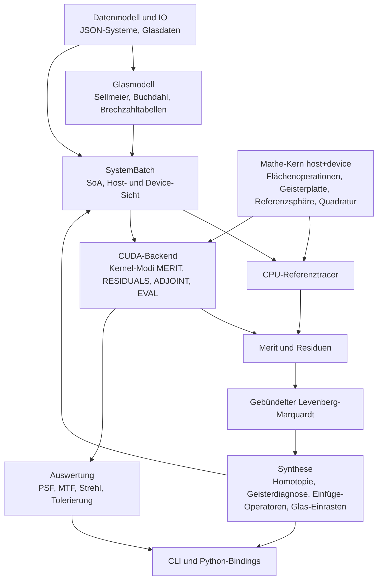

# Architektur

## Schichten



## Module und geplante Pfade

| Modul | Header | Quellen | Meilenstein |
|---|---|---|---|
| Mathe-Kern | `include/mikroptim/math/`, `include/mikroptim/trace/` | header-only | M0, M1, M4 |
| Datenmodell und IO | `include/mikroptim/model/`, `include/mikroptim/io/` | `src/model/`, `src/io/` | M1 |
| Glasmodell | `include/mikroptim/glass/` | `src/glass/` | M1, M6 |
| Pupillenquadratur | `include/mikroptim/pupil/` | header-only | M1 |
| Paraxialoptik | `include/mikroptim/paraxial/` | `src/paraxial/` | M1 |
| SystemBatch | `include/mikroptim/batch/` | `src/batch/` | M2 |
| CPU-Tracer, Lader | `include/mikroptim/cpu/` | `src/cpu/` | M1 |
| CUDA-Backend | `include/mikroptim/cuda/` (reines C++) | `src/cuda/` | M2–M8 |
| Merit (ab M1-T7: Wellenfront) | `include/mikroptim/merit/` | `src/merit/` | M1, M3, M4 |
| Optimierer (ab M3-T1: Variablen, Variantengenerator; M3-T2: FD-Jacobi) | `include/mikroptim/optim/` | `src/optim/`, `src/cuda/` | M3, M5 |
| Synthese | `include/mikroptim/synth/` | `src/synth/` | M6 |
| Auswertung | `include/mikroptim/eval/` | `src/eval/`, `src/cuda/` | M8 |
| CLI ([cli.md](cli.md)) | – (intern `src/cli/trace_command.hpp`) | `src/cli/` | M1 ff. |
| Python | – | `python/` | M9 |

## Datenmodell und IO

Statische Host-Bibliothek `mikroptim_model` (Alias `Mikroptim::model`), gelinkt in CLI und Tests:

- `include/mikroptim/model/system.hpp`: `mko::SystemDescription` mit `Spectrum`, `Source`, `Target`, `Surface` (Typen `SurfaceType`, `SourceType`), Validierung `validate_system` und `validate_materials`.
- `include/mikroptim/model/variables.hpp`: Abschnitt `variables` (`mko::Variables`, `VariableSpec`, `VariableType`), Auflösung und Prüfung `resolve_variables` (ab M3-T1).
- `include/mikroptim/model/material.hpp`: `mko::MaterialSpec` (Medium nach einer Fläche; gemeinsam mit dem Glasmodell).
- `include/mikroptim/model/format_error.hpp`: `mko::FormatError` mit JSON-Pfad.
- `include/mikroptim/io/system_json.hpp`: Einlesen und Schreiben von `mikroptim.system/1`, Auflösung der Glaskatalog-Pfade (Details: [dateiformat.md](dateiformat.md#einlesen-und-validierung)).

nlohmann/json (v3.12.0, FetchContent) wird nur in Quellen unter `src/` eingebunden und privat gelinkt; öffentliche Header bleiben frei von JSON-Typen.

## Mathe-Kern

Alle Rechnungen, die pro Strahl laufen, liegen header-only im Mathe-Kern, sind `MKO_HD` und über den Zahlentyp `R` templatisiert (ADR-0005). CPU-Tracer und CUDA-Kernel rufen dieselben Funktionen auf. Der sequenzielle Trace über ein System ist eine Funktion

```cpp
template <class R, class SurfaceTable, class Observer = NoSurfaceObserver>
MKO_HD TraceStatus trace_ray(const SurfaceTable& sys, int wavelength_index, Ray<R>& ray,
                             TraceRecord<R>* record, int* failed_surface = nullptr,
                             Observer* observer = nullptr);
```

`SurfaceTable` ist eine schlanke Sicht (Zeiger und Längen) auf die Flächendaten einer Variante, im Kernel auf Shared Memory. `record` ist optional und speichert Zwischenzustände für den adjungierten Modus. `observer` (optional, ab M2-T3) sieht jede passierte Fläche, z. B. für Strahlhöhen und Einfallswinkel ([Max-Reduktionen](#max-reduktionen-m2-t3)). Details im folgenden Abschnitt.

## Sequenzieller Trace (M1-T5)

Ablauf, Start- und Endzustand und Statuscodes: [numerik.md](numerik.md#sequenzieller-trace-m1-t5).

### Mathe-Kern (header-only, `MKO_HD`)

`include/mikroptim/trace/surface_table.hpp`:

```cpp
inline constexpr int kMaxSurfaces = 64;                     // inkl. Blende und Geisterplatten
inline constexpr int kMaxGhostTerms = 32;                   // größte Ordnung K einer Geisterplatte
enum class SurfaceKind : std::uint8_t { Stop = 0, Plane = 1, Sphere = 2, GhostPlate = 3 };
template <class R> struct SurfaceTableView {                // trivial kopierbar
    int surfaces, wavelengths;                              // S, L
    const SurfaceKind* type; const R* curvature; const R* thickness;  // [S]
    const R* index;                                         // [S·L], index[s·L + l] = Medium nach Fläche s
    int ghost_plates = 0, ghost_terms = 0;                  // G, K (M4-T5)
    const R* ghost_coeff = nullptr;                         // [G·K], a_k der Geisterplatte g bei g·K + k − 1
    const R* ghost_index = nullptr;                         // [G·L], n_G bei g·L + l
    const R* ghost_norm_radius = nullptr;                   // [G], r_g
};
```

`trace_ray` greift nur über die Namen `surfaces`, `wavelengths`, `type[s]`, `curvature[s]`, `thickness[s]`, `index[s * wavelengths + l]` und die Geisterfelder (Abschnitt [Geisterplatten](#geisterplatten-m4-t5)) auf die Tabelle zu. Jeder Typ mit diesen Namen ist eine gültige Tabelle, z. B. feste Felder im Shared Memory oder (M2) eine Batch-Sicht, deren Zeiger um v·S bzw. v·S·L versetzt sind. Der CUDA-Prüfkernel `src/cuda/trace_check.cu` lädt die Tabelle pro Block in den Shared Memory (dynamisch, (2S + S·L)·8 + S Byte) und baut die Sicht darauf.

`include/mikroptim/trace/trace.hpp`:

```cpp
template <class R> struct TraceRecord {          // optional, z. B. Local Memory im Kernel
    int count;                                   // gültige Einträge; bei Versagen an Fläche s: count = s
    Vec3<R> p[kMaxSurfaces], d[kMaxSurfaces];    // Schnittpunkt (lokal) und Richtung nach Fläche s
    R opl[kMaxSurfaces];                         // Eintrag 0 = Startzustand
};
template <class R> MKO_HD Ray<R> collimated_ray(R a, R theta, R rho, R phi);        // OPL₀ = p₀·d₀
template <class R> MKO_HD Ray<R> point_source_ray(Vec3<R> q, R sin_max, R rho, R phi); // OPL₀ = 0
template <class R> MKO_HD TraceStatus propagate_surface(Ray<R>&, R t, SurfaceKind, R c, R n_before, R n_after,
                                                        const GhostPlateParams<R>* ghost = nullptr);
template <class R, class T, class Obs = NoSurfaceObserver>
MKO_HD TraceStatus trace_ray(const T& sys, int l, Ray<R>&, TraceRecord<R>*, int* failed_surface = nullptr,
                             Obs* observer = nullptr);   // Beobachter: surface_extrema.hpp (M2-T3)
template <class R, class T> MKO_HD TraceStatus transfer_to_image_plane(const T& sys, int l, Ray<R>&);
```

Erweiterungspunkte: Ein neuer Flächentyp bekommt einen Zweig in `propagate_surface` und seine Daten als zusätzliche Felder der Tabelle (so umgesetzt für die Geisterplatte, M4-T5). Der adjungierte Modus (M5) liest Schnittpunkte und Richtungen aus `TraceRecord` (die Richtung vor der Brechung an Fläche s ist `d[s − 1]`). Strahlhöhe und Einfallswinkel pro Fläche (M4-T3) liefert der Beobachter `RaySurfaceRecord` ohne `TraceRecord` (Abschnitt [Max-Reduktionen](#max-reduktionen-m2-t3)); dieselben Werte folgen aus `p[s]`, `d[s − 1]` und der Flächennormale (Test `SurfaceExtrema.ObserverMatchesTraceRecord`).

### Host-Schicht (Bibliothek `Mikroptim::cpu`, `src/cpu/`)

Statische Bibliothek `mikroptim_cpu`, linkt `Mikroptim::model` und `Mikroptim::glass`.

- `include/mikroptim/cpu/host_surface_table.hpp`: `HostSurfaceTable` (FP64-Vektoren `type`, `curvature`, `thickness`, `index`, Geisterfelder `ghost_coeff`, `ghost_index`, `ghost_norm_radius` mit G, K, zusätzlich `semi_diameter`; `view()` liefert die `SurfaceTableView<double>`), `make_system_index_table(SystemDescription, GlassCatalog)` (Brechzahlen der Dateiflächen und der Gläser der Geisterplatten) und `make_surface_table(SystemDescription, IndexTable)`, die die Geisterplatten als Flächen einfügt ([dateiformat.md](dateiformat.md#abbildung-dateiflächen--tabellenflächen)). Krümmungen von Stop, Plane und GhostPlate werden 0; mehr als `kMaxSurfaces` Tabellenflächen oder unpassende Tabellen werfen `std::invalid_argument`.
- `include/mikroptim/cpu/load_system.hpp`: `load_system(path)` verbindet `read_system_file`, `resolve_glass_catalogs` (relativ zum Verzeichnis der Datei), `GlassCatalog::from_file` + `merge`, `validate_materials`, `make_index_table` und `make_surface_table` zu einem `LoadedSystem { system, catalog_files, catalog, index, table, warnings }`. `prepare_system(description, base_dir)` macht dasselbe für eine bereits eingelesene Beschreibung.
- `include/mikroptim/cpu/cpu_trace.hpp`: `trace_system_cpu(system, table, quadrature)` traced alle Felder × Wellenlängen × Pupillenstützstellen (eine Quadratur für alle Felder) und liefert `CpuTraceResult` mit Endzustand (Schnittpunkt der letzten Fläche), Status und versagender Fläche pro Strahl, abgelegt unter `(f · L + l) · N + k` wie die Blöcke und Threads im Kernel. `source_ray(system, table, f, l, sample)` erzeugt den Startstrahl (kollimiert mit a = Halbdurchmesser der Blende, Punktquelle mit sin ϑ_max = NA / index[0][l]); `source_field_count` liefert die Zahl der Felder (1 bei der Punktquelle).

## Wellenfront (M1-T7)

Referenzsphäre, Kolbenabzug und RMS-Wellenfront pro Feld und Wellenlänge. Formeln, Wahl des Schnittpunkts, Versagensbehandlung, f_soll-Regel, Summationsreihenfolge und Einheiten: [numerik.md, Abschnitt 7](numerik.md#7-referenzsphäre-und-opd).

### Mathe-Kern (header-only, `MKO_HD`)

```cpp
// include/mikroptim/trace/reference_sphere.hpp
template <class R> MKO_HD TraceStatus reference_sphere_step(Ray<R>&, Vec3<R> center, R n_image,
                                                            R* s_ref = nullptr);   // Missed bei Versagen
template <class R, class T> MKO_HD TraceStatus trace_to_reference_sphere(const T& sys, int l, Ray<R>&,
                                                            Vec3<R> center, int* failed_surface = nullptr);
// include/mikroptim/merit/opd.hpp
template <class R> struct OpdStatistics { R valid_weight, piston, rms; int failed; };
template <class R> MKO_HD OpdStatistics<R> opd_statistics(const R* opl, const R* weight,
                                const TraceStatus* status, int count, R* opd /* oder nullptr */);
```

`trace_to_reference_sphere` ist der Pro-Strahl-Teil (Thread im Kernel): `trace_ray`, dann der Schritt auf die Sphäre um **M**_f im Medium index[S−1][l]; versagt die Referenzsphäre, ist `*failed_surface = S`. `opd_statistics` ist die sequenzielle Referenz der Block-Reduktion (Kolben, OPD, RMS über die Stützstellen eines Blocks); Der Kernel `RESIDUALS` (M2-T2, Abschnitt [Kernel RESIDUALS](#kernel-residuals-m2-t2)) baut sie als Baumreduktion nach.

### Host-API (Bibliothek `Mikroptim::merit`, `src/merit/`)

Statische Bibliothek `mikroptim_merit`, linkt `Mikroptim::cpu` und `Mikroptim::paraxial`. Die Wellenfrontauswertung gehört zum Modul Merit, weil M3/M4 aus denselben OPD-Werten die Residuen bilden; der CPU-Tracer bleibt reiner Strahltransport.

```cpp
struct WavefrontOptions { int rings = 10, spokes = 8; std::optional<PupilMode> pupil_mode; };
struct WavefrontMap {                        // ein Tupel (Feld f, Wellenlänge l)
    int field, wavelength; double wavelength_nm; Vec3<double> image_point;   // M_f
    PupilQuadrature<double> quadrature; std::vector<PupilSample<double>> pupil;
    std::vector<double> opl, opd, opd_waves; // [k]; NaN bei versagten Strahlen
    std::vector<TraceStatus> status; std::vector<int> failed_surface;       // S = Referenzsphäre
    double piston, rms, rms_waves, valid_weight; int failed;
    int samples() const; bool valid() const; // valid: mindestens ein gültiger Strahl
};
struct WavefrontResult { int fields, wavelengths; double reference_nm, focal_length;
                         std::vector<WavefrontMap> maps;          // maps[f · L + l]
                         const WavefrontMap& at(int f, int l) const; std::size_t failed_count() const; };

double target_focal_length(const SystemDescription&, const GlassCatalog&);   // f_soll
std::vector<Vec3<double>> ideal_image_points(const SystemDescription&, const HostSurfaceTable&,
                                             double focal_length);           // (0, f tan θ_f, w)
PupilMode wavefront_pupil_mode(const SystemDescription&, int field, const WavefrontOptions& = {});
WavefrontResult evaluate_wavefront(const SystemDescription&, const HostSurfaceTable&,
                                   std::span<const Vec3<double>> image_points, const WavefrontOptions& = {});
WavefrontResult evaluate_wavefront(const LoadedSystem&, const WavefrontOptions& = {});
```

Jedes Feld hat eine eigene Quadratur (Achsfächer auf der Achse, sonst halbe Pupille), daher die Ablage pro Tupel statt eines gemeinsamen Arrays wie in `CpuTraceResult`. Fehler: `std::invalid_argument` (Tabelle passt nicht, falsche Zahl von Bildpunkten, afokales System ohne `target.focal_length`, ungültige Quadratur), `std::out_of_range` (Feld), `GlassError` (Brechzahl bei `reference_nm`). Ausgabe auf der Kommandozeile: `mikroptim trace` ([cli.md](cli.md)).

## SystemBatch und Datenlayout

Ein Batch enthält V Varianten mit derselben Topologie (Flächenzahl und Flächentypen). Varianten mit anderer Topologie gehören in einen anderen Batch.

### Topologie und Felder (M2-T1)

Die Topologie `BatchTopology` umfasst S (Flächen, 2 … `kMaxSurfaces`), L (Wellenlängen), F (Felder), G (Geisterplatten), K (Koeffizienten pro Geisterplatte), die Quellenart (`SourceKind::Collimated` oder `Point`) und `type[s]`. Regeln (`validate_topology`, sonst `std::invalid_argument`): L, F ≥ 1; G = Anzahl der Flächen vom Typ `GhostPlate`; G > 0 ⇒ K ≥ 1, G = 0 ⇒ K = 0; Punktquelle ⇒ F = 1; `pupil_mode` leer oder mit F gültigen Einträgen.

**Pupillenart pro Feld** (`pupil_mode[f]`, ab M2-T2): eine Eigenschaft des Batches, nicht der Variante, weil sie Zahl und Ablage der Residuen festlegt (`ResidualLayout`). `topology_of` setzt sie beim Aufbau aus dem Ausgangssystem mit derselben Regel wie `wavefront_pupil_mode`: kollimiert θ_f = 0 → `Axis` (N Stützstellen), sonst `Half` (N·M); Punktquelle auf der Achse → `Axis`, mit x = 0 → `Half`, sonst `Full`. Leer heißt „nicht festgelegt“ (erlaubt für reine Speicherrechnungen; der Residuen-Kernel verlangt die Festlegung). Varianten dürfen ein Achsfeld nicht verlassen: `check_pupil_modes(batch, first, count)` verlangt bei `Axis` den Feldwinkel 0 in jeder Variante (bei der Punktquelle x = y = 0, bei `Half` x = 0); `Half` und `Full` gelten für jeden Winkel, auch 0 (eine Feld-Homotopie darf also bei θ = 0 beginnen, ohne die Ablage zu ändern). Geprüft wird in `validate_values`, beim Upload (`DeviceSystemBatch::upload`) und in `residuals_cpu`.

Structure of Arrays, alle Werte FP64 (außer `type` und `ghost_surface`), Variante v immer als äußerster Index:

| Feld | Typ | Ablage | Bedeutung |
|---|---|---|---|
| `type[s]` | uint8 | gemeinsam | Flächentyp `SurfaceKind`: Stop, Plane, Sphere, GhostPlate |
| `ghost_surface[g]` | int32 | gemeinsam | Fläche der Geisterplatte g (abgeleitet: g-te Fläche vom Typ GhostPlate) |
| `ghost_norm_radius[g]` | R | gemeinsam | Normierungsradius r_g des Dickenprofils [mm] |
| `wavelength_nm[l]` | R | gemeinsam | Wellenlängen, für die `index` berechnet wurde [nm] |
| `wavelength_weight[l]` | R | gemeinsam | Gewicht w_λ |
| `field_weight[f]` | R | gemeinsam | Gewicht w_f |
| `reference_wavelength_nm` | R | Skalar | λ_ref (OPD in Wellen, optimierung.md, Abschnitt 2) |
| `source_point[3]`, `source_na` | R | Skalar | nur Punktquelle: Quellpunkt (lokal zu Fläche 0), NA im Medium nach Fläche 0 |
| `curvature[v][s]` | R | pro Variante | Krümmung c = 1/R [1/mm], 0 bei Stop und Plane |
| `thickness[v][s]` | R | pro Variante | Abstand zum nächsten Scheitel [mm]; `thickness[v][S−1]` = Arbeitsabstand |
| `index[v][s][l]` | R | pro Variante | Brechzahl nach Fläche s bei Wellenlänge l (vorab aus dem Glasmodell) |
| `pupil_radius[v]` | R | pro Variante | Pupillenradius a = Halbdurchmesser der Blende [mm] |
| `field_angle[v][f]` | R | pro Variante | Feldwinkel θ_f [rad] (Punktquelle: 0) |
| `field_target[v][f]` | R | pro Variante | ideale Bildhöhe h_f = f_soll · tan θ_f [mm] (numerik.md, Abschnitt 7) |
| `ghost_coeff[v][g][k]` | R | pro Variante | Koeffizienten a_{g,k} der Geisterplatte g |
| `ghost_index[v][g][l]` | R | pro Variante | Brechzahl des virtuellen Glases der Geisterplatte |
| `paraxial_index[v][s]` | R | pro Variante | Brechzahl nach Fläche s bei λ_ref (Paraxialrechnung, ab M3-T3) |
| `paraxial_ghost_index[v][g]` | R | pro Variante | Brechzahl des Glases der Geisterplatte g bei λ_ref (ab M3-T3) |

Indexformeln (`BatchShape`, header-only, `MKO_HD`; Element-, nicht Byteindizes):

| Feld | Index | Elemente pro Variante |
|---|---|---|
| `curvature`, `thickness` | v·S + s | S |
| `index` | (v·S + s)·L + l | S·L |
| `pupil_radius` | v | 1 |
| `field_angle`, `field_target` | v·F + f | F |
| `ghost_coeff` | (v·G + g)·K + k | G·K |
| `ghost_index` | (v·G + g)·L + l | G·L |
| `paraxial_index` | v·S + s (wie `curvature`) | S |
| `paraxial_ghost_index` | v·G + g (`ghost_at`) | G |

Die Daten einer Variante liegen in jedem Feld zusammenhängend; Variante v der Flächentabelle ist daher eine `SurfaceTableView` mit um v·S bzw. v·S·L versetzten Zeigern (`SystemBatchView::surface_table(v)`), `type` ist für alle Varianten derselbe Zeiger. `index` hat für eine Variante dasselbe Layout wie `IndexTable::n`.

Festlegungen:

- **Arbeitsabstand:** Ein eigenes Feld `image_distance[v]` gibt es nicht. Einzige Quelle ist `thickness[v][S−1]` (so lesen es `trace_ray`, `transfer_to_image_plane` und die Paraxialrechnung); `image_distance(v)` ist nur ein Zugriff darauf. Die Variable „Arbeitsabstand w“ (M3) ist dieses Element.
- **Pro Variante** liegt alles, was der Optimierer oder eine Homotopie für einzelne Läufe ändert: Krümmungen, Dicken (inklusive Arbeitsabstand), Brechzahlen (Glasvariablen M6), Geisterkoeffizienten (M4), Pupillenradius (NA-Homotopie), Feldwinkel und Feldziele (Feld-Homotopie).
- **Gemeinsam** liegt, was die Meritfunktion definiert und für alle Varianten gleich sein muss, damit Merits vergleichbar sind: Gewichte, Wellenlängen, λ_ref, Quellenart und Punktquelle, Normierungsradien. Eine Spektrum-Homotopie verschiebt die Wellenlängen aller Varianten eines Batches gemeinsam (neue `index`-Zeilen pro Variante).
- **Feldziel** beim Aufbau aus einem System: f_soll = `target.focal_length`, sonst die paraxiale Brennweite bei λ_ref; afokale Systeme (z. B. `planplatte_bk7.json`), θ_f = 0 und die Punktquelle haben h_f = 0.
- **Feldwinkel** werden mit demselben Ausdruck wie im CPU-Tracer umgerechnet (θ = Grad · (π/180)), damit CPU-Trace über Batch und Einzeltabelle bitgleich sind.
- **Geisterplatten** (M4-T5): `type` enthält die eingefügten Flächen vom Typ GhostPlate, G = deren Zahl, K = größte Ordnung (kürzere Profile mit 0 ergänzt, K ≤ `kMaxGhostTerms`, geprüft in `validate_topology`); `make_system_batch` füllt `ghost_norm_radius`, `ghost_coeff` und `ghost_index` aus der Flächentabelle. `surface_table(v)` setzt die Geisterzeiger auf `ghost_coeff + ghost_coeff_at(v, 0, 0)` und `ghost_index + ghost_index_at(v, 0, 0)` (gleiches Layout wie `SurfaceTableView`).
- Brechzahlen werden pro Variante und Wellenlänge auf dem Host (oder einem kleinen Kernel) berechnet; der Trace-Kernel rechnet keine Dispersionsformeln.
- **Brechzahlen bei λ_ref** (M3-T3): Die Paraxial-Nebenbedingungen (Brennweite bei λ_ref, numerik.md §9) brauchen Brechzahlen bei λ_ref, die nicht unter den Wellenlängen des Batches sein muss (Spektrum-Homotopie: z. B. nur 480 und 644 nm bei λ_ref = 546 nm). Deshalb hat der Batch zwei Spalten pro Variante: `paraxial_index[v][s]` (Medium nach Tabellenfläche s; bei Geisterplatten das Medium des Spalts) und `paraxial_ghost_index[v][g]`. Sie sind immer vorhanden (eine Regel statt „Spalte von λ_ref, falls vorhanden“) und gehören zu `index`/`ghost_index`: Wer die Brechzahlen einer Variante ändert (Glasvariablen M6), ändert beide. `make_system_batch` füllt sie aus `IndexTable::reference_n`/`reference_ghost_n` (`make_system_index_table`), sonst aus der Spalte von λ_ref; fehlt beides, wirft es. Die Trace-Kernel lesen sie nicht; sie liegen trotzdem im Gerätepuffer (Upload/Download bleiben verlustfrei, Kosten (S + G)·8 Byte pro Variante). `validate_values` verlangt nur Endlichkeit (von Hand gebaute Batches für reine Traces dürfen sie auf 0 lassen); die Paraxialrechnung prüft n > 0 selbst.

### Host-Container (Bibliothek `Mikroptim::batch`, `src/batch/`)

Statische Bibliothek `mikroptim_batch`, linkt `model`, `glass`, `cpu` und privat `paraxial`. Header unter `include/mikroptim/batch/`:

```cpp
// system_batch_view.hpp (header-only, MKO_HD, ohne std-Container)
struct BatchShape { int variants, surfaces, wavelengths, fields, ghost_plates, ghost_terms;
                    size_t surface_at(v, s), index_at(v, s, l), field_at(v, f),
                           ghost_coeff_at(v, g, k), ghost_index_at(v, g, l), ghost_at(v, g);
                    /* + *_stride() */ };
template <class R> struct SystemBatchView {          // trivial kopierbar, per Wert an Kernel
    BatchShape shape; SourceKind source; R source_point[3], source_na, reference_wavelength_nm;
    const SurfaceKind* type; const int* ghost_surface; const R *ghost_norm_radius, *wavelength_nm,
        *wavelength_weight, *field_weight, *curvature, *thickness, *index, *pupil_radius,
        *field_angle, *field_target, *ghost_coeff, *ghost_index, *paraxial_index,
        *paraxial_ghost_index;
    SurfaceTableView<R> surface_table(int v) const;  // Eingabe für trace_ray
    R image_distance(int v) const;                   // = thickness[v][S−1]
};
template <class R> Ray<R> batch_source_ray(const SystemBatchView<R>&, int v, int f, int l,
                                           const PupilSample<R>&);   // wie source_ray (cpu_trace)

// system_batch.hpp
void validate_topology(const BatchTopology&);
class SystemBatchHost {                              // besitzt alle Felder (std::vector<double>)
    explicit SystemBatchHost(BatchTopology, int variants = 0);   // alle Werte 0
    void resize(int); int add_variant_copy(int from); void copy_variant(int from, int to);
    void copy_variant_from(const SystemBatchHost& other, int from, int to); // gleiche Topologie
    double& curvature(int v, int s); /* … jedes Feld, jeder Index geprüft (std::out_of_range) */
    std::span<double> curvature_data(); /* … Rohfelder für Upload und schnelle Schleifen */
    SystemBatchView<double> view() const; SurfaceTableView<double> surface_table(int v) const;
    void validate_values() const;                    // endlich, n > 0, a > 0, Gewichte >= 0 …
    friend bool operator==(const SystemBatchHost&, const SystemBatchHost&); // bitweise
};
BatchTopology topology_of(const SystemDescription&, const IndexTable&);
SystemBatchHost make_system_batch(const SystemDescription&, const IndexTable&, int variants = 1,
                                  std::optional<double> focal_length = std::nullopt);
SystemBatchHost make_system_batch(const LoadedSystem&, int variants = 1);

// batch_trace_cpu.hpp: CPU-Referenz pro Variante, Ablage wie trace_system_cpu
CpuTraceResult trace_variant_cpu(const SystemBatchHost&, int v, const PupilQuadrature<double>&);
```

Für eine aus einem System gebaute Variante ist `trace_variant_cpu` bitgleich zu `trace_system_cpu` über dessen Einzeltabelle (Test `BatchTrace.*`).

### Gerätespeicher (`Mikroptim::cuda`)

`include/mikroptim/cuda/device_system_batch.hpp` (reines C++):

```cpp
class DeviceSystemBatch {                            // RAII, nur verschiebbar
    explicit DeviceSystemBatch(const SystemBatchHost&, int device = -1);
    void upload(const SystemBatchHost&, int first = 0, int count = -1); // Varianten-Bereich
    void download(SystemBatchHost&, int first = 0) const; SystemBatchHost download() const;
    void release() noexcept;
    SystemBatchView<double> view() const;            // Gerätezeiger
    int device() const; int variants() const; const SystemBatchLayout& layout() const;
};
int max_variants_on_device(const BatchTopology&, const OutputRequest&,
                           const MemoryReserve& = {}, size_t extra_bytes_per_variant = 0,
                           int device = -1);
// device_info.hpp
struct DeviceMemoryInfo { size_t free_bytes, total_bytes; };
DeviceMemoryInfo device_memory_info(int device = -1);   // cudaMemGetInfo
```

Alle Felder liegen in **einem** Puffer (ein `cudaMalloc`) im Layout `make_batch_layout`: erst die gemeinsamen, dann die Felder pro Variante, in der Reihenfolge der Tabelle oben, jedes auf `kBatchAlignment` = 256 Byte ausgerichtet. Die Skalare liegen nur in der Sicht. `upload` lädt einen Variantenbereich [first, first + count) hoch, der auf dem Gerät die Nummern 0 … count − 1 trägt (Tranchen in M2-T4, Aufteilung auf GPUs in M7), und verwendet den Puffer weiter, wenn er groß genug ist. Kopien sind synchron. Das Gerät wird beim ersten Upload festgelegt; alle Aufrufe stellen das aktuelle Gerät des Aufrufers wieder her.

Fehlerbehandlung: Konfigurations- und Speicherfehler sind Host-Fehler (AGENTS.md, Abschnitt 5) und werfen `mko::cuda::CudaError` (`include/mikroptim/cuda/cuda_error.hpp`, Makro `MKO_CUDA_CHECK` in `src/cuda/cuda_check.hpp`); falsche Argumente werfen `std::invalid_argument` bzw. `std::out_of_range`. Die älteren Prüfkernel (M1) melden Fehler weiterhin per `bool` (`MKO_CUDA_TRY`).

Der Prüfkernel `trace_batch_gpu` (`include/mikroptim/cuda/batch_trace_check.hpp`) traced jeden Strahl (v, f, l, k) mit `batch_source_ray` und `trace_ray` über `view.surface_table(v)` direkt aus dem globalen Speicher. Er prüft nur das Layout gegen `trace_variant_cpu`; Grid-Abbildung, Shared Memory und Reduktionen hat der Kernel `RESIDUALS` (unten).

Für df64 (M7-T1) bleiben Host-Container, Gerätepuffer und Sicht FP64; die Kernel wandeln die Daten eines Blocks beim Laden in den Rechentyp um ([Zahlentypen der Kernel](#zahlentypen-der-kernel-m7-t1)). Eine eigene Sicht `SystemBatchView<df64>` gibt es nicht.

## Brechzahltabelle

Modul Glasmodell (`include/mikroptim/glass/`, Bibliothek `Mikroptim::glass`):

- `dispersion.hpp` – header-only, `MKO_HD`, templatisiert über `R`: `sellmeier_index`, `buchdahl_omega`, `buchdahl_index` (λ in µm) und `nm_to_um` als einzige Umrechnungsstelle nm → µm.
- `catalog.hpp` – `GlassCatalog` (Host), Einlesen siehe [dateiformat.md](dateiformat.md#glasdaten).
- `index_table.hpp` – `material_index` und `make_index_table`.
- `buchdahl_fit.hpp` – Kleinste-Quadrate-Fit des Buchdahl-Modells (Verfahren: [numerik.md](numerik.md#10-glasmodelle)):

```cpp
struct BuchdahlFitOptions { double lambda_min_nm = 400, lambda_max_nm = 700; int samples = 301;
                            BuchdahlFitNodes nodes = Chebyshev; int check_samples = 3001; };
struct BuchdahlFit { int dispersion_terms; double n0; std::array<double, 3> nu;
                     double max_abs_error, rms_error; BuchdahlFitOptions options;
                     double index(double lambda_nm) const; };
BuchdahlFit fit_buchdahl(const Glass& glass, int dispersion_terms /* 2 oder 3 */,
                         const BuchdahlFitOptions& = {});
BuchdahlFit fit_buchdahl(const IndexFunction& index_nm, int dispersion_terms,
                         const BuchdahlFitOptions& = {}); // beliebiges n(lambda_nm)
MaterialSpec to_buchdahl_material(const BuchdahlFit& fit);   // kind = Buchdahl
```

```cpp
struct IndexTable { int surfaces; int wavelengths; std::vector<double> n; double at(int s, int l) const;
                    int ghost_plates; std::vector<double> ghost_n;              // M4-T5
                    double reference_nm; std::vector<double> reference_n,       // M3-T3: bei λ_ref
                                                             reference_ghost_n; };
IndexTable make_index_table(std::span<const MaterialSpec> media,
                            std::span<const double> wavelengths_nm, const GlassCatalog& catalog);
```

`make_system_index_table(system, catalog)` (`include/mikroptim/cpu/host_surface_table.hpp`) füllt zusätzlich `ghost_n` und die Brechzahlen bei `spectrum.reference_nm` (`reference_n[s]`, `reference_ghost_n[g]`, mit `material_index`, also bitgleich zur Spalte, wenn λ_ref im Spektrum liegt); liegt λ_ref außerhalb des Gültigkeitsbereichs eines Glases, wirft es `GlassError`. `make_index_table` lässt sie leer.

`media[s]` ist das Medium **nach** Fläche s (`mko::MaterialSpec` aus `include/mikroptim/model/material.hpp`), das Medium vor Fläche 0 ist Luft. Die Tabelle ist zeilenweise abgelegt: `n[s * wavelengths + l]`, also dasselbe Layout wie `index[v][s][l]` für eine Variante. Air → 1, `constant` → n, Katalogname → Sellmeier mit Prüfung von `range_nm`, `buchdahl` → Formel aus numerik.md, Abschnitt 10. Fehler (unbekanntes Glas, Wellenlänge außerhalb des Gültigkeitsbereichs) sind `GlassError` mit Fläche, Wellenlänge und Glasname.

## Paraxialoptik

Modul `include/mikroptim/paraxial/`, Bibliothek `mikroptim_paraxial` (Alias `Mikroptim::paraxial`, linkt `model` und `glass`). Definitionen und Vorzeichen: [numerik.md, Abschnitt 9](numerik.md#9-paraxialoptik).

- `ynu_trace.hpp` – header-only, `MKO_HD`, templatisiert über `R`: `ParaxialRay<R>{y, u}`, `surface_power`, `paraxial_refract`, `paraxial_transfer`, `paraxial_trace(c, t, n, count, ray, at_surface)` und `petzval_sum(c, n, count)` über nackte Arrays (Layout wie eine Variante im SystemBatch). Für Paraxialdaten vieler Varianten (M3-T3: `batch_paraxial` mit `paraxial_index`, M4-T4) auf Host oder GPU.
- `paraxial.hpp` – Host-API:

```cpp
struct ParaxialData {
    std::array<double, 4> abcd;          // Systemmatrix {A, B, C, D}, reduzierte Winkel
    double power; bool afocal;
    double focal_length, back_focal_distance, front_focal_distance;
    double front_principal_plane, rear_principal_plane, image_defocus;
    double petzval_sum, petzval_curvature, petzval_radius;
    bool exit_pupil_at_infinity;
    double exit_pupil_position, exit_pupil_magnification, exit_pupil_semi_diameter;
};
ParaxialData compute_paraxial(std::span<const double> curvatures, std::span<const double> thicknesses,
                              std::span<const double> indices, double stop_semi_diameter);
ParaxialData compute_paraxial(const SystemDescription&, const IndexTable&, int wavelength_index);
ParaxialData compute_paraxial(const SystemDescription&, const GlassCatalog&, double wavelength_nm);
ParaxialData compute_paraxial(const SystemDescription&, const GlassCatalog&);   // reference_nm
```

Fehler: `std::invalid_argument` (leere oder ungleich lange Arrays, nicht endliche Werte, n ≤ 0, Blendenradius ≤ 0, Brechzahltabelle passt nicht zum System), `std::out_of_range` (Wellenlängenindex), `GlassError` (Brechzahl nicht bestimmbar). Geisterplatten (M4-T5) gehen als dünne Elemente ein: Überladung mit den Spannen `power` (φ_G pro Fläche) und `petzval` (φ_G/(n_m n_G)); die Überladungen für Systembeschreibungen rechnen über die Tabellenflächen und berücksichtigen Geisterplatten automatisch ([numerik.md, Abschnitt 9](numerik.md#9-paraxialoptik)). `ParaxialData` bleibt unverändert.

## Geisterplatten (M4-T5)

Physik und Formeln: [numerik.md, Abschnitt 6](numerik.md#6-geisterplatte); Dateiformat und Abbildung Dateiflächen ↔ Tabellenflächen: [dateiformat.md](dateiformat.md#geisterplatten).

```cpp
// include/mikroptim/trace/ghost_plate.hpp (header-only, MKO_HD)
template <class R> struct GhostPlateParams { const R* coeff; int terms; R norm_radius; R n_glass; };
template <class R> void legendre(int k, R xi, R& p, R& dp);                     // P_k, P'_k (Rekursionen)
template <class R> struct GhostProfile { R t, dt_du; };
template <class R> GhostProfile<R> ghost_profile(const R* coeff, int K, R u);   // u = (r/r_g)²
template <class R> R ghost_profile_t2(const R* coeff, int K, R r_g);            // paraxial t₂
template <class R> R ghost_plate_power(const R* coeff, int K, R r_g, R n_G, R n_m);   // φ_G
template <class R> R ghost_plate_petzval(const R* coeff, int K, R r_g, R n_G, R n_m); // φ_G/(n_m n_G)
template <class R> TraceStatus phase_surface_step(Ray<R>&, R phase, R grad_x, R grad_y, R n, R n_prime);
template <class R> TraceStatus ghost_plate_step(Ray<R>&, const GhostPlateParams<R>&, R n, R n_prime);
// include/mikroptim/model/system.hpp
struct GhostPlate { int after_surface; double distance; MaterialSpec glass; double norm_radius;
                    std::vector<double> coefficients; };            // SystemDescription::ghost_plates
struct SurfaceMap { std::vector<int> table_of_file, file_of_table, ghost_of_table, table_of_ghost;
                    int file_surface(int table_surface) const; int table_surface(int file_surface) const; };
SurfaceMap make_surface_map(const SystemDescription&); int table_surface_count(const SystemDescription&);
// include/mikroptim/glass/index_table.hpp: IndexTable::ghost_plates, ghost_n[g·L + l], ghost_at(g, l)
```

`trace_ray` zählt die Flächen vom Typ GhostPlate in Tracerichtung mit; die g-te erhält `GhostPlateParams{ghost_coeff + g·K, K, ghost_norm_radius[g], ghost_index[g·L + l]}`, Flächen vom Typ GhostPlate ohne Daten (g ≥ G) melden `Unsupported`. Tabellen ohne Geisterplatten (G = 0, Nullzeiger als Standardwerte) funktionieren unverändert.

## Kernel-Abbildung

- **Grid:** ein Block pro Tupel (Variante v, Feld f, Wellenlänge l), eindimensional linearisiert: b = (v·F + f)·L + l, Indexrechnung in 64 Bit; V·F·L ≤ 2³¹ − 1 (`kMaxGridBlocks`; größere Batches teilt die TraceEngine in Tranchen, M2-T4).
- **Block:** `kResidualThreads` = 128 Threads (Konstante in `include/mikroptim/cuda/residuals.hpp`, zu tunen in M7). Thread t bearbeitet die Stützstellen k = t, t + 128, … < n_f in aufsteigender Reihenfolge. Bei der Standardquadratur (n_f = 80, auf der Achse 10) bleibt ein Teil der Threads leer; das ist ein Thema für M7.
- **Shared Memory:** Flächentabelle der Variante mit den Brechzahlen nur der Wellenlänge l des Blocks, Quadratur des Feldes, Teilsummen pro Warp, Kolben (Belegung unten, ca. 1,9 KB).
- **Pupillenstützstellen** werden im Thread aus dem Index berechnet (`sample`: Ring i, Speiche j, Gewicht).
- **Versagen:** Strahlen, die eine Fläche verfehlen, totalreflektieren oder rückwärts laufen, laufen maskiert weiter: kein früher Ausstieg aus Schleifen oder Reduktion, jeder Thread erreicht jedes `__syncthreads` und jeden Warp-Shuffle. In M2 ist Versagen hart (wie `opd_statistics`); weiches Versagen mit Strafresiduen folgt in M4-T2 (numerik.md, Abschnitt 11).

## Kernel RESIDUALS (M2-T2)

Implementiert in `src/cuda/residuals.cu` (Kernel `residuals_kernel<R, kExtrema>`, templatisiert über den Rechentyp; instanziiert für `double` und `df64`, M7-T1), Host-API in `include/mikroptim/cuda/residuals.hpp` (reines C++), Ablage und CPU-Referenz in `include/mikroptim/batch/batch_residuals.hpp` (Bibliothek `Mikroptim::batch`), Pro-Strahl-Teil header-only in `include/mikroptim/merit/ray_residual.hpp`. Definition des Residuums: [numerik.md, Abschnitt 7](numerik.md#residuen-pro-strahl-m2).

### Residuenlayout

Der Residuenvektor einer Variante ist die Konkatenation der Tupel (f, l), f-major, dann l, dann der Stützstellenindex k = i·M + j der Quadratur des Feldes. Achsfelder haben n_f = N, alle anderen n_f = N·M Einträge pro Wellenlänge:

offset(f, l) = L · Σ_{f′ < f} n_f′ + l · n_f,  R_v = L · Σ_f n_f = `rays_per_variant(F, L, N·M, F_Achse, N)`.

Die Ablage ist für alle Varianten eines Batches gleich, weil die Pupillenart pro Feld zur Topologie gehört (`BatchTopology::pupil_mode`, oben). Nach den R_v Strahlresiduen folgen optional E weitere Residuen pro Variante (Paraxial, Strafen, ab M3; `ResidualRunOptions::extra_residuals`), Stride pro Variante R_v + E; der Lauf setzt sie auf 0. OPD (optional) und Status (1 Byte, `TraceStatus`) liegen ohne die weiteren Residuen ab v·R_v. Der Speicher folgt `make_output_layout` mit `OutputRequest{residuals, ray_status, opd}`.

```cpp
// include/mikroptim/batch/batch_residuals.hpp
struct ResidualSettings { int rings = 10, spokes = 8; };
struct ResidualFieldPlan { int64_t offset; int samples; PupilMode mode; };   // [F], für den Kernel
class ResidualLayout {                              // aus Topologie + Einstellungen
    ResidualLayout(const BatchTopology&, const ResidualSettings& = {});   // wirft ohne pupil_mode
    int fields(), wavelengths(), axis_fields(); PupilMode pupil_mode(f); int samples(f);
    const PupilQuadrature<double>& quadrature(f); int64_t offset(f, l), rays_per_variant();
    std::span<const ResidualFieldPlan> plan();
};
struct ResidualResult { int variants; int64_t rays_per_variant, stride;
    std::vector<double> residuals /*[V·stride]*/, opd /*[V·R_v] oder leer*/;
    std::vector<uint8_t> status /*[V·R_v]*/;
    double residual(v, i), opd_at(v, i); TraceStatus status_at(v, i); size_t failed_count(); };
ResidualResult residuals_cpu(const SystemBatchHost&, int v, const ResidualLayout&); // CPU-Referenz
ResidualResult residuals_cpu(const SystemBatchHost&, const ResidualLayout&);        // alle Varianten
void check_residual_layout(const BatchTopology&, const ResidualLayout&);
void check_pupil_modes(const SystemBatchHost&, int first = 0, int count = -1);   // system_batch.hpp

// include/mikroptim/merit/ray_residual.hpp (header-only, MKO_HD, CPU und Kernel)
// Rechentyp R (Tabelle, Stützstelle) und Speichertyp B des Batches dürfen verschieden sein (M7-T1)
template <class B, class T> Vec3<R> batch_image_point(const SystemBatchView<B>&, const T& table, int v, int f);
template <class R, class B, class T> TraceStatus batch_ray_opl(const SystemBatchView<B>&, const T& table, int table_l,
                                                      int v, int f, int l, const PupilSample<R>&, Vec3<R> center, R* opl);
template <class B> B residual_scale(const SystemBatchView<B>&, int f, int l);   // M2: 1
template <class R> R ray_residual(R scale, const PupilSample<R>&, R opd);       // scale·√(W)·OPD
```

`residuals_cpu` ist zugleich der CPU-Pfad für eine Optimierung ohne GPU (CI). Sie rechnet mit denselben Funktionen wie der Kernel (`batch_ray_opl`, `ray_residual`, `residual_scale`) und dem sequenziellen `opd_statistics`; für eine aus einem System gebaute Variante ist ihre OPD bitgleich zu `evaluate_wavefront` (Test `ResidualsCpu.MatchesEvaluateWavefront`).

### Ablauf im Block

1. **Laden:** Threads s = t, t + 128, … kopieren `type[s]`, `curvature[v][s]`, `thickness[v][s]` und `index[v][s][l]` in den Shared Memory, die ersten N Threads die Knoten u_i und Gewichte W_i, Thread 0 Ringzahl, Speichenzahl (1 auf der Achse) und Pupillenart aus `ResidualFieldPlan[f]`; danach `__syncthreads`. Die Sicht auf die Tabelle hat `wavelengths = 1` (Wellenlängenindex 0) und liefert dieselben Zahlen wie `surface_table(v)` auf der CPU.
2. **Durchlauf 1:** pro Stützstelle `batch_ray_opl` (Startstrahl `batch_source_ray`, `trace_to_reference_sphere` um **M**_f = (0, `field_target[v][f]`, `thickness[v][S−1]`)); die OPL wird vorläufig auf den Residuenplatz geschrieben, der Status in das Statusfeld. Jeder Thread summiert (W_k, W_k·OPL_k) seiner gültigen Strahlen in aufsteigender Reihenfolge.
3. **Reduktion:** Baumreduktion im Warp mit `__shfl_down_sync` (Abstände 16, 8, 4, 2, 1, volle Maske), Lane 0 schreibt die Warp-Summe in den Shared Memory, `__syncthreads`, Thread 0 summiert die 4 Warp-Summen in fester Reihenfolge und schreibt den Kolben OPL̄ = Σ W·OPL / W_ok und ein Gültigkeitsflag, `__syncthreads`. Keine Gleitkomma-Atomics (ADR-0007): Zwei Läufe mit gleichen Eingaben sind auf derselben GPU bitgleich (Test `CudaResiduals.RepeatedRunsAreBitIdentical`, 10 Läufe). Die Summationsreihenfolge hängt von `kResidualThreads` ab, nicht von der Batchgröße oder der Lage der Variante im Batch.
4. **Durchlauf 2:** derselbe Thread liest OPL und Status seiner Stützstellen zurück und schreibt OPD_k = OPL_k − OPL̄ (0 bei Versagen) und r_k = `ray_residual(residual_scale(f, l), sample_k, OPD_k)`.

**Tupel ohne gültigen Strahl** (W_ok = 0, Kolben undefiniert): alle OPD und Residuen des Tupels sind 0, der Status bleibt gesetzt (gleiche Regel wie `opd_statistics`).

**Shared Memory** (statisch, unabhängig von S bis `kMaxSurfaces` = 64), für R = double: Typ 64 B + Krümmung, Dicke, Brechzahl 3 · 64 · 8 B = 1.536 B + Quadratur 272 B + Teilsummen 2 · 4 · 8 B + Kolben und Flag 12 B, zusammen ca. 1,9 KB. Dazu **dynamisch** die Geisterplatten der Variante (M4-T5): Koeffizienten G·K, Brechzahlen der Gläser bei der Wellenlänge des Blocks G und Normierungsradien G, also (G·K + 2G)·8 B, höchstens (64·32 + 128)·8 B = 17 KiB; ohne Geisterplatten 0 B. Zusammen ≤ 19 KB < 48 KB auf beiden Karten (kein Opt-in; `static_assert` und Prüfung beim Start). Geladen werden sie in Schritt 1 zusammen mit der Flächentabelle; die Sicht im Shared Memory hat dieselben Geisterfelder wie `surface_table(v)` mit `wavelengths = 1`.

**Abweichung CPU/GPU:** Die Pro-Strahl-Rechnung ist dieselbe Funktion; Unterschiede kommen aus FMA-Kontraktion, `sin`/`cos` der CUDA-Bibliothek und der Summationsreihenfolge des Kolbens (≈ 10⁻¹⁶·OPL). Für je 1.000 gestörte Varianten der Testsysteme liegen alle Strahlen innerhalb `kCpuGpuFp64` = 10⁻¹² mm, außer einzelnen schlecht konditionierten Strahlen (nahe Totalreflexion oder streifend, |OPD| von mm), die relativ ≤ 1,3·10⁻¹² abweichen (`kCpuGpuFp64Relative`, Test `CudaResiduals.MatchCpuForPerturbedVariants`).

### Host-API

```cpp
// include/mikroptim/cuda/residuals.hpp (reines C++)
inline constexpr int kResidualThreads = 128;
struct ResidualRunOptions { bool opd = false; int64_t extra_residuals = 0;
                            bool extrema = false;      // Max-Reduktionen (M2-T3)
                            Precision precision = Precision::Fp64; };   // Rechentyp (M7-T1)
class DeviceResiduals {                  // Ausgabepuffer auf dem Gerät, RAII, nur verschiebbar
    void run(const DeviceSystemBatch&, const ResidualLayout&, const ResidualRunOptions& = {});
    ResidualResult download() const; void download(ResidualResult&) const; void release() noexcept;
    const double* device_residuals() const; const uint8_t* device_status() const;
    const double* device_opd() const;     // für Folgekernel (M3), gültig bis zum nächsten run
    const double* device_extrema() const; // [V][S][2], nur mit extrema (M2-T3)
};
ResidualResult run_residuals(const DeviceSystemBatch&, const ResidualLayout&,
                             const ResidualRunOptions& = {});   // ein Lauf mit Download
```

`run` legt einen Puffer an (ein `cudaMalloc`, Layout `make_output_layout` plus `ResidualFieldPlan[F]`) oder verwendet ihn weiter, lädt die Feldablage hoch, startet den Kernel auf dem Gerät des Batches, prüft `cudaGetLastError` und wartet auf das Ende (`cudaDeviceSynchronize`; Streams und Überlappung sind Sache von M2-T4/M7). Fehler: `CudaError` (CUDA), `std::invalid_argument` (Layout passt nicht, zu großes Grid, negative Zahl weiterer Residuen), `std::logic_error` (leerer Batch, Download ohne Lauf). Die Werte der Varianten prüft der Aufrufer auf dem Host (`validate_values`; `check_pupil_modes` läuft beim Upload). Die [TraceEngine](#host-api-traceengine-m2-t4) (M2-T4) kapselt Gerätewahl, Prüfung, Tranchen und diese Klasse; Programme benutzen nur sie.

**Erweiterungspunkte:** `residual_scale(view, f, l)` liefert in M2 den Faktor 1; M4-T1 setzt dort √(w_f·w_λ)/λ_ref ein (CPU und Kernel gemeinsam). Weiches Versagen (M4-T2) ersetzt die harte Maske in den Durchläufen 1 und 2 und hängt Strafresiduen an. Der Kernel `MERIT` (M2-T3, unten) bildet aus denselben Größen die Quadratsumme pro Block; Laden, Kolben und Reduktionen teilen sich beide Kernel in `src/cuda/wavefront_block.hpp`. Mit `extrema` liefert auch `RESIDUALS` die [Max-Reduktionen](#max-reduktionen-m2-t3) (`ResidualResult::extrema`, bitgleich zu denen aus `MERIT`).

**Erste Durchsatzzahl** (RTX 3090, FP64, Test `CudaResiduals.LargeBatch`, kein Benchmark): 10.000 Varianten von `testsystem_mehrlinser.json` (S = 8, 680 Strahlen pro Variante) in ca. 26 ms für den Kernel allein, also ca. 2,6·10⁸ Strahlen/s; über die TraceEngine mit Upload und Download (seit M2-T4) ca. 33 ms, 2,1·10⁸ Strahlen/s. Messungen über Flächenzahl und Batchgröße: [benchmarks.md](benchmarks.md) (M2-T6, `bench/trace_throughput`).

## Kernel MERIT (M2-T3)

Implementiert in `src/cuda/merit.cu` (Kernel `merit_kernel<R, kExtrema>` und `merit_finalize_kernel<R>`), Host-API in `include/mikroptim/cuda/merit.hpp` (reines C++), Ergebnis und CPU-Referenz in `include/mikroptim/batch/batch_merit.hpp` (Bibliothek `Mikroptim::batch`). Programme benutzen den Modus über die TraceEngine (`TraceMode::Merit`).

**Definition.** Pro Variante v

F_v = Σ_k r_k² (+ E_v),

über alle R_v Strahlresiduen in der Ablage von `ResidualLayout`, mit denselben r_k wie im Kernel `RESIDUALS` (r_k = s_{f,l}·√(W_i V_j)·OPD_k, hartes Versagen: versagte Strahlen r_k = 0, Tupel ohne gültigen Strahl alle r_k = 0). E_v ist der optionale Anteil weiterer Residuen (Paraxial, Strafen ab M3/M4), den der Aufrufer pro Variante liefert (`MeritRunOptions::extra_merit` bzw. `TraceSettings::extra_merit`); der Kernel berechnet ihn nicht. Zusätzlich `failed[v]` = Zahl der Strahlen mit Status ≠ Ok. **Eine Variante ohne gültigen Strahl hat F_v = 0 (+ E_v)**; sie ist nur an `failed[v] = R_v` erkennbar, deshalb muss jeder Aufrufer (Liniensuche, Screening) `failed` prüfen, bis M4-T2 Strafresiduen für versagte Strahlen einführt.

**Ablauf im Block** (b = (v·F + f)·L + l, 128 Threads, wie RESIDUALS):

1. Laden der Flächentabelle und Quadratur (`load_block_table`, gemeinsam mit RESIDUALS).
   Geisterplatten (M4-T5) lädt `load_block_ghosts` wie in RESIDUALS an den Anfang des dynamischen Shared Memory ((G·K + 2G)·8 Byte, höchstens 17 KiB).
2. Durchlauf 1: `batch_ray_opl` pro Stützstelle; OPL und Status in den **Shared Memory** (dynamisch hinter den Geisterdaten, n_max·9 Byte, n_max = größte Stützstellenzahl eines Feldes), Teilsummen (W_k, W_k·OPL_k) der gültigen Strahlen in aufsteigender Reihenfolge der eigenen Stützstellen.
3. Kolben per `block_piston` – dieselbe Funktion, Threadzuordnung und Reihenfolge wie in RESIDUALS. Daher sind Kolben, OPD und r_k in beiden Kernels **bitgleich**; MERIT braucht keinen Residuenvektor im globalen Speicher.
4. Durchlauf 2: r_k aus der OPL im Shared Memory, Teilsumme Σ r_k² pro Thread in aufsteigender Reihenfolge, Zähler versagter Strahlen.
5. Blocksumme `block_sum`: Baumreduktion im Warp mit `__shfl_down_sync` (Abstände 16, 8, 4, 2, 1, volle Maske), Thread 0 summiert die 4 Warp-Summen in fester Reihenfolge; Ablage `merit_partial[b]` und `failed_rays_partial[b]` (int32).
6. **Zweite Stufe** (`merit_finalize_kernel`, ein Thread pro Variante): F_v = ((Σ_{b = f·L + l} partial in der Reihenfolge f, dann l) + E_v), `failed[v]` als int64.

Keine Gleitkomma-Atomics (ADR-0007). Die Summationsreihenfolge hängt nur von `kMeritThreads` = `kResidualThreads` = 128, F und L ab, nicht von der Batchgröße, der Lage der Variante oder der Aufteilung in Tranchen: zehn Läufe sind bitgleich (Test `CudaMerit.RepeatedRunsAreBitIdentical`), ebenso dieselben Varianten an anderer Stelle eines Batches und über mehrere Tranchen (`TraceEngine.MeritTranchesMatchSingleRun`).

**Vergleich mit Σ RESIDUALS²** (Abnahme, Test `CudaMerit.MatchesSumOfResiduals`): Der Test lädt die RESIDUALS-Ausgabe herunter und summiert r_k² pro Variante auf dem Host **kompensiert (Neumaier) in der Ablagereihenfolge (f, l, k)**, also nahezu exakt; die Abweichung ist allein der Rundungsfehler der Baumsumme (Schranke ≈ (⌈n/128⌉ + 7 + F·L)·ε). Gemessen für je 1.000 gestörte Varianten von `einzellinse_bk7.json` und `testsystem_mehrlinser.json` (N × M = 10 × 8 und 6 × 5): ≤ 4,1·10⁻¹⁶ relativ; mit Geisterplatten (`einzellinse_geisterplatte.json`, Koeffizienten und Gläser gestört, Test `CudaMerit.GhostPlates`) ≤ 3,7·10⁻¹⁶ (Toleranz `kMeritVsResidualSum` = 10⁻¹³). Zur Information rechnet der Test zusätzlich die Kernel-Reihenfolge auf dem Host nach (`std::fma` pro Thread, Warp-Baum, Warps, Tupel): 2.999 von 3.000 Varianten sind dazu bitgleich.

**CPU-Referenz** `merit_cpu(batch, v, layout, extrema)`: F_v = Σ_{(f,l)} (Σ_k r_k²) aus `residuals_cpu`, innen aufsteigend in k, außen in der Tupelreihenfolge wie die zweite Stufe; ohne E_v. GPU gegen CPU: |√F_GPU − √F_CPU| ≤ ‖r_GPU − r_CPU‖₂, geprüft gegen die 2-Norm der Toleranzen pro Strahl aus M2-T2 (max(`kCpuGpuFp64`, `kCpuGpuFp64Relative`·|r|)); gemessen ≤ 3,5·10⁻¹⁴ mm (1.000 Varianten), 1,2·10⁻¹² mm (10.000 Varianten mit einzelnen schlecht konditionierten Strahlen).

**Shared Memory** (R = double): statisch 2,0 KB (Tabelle, Quadratur, Kolben, Warp-Summen), mit Max-Reduktionen 6,1 KB, plus dynamisch Geisterdaten (G·K + 2G)·8 Byte und n_max·9 Byte. Höchstens 48 KB pro Block (`kMeritMaxSharedBytes`, ohne Opt-in auf beiden Karten): ohne Geisterplatten n_max ≤ 5.239 ohne bzw. 4.784 mit Max-Reduktionen, mit Geisterplatten entsprechend weniger (`merit_max_samples(extrema, G, K)`, aus den Kernelattributen; im ungünstigsten Fall G = 64, K = 32 mit Max-Reduktionen noch ca. 2.800); die Standardquadratur hat 80. Größere Quadraturen weist `DeviceMerit::run` bzw. die TraceEngine mit `std::invalid_argument` ab.

**Register und Local Memory** (`cuobjdump --dump-resource-usage`, CUDA 12.9):

| Kernel | sm_60 | sm_86 |
|---|---|---|
| `merit_kernel<double, false>` | 110 Register, Stack 72 B | 110 Register, Stack 72 B |
| `merit_kernel<double, true>` | 105 Register, Stack 2.120 B | 112 Register, Stack 2.120 B |
| `residuals_kernel<double, false>` | 118 Register, Stack 72 B (wie main nach M4-T5) | 110 Register, Stack 72 B (main nach M4-T5: 96 Register, Stack 104 B) |
| `residuals_kernel<double, true>` | 116 Register, Stack 2.120 B | 96 Register, Stack 2.144 B |

Ohne Max-Reduktionen kostet die Erweiterung nichts Wesentliches (sm_60 identisch zu RESIDUALS auf main nach M4-T5; auf sm_86 verteilt ptxas anders: mehr Register, weniger Stack). Der Registerbedarf stammt überwiegend aus dem Zweig der Geisterplatte (M4-T5) im Trace. Mit Max-Reduktionen liegen `RaySurfaceRecord` und `SurfaceExtrema` (je 2·`kMaxSurfaces`·8 = 1 KB) im Local Memory; die Laufzeitreserve dafür beträgt etwa 2 KB × 2.048 Threads × SM-Zahl (RTX 3090: ca. 350 MB, P100: ca. 240 MB) und ist in der Standardreserve (≥ 5 % des freien Speichers) enthalten. Kleinere Felder für kleine S sind ein Thema für M7.

**Durchsatz** (RTX 3090, FP64, Test `CudaMerit.LargeBatch`, über die TraceEngine mit Upload und Download, kein Benchmark): 10.000 Varianten von `testsystem_mehrlinser.json` (680 Strahlen): MERIT ca. 29 ms (2,3·10⁸ Strahlen/s), MERIT mit Max-Reduktionen ca. 38 ms (1,8·10⁸ Strahlen/s), RESIDUALS ca. 36 ms (1,9·10⁸ Strahlen/s). Der Kernel allein ist in beiden Modi gleich schnell (ca. 24 ms; die FP64-Rechnung pro Strahl dominiert); MERIT spart den Download der Residuen (54 MB) und vor allem Gerätespeicher: ca. 0,6 kB statt 6,5 kB pro Variante beim Mehrlinser (ohne Max-Reduktionen; mit ihnen ca. 2,3 kB wegen der Teilergebnisse pro Block und Fläche), also entsprechend größere Tranchen für Liniensuche und Multistart-Screening.

### Host-API

```cpp
// include/mikroptim/cuda/merit.hpp (reines C++)
inline constexpr int kMeritThreads = kResidualThreads;
inline constexpr size_t kMeritMaxSharedBytes = 48 * 1024;
struct MeritRunOptions { bool extrema = false; std::span<const double> extra_merit; /* leer oder [V] */
                         Precision precision = Precision::Fp64; };   // Rechentyp (M7-T1)
class DeviceMerit {                      // Ausgabepuffer auf dem Gerät, RAII, nur verschiebbar
    void run(const DeviceSystemBatch&, const ResidualLayout&, const MeritRunOptions& = {});
    MeritResult download() const; void download(MeritResult&) const; void release() noexcept;
    const double* device_merit() const; const int64_t* device_failed() const;
    const double* device_extrema() const; // [V][S][2] oder nullptr
};
MeritResult run_merit(const DeviceSystemBatch&, const ResidualLayout&, const MeritRunOptions& = {});
int merit_max_samples(bool extrema, int ghost_plates = 0, int ghost_terms = 0,
                      Precision precision = Precision::Fp64);

// include/mikroptim/batch/batch_merit.hpp, batch_extrema.hpp (Host, auch ohne CUDA)
struct MeritResult { int variants; int64_t rays_per_variant; std::vector<double> merit;  // [V]
                     std::vector<int64_t> failed; SurfaceExtremaResult extrema; };
struct SurfaceExtremaResult { int variants, surfaces; std::vector<double> values;   // [V][S][2]
    double max_height(v, s), min_cos_incidence(v, s), max_incidence_angle(v, s); };
MeritResult merit_cpu(const SystemBatchHost&, int v, const ResidualLayout&, bool extrema = true);
MeritResult merit_cpu(const SystemBatchHost&, const ResidualLayout&, bool extrema = true);
SurfaceExtremaResult surface_extrema_cpu(const SystemBatchHost&, int v, const ResidualLayout&);
SurfaceExtremaResult surface_extrema_cpu(const SystemBatchHost&, const ResidualLayout&);
void check_residual_variant(const SystemBatchHost&, int v, const ResidualLayout&);
```

`run` legt einen Puffer an (Layout `make_output_layout` mit `merit` und optional `surface_max`, plus `ResidualFieldPlan[F]` und `extra_merit[V]`) oder verwendet ihn weiter, startet Block-Kernel, zweite Stufe und gegebenenfalls die zweite Stufe der Max-Reduktionen, prüft nach jedem Start `cudaGetLastError` und wartet auf das Ende. Fehler: `CudaError`, `std::invalid_argument` (Layout, Grid, Länge von `extra_merit`, zu viele Stützstellen), `std::logic_error` (leerer Batch, Download ohne Lauf).

### Max-Reduktionen (M2-T3)

Pro Variante v und Fläche s über alle **gültigen** Strahlen (Status Ok, einschließlich Referenzsphäre) aller Felder, Wellenlängen und Stützstellen; Ablage `[(v·S + s)·2 + {0, 1}]`:

- {0} **größte Strahlhöhe** h = √(x² + y²) [mm] im Schnittpunkt mit Fläche s (lokale Koordinaten),
- {1} **kleinster cos I** = **d**·**N**, **d** = Richtung vor der Brechung, **N** = (−c x, −c y, 1 − c z) die Einheitsnormale (numerik.md, Abschnitt 5), also der größte Einfallswinkel I = arccos(cos I) (`max_incidence_angle` begrenzt cos I auf [−1, 1]).

**Flächen sind Tabellenflächen** (wie `failed_surface` seit M4-T5): Dateiflächen plus Geisterplatten in Tracerichtung, s = 0 … S − 1 der `SurfaceTableView`; die Zuordnung zu Dateiflächen liefert `SurfaceMap` (`make_surface_map`, Modell). Eine Geisterplatte ist eine Ebene (c = 0): Höhe im Durchstoßpunkt, cos I = d_z vor dem Phasenschritt. Fläche 0 (Blende, keine Brechung): Startpunkt in ihrer Ebene und cos I = d_z des Startstrahls (c = 0). Versagte Strahlen tragen nichts bei, auch nicht zu den Flächen vor der versagenden (hartes Versagen wie M2-T2; weiches Versagen M4-T2 kann hier Strafen anhängen). Ohne gültigen Strahl bleiben die neutralen Elemente h = 0 und cos I = 1. Gespeichert wird cos I statt des Winkels: die Reduktion bleibt exakt und ohne `acos` im Kernel, und eine Nebenbedingung „I ≤ I_max“ lautet cos I ≥ cos I_max (M4-T3).

**Pro-Strahl-Teil** (`include/mikroptim/trace/surface_extrema.hpp`, header-only, `MKO_HD`): `trace_ray`, `trace_to_reference_sphere` und `batch_ray_opl` nehmen einen optionalen Beobachter (Template-Parameter, Standard `NoSurfaceObserver`; ohne Beobachter entfällt der Aufruf zur Übersetzungszeit). Er wird nach jeder passierten Fläche mit (s, wirksame Krümmung `surface_curvature(kind, c)`, Richtung vor der Brechung, Strahl im Schnittpunkt) aufgerufen, für s = 0 mit dem Startzustand. `RaySurfaceRecord<R>` legt pro Strahl x² + y² und cos I ab; erst nach dem Status Ok übernimmt `SurfaceExtrema<R>::add_ray` die Werte (Maximum der Höhenquadrate, Minimum von cos I mit `extremum_max`/`extremum_min`). Dieselben Bausteine nutzen später M4-T3 (mechanische Nebenbedingungen) und M5 (eigener Beobachter für die Adjungierte).

**Reduktion:** pro Thread `SurfaceExtrema`, im Block pro Fläche `warp_max`/`warp_min` mit `__shfl_down_sync` (gleiche Struktur wie die Summen), Lane 0 in den Shared Memory [Warp][Fläche][2], Threads s < S kombinieren die 4 Warps in fester Reihenfolge und schreiben `surface_max_partial[b][s][2]` (Höhe²). Zweite Stufe `extrema_finalize_kernel` (ein Thread pro (v, s)): Maximum/Minimum über die Blöcke in der Reihenfolge (f, l), dann √ der Höhe (√ ist monoton und korrekt gerundet, also gleich dem Maximum der Wurzeln). Max und Min sind exakt und reihenfolgeunabhängig; die feste Reihenfolge und der Verzicht auf einen `atomicMax`-Trick halten trotzdem dasselbe Schema wie die Summen. Beide Modi (`MERIT`, `RESIDUALS`) liefern bitgleiche Max-Reduktionen.

**CPU-Referenz** `surface_extrema_cpu` (gleiche Bausteine über `batch_ray_opl`). GPU gegen CPU: max ist 1-Lipschitz, also gelten die Toleranzen pro Strahl: Höhe ≤ max(`kCpuGpuFp64`, `kCpuGpuFp64Relative`·h), gemessen ≤ 9,9·10⁻¹³ mm; cos I ≤ `kCpuGpuFp64`, gemessen ≤ 6·10⁻¹⁴. Geschlossene Formeln (Tests `SurfaceExtrema.CollimatedBeamMatchesClosedForm`, `CudaMerit.FailedRaysAndClosedForm`): achsparalleles Bündel der Einzellinse, h = a·ρ_N an Blende und erster Fläche, cos I = 1 bzw. √(1 − (c h)²); mit Feldwinkeln bis 2° cos I = cos 2° an der Blende.

## Zahlentypen der Kernel (M7-T1)

Die Kernel `RESIDUALS` und `MERIT` sind über den Rechentyp `R` templatisiert und für `double` und `df64` (Paar aus zwei float, [numerik.md, „Zahlentyp df64“](numerik.md#zahlentyp-df64-m7-t1)) instanziiert. Gewählt wird pro Lauf:

```cpp
// include/mikroptim/cuda/precision.hpp (reines C++)
enum class Precision { Fp64 = 0, Df64 = 1 };
const char* to_string(Precision);          // "FP64", "DF64"
void check_precision(Precision);           // std::invalid_argument bei unbekanntem Wert
// TraceSettings::precision, ResidualRunOptions::precision, MeritRunOptions::precision,
// merit_max_samples(extrema, G, K, precision); Standard überall Precision::Fp64
```

**Datenfluss.** Batch im Gerätespeicher, Kernelparameter (`SystemBatchView<double>`, Quadratur) und alle Ausgaben (Residuen, OPD, Status, Merit, Teilsummen, Max-Reduktionen) bleiben FP64; der Rechentyp ist ein reines Implementierungsdetail des Kernels. `load_block_table<R>` und `load_block_ghosts<R>` wandeln Flächentabelle, Quadraturknoten und Geisterdaten beim Laden in den Shared Memory in `R` um, `batch_source_ray` wandelt Pupillenradius und Feldwinkel des Strahls (`R(…)`), `residual_scale` liefert FP64 und wird einmal pro Block gewandelt. Trace, Referenzsphäre, Kolben (Baumreduktion in `R`), OPD, Residuen und die Quadratsumme laufen in `R`; geschrieben wird `static_cast<double>(…)`. Im Kernel `RESIDUALS` liegt die vorläufige OPL zwischen den Durchläufen im Rechentyp auf dem Residuenplatz (`sizeof(df64) == sizeof(double)`), ohne Rundung nach double. Die zweite Stufe von `MERIT` und der Max-Reduktionen summiert bzw. vergleicht die FP64-Teilergebnisse wie bisher. Für `R = double` sind alle Umwandlungen ohne Wirkung: der FP64-Pfad ist unverändert (gleiche Register, gleiche Ergebnisse, alle bisherigen Tests unverändert grün).

**Reduktionen.** Warp-Summen und -Extrema rufen `shfl_down_sync`: für eingebaute Typen `__shfl_down_sync`, für df64 eine Überladung in `df64.hpp` aus zwei float-Shuffles (gefunden über ADL). Baumstruktur und Reihenfolge sind dieselben wie in FP64; zehn Läufe sind bitgleich (ADR-0007).

**Speicher.** df64 belegt 8 Byte wie double; Shared Memory (statisch und dynamisch: Geisterdaten, OPL im Kernel `MERIT`), Local Memory (`RaySurfaceRecord`, `SurfaceExtrema`) und alle Gerätepuffer sind gleich groß. Die Speicherabschätzung der TraceEngine (`max_variants`, Tranchen) hängt deshalb nicht vom Zahlentyp ab, und `merit_max_samples` liefert für beide denselben Wert (Test `CudaDf64.SettingsAndLimits`, aus den Kernelattributen der jeweiligen Variante).

**Register und Local Memory** (`cuobjdump --dump-resource-usage`, CUDA 12.9; FP64 zum Vergleich wie oben):

| Kernel | sm_60 | sm_86 |
|---|---|---|
| `residuals_kernel<df64, false>` | 96 Register, Stack 40 B | 96 Register, Stack 48 B |
| `residuals_kernel<df64, true>` | 96 Register, Stack 2.096 B | 96 Register, Stack 2.096 B |
| `merit_kernel<df64, false>` | 93 Register, Stack 32 B | 104 Register, Stack 32 B |
| `merit_kernel<df64, true>` | 96 Register, Stack 2.080 B | 104 Register, Stack 2.080 B |

Mit 96 Registern passen auf sm_86 5 Blöcke à 128 Threads pro SM (20 von 48 Warps), mit 104 Registern 4 (wie FP64 mit 110 Registern). Durchsatz: [benchmarks.md, „df64“](benchmarks.md#df64-m7-t1); auf der RTX 3090 rechnet der Kernel in df64 etwa 4-mal so schnell wie in FP64. Einsatz: GeForce-Karten (RTX 3090) mit `Precision::Df64`, die Tesla P100 (FP64 mit halber FP32-Rate) bleibt bei FP64 ([hardware.md](hardware.md#zielhardware)).

## FP32-Vorfilterung (M7-T2)

Schneller Pfad zum Aussortieren hoffnungsloser Multistart-Varianten; Fehlerabschätzung, Margen und Entscheidungsregel: [numerik.md, „FP32-Vorfilterung“](numerik.md#fp32-vorfilterung-m7-t2), Einsatz: [optimierung.md, Abschnitt 8](optimierung.md#8-kandidatenverwaltung). **Einziger Pfad mit R = float** (AGENTS.md §6.1); er ist kein Modus der Engine und kein Wert von `Precision`, damit seine Ergebnisse nicht versehentlich als Merit verwendet werden. Die Namen aller Bausteine enthalten „Prefilter“.

| Baustein | Ort | Inhalt |
|---|---|---|
| Pro Strahl | `include/mikroptim/merit/prefilter_ray.hpp` (header-only, `MKO_HD`) | `prefilter_ray` (Trace, Referenzsphäre, Grenzabstand), `PrefilterMarginObserver`, `prefilter_opl_offset` |
| Entscheidung, CPU-Referenz | `include/mikroptim/batch/batch_prefilter.hpp`, `src/batch/batch_prefilter.cpp` (`Mikroptim::batch`) | `PrefilterCriteria`, `PrefilterMargins`, `PrefilterStats`, `PrefilterResult`, `prefilter_decide`, `prefilter_decide_exact`, `prefilter_stats_cpu`, `prefilter_cpu`, `prefilter_rays_cpu` |
| Kernel | `src/cuda/prefilter.cu`, Header `include/mikroptim/cuda/prefilter.hpp` (reines C++) | `prefilter_kernel`, `prefilter_finalize_kernel`, `DevicePrefilter`, `prefilter_max_samples`, `make_prefilter_output_layout` |
| Engine | `TraceEngine::prefilter_variants` (Implementierung in `src/cuda/prefilter.cu`) | Prüfung, Tranchen, Upload, Kernel, Download der Rohdaten, Entscheidung auf dem Host |

```cpp
// include/mikroptim/cuda/trace_engine.hpp
struct PrefilterSettings { ResidualSettings quadrature; PrefilterOptions options;   // Kriterien, Margen
                           std::span<const double> extra_merit; };                 // leer oder [V], FP64
TraceRunInfo TraceEngine::prefilter_variants(const SystemBatchHost&, const PrefilterSettings&,
                                             PrefilterResult& out);
PrefilterResult TraceEngine::prefilter_variants(const SystemBatchHost&, const PrefilterSettings& = {});

// include/mikroptim/batch/batch_prefilter.hpp (Host, auch ohne CUDA)
struct PrefilterCriteria { double max_failed_fraction = 0.5, max_merit = inf, max_merit_factor = inf; };
struct PrefilterMargins  { double boundary = 0.15, opl_error_factor = 32, merit_relative = 0.01; };
struct PrefilterStats    { int variants; int64_t rays_per_variant; vector<double> merit, optical_length;
                           vector<int64_t> failed, uncertain_ok, uncertain_failed; };
struct PrefilterResult   { PrefilterStats stats; vector<double> merit_lower, merit_upper;
                           vector<uint8_t> reject;            // Bitmaske PrefilterReason, 0 = behalten
                           double reference_merit; int reference_variant, kept; bool keep(int v) const; };
```

**Ablauf im Block** (b = (v·F + f)·L + l, 128 Threads, wie MERIT): Flächentabelle, Quadratur und Geisterdaten in float in den Shared Memory (`load_block_table<float>`, `load_block_ghosts<float>`); `opl_offset` = axiale optische Länge des Tupels (jeder Thread rechnet sie aus dem Shared Memory, keine weitere Synchronisation). Durchlauf 1: `prefilter_ray` pro Stützstelle, Klasse (sicher gültig, sicher versagt, unsicher gültig, unsicher versagt) und OPL in den dynamischen Shared Memory, Teilsummen (W, W·OPL) und größte optische Länge der sicher gültigen Strahlen, Zähler der Klassen. Kolben `block_piston<float>` über die sicher gültigen Strahlen; Durchlauf 2: Σ r² der sicher gültigen Strahlen. Reduktionen wie MERIT: `block_sum` (float bzw. int32), `block_max` für die optische Länge; Thread 0 schreibt pro Block Σ r², Länge (als double) und drei int32-Zähler. Zweite Stufe `prefilter_finalize_kernel` (ein Thread pro Variante, Blöcke in der Reihenfolge f, l): Summe in double, Maximum, Zähler als int64. Keine Gleitkomma-Atomics; Ergebnisse bitgleich über Läufe und Tranchen.

**Speicher.** Ausgaben pro Variante 5 × 8 Byte, pro Block 2 × 8 + 3 × 4 Byte, dazu die Feldablage (`make_prefilter_output_layout`, Bereiche auf 256 Byte ausgerichtet); die Engine bestimmt die Tranche per Bisektion über `prefilter_device_bytes` (Batch + Ausgaben) gegen den nutzbaren Speicher. Die Puffer von RESIDUALS und MERIT bleiben erhalten, solange sie die Tranche nicht unter V drücken; der Puffer der Vorfilterung wird beim nächsten `run` freigegeben (er zählt in `available_bytes` als verfügbar). Shared Memory: statisch 1.104 Byte, dynamisch Geisterdaten (G·K + 2G)·4 Byte (auf 8 aufgerundet) und 5 Byte pro Stützstelle; höchstens 48 KB, also bis 9.609 Stützstellen pro Feld ohne und 7.868 im ungünstigsten Fall mit Geisterplatten (G = 64, K = 32, `prefilter_max_samples`).

**Register** (`cuobjdump --dump-resource-usage`, CUDA 12.9): `prefilter_kernel` 72 Register, Stack 32 B auf sm_60 und sm_86 (sm_86: 7 Blöcke à 128 Threads pro SM, 28 von 48 Warps). Durchsatz: [benchmarks.md, „FP32-Vorfilterung“](benchmarks.md#fp32-vorfilterung-m7-t2).

## Kernel-Modi

| Modus | Ausgabe | Zweck | Meilenstein |
|---|---|---|---|
| `MERIT` | gewichtete Quadratsumme pro Variante | Liniensuche, Multistart-Screening | M2 |
| `RESIDUALS` | Residuenvektor pro Variante | finite Differenzen, LM | M2 |
| `ADJOINT` | Residuen plus Gradientenzeilen | analytische Jacobi-Matrix | M5 |
| `EVAL` | OPD-Karten auf dichtem Raster, Spotdaten | PSF, MTF, Tolerierung | M8 |

Zusätzlich liefern alle Modi optional pro Variante und Fläche die maximale Strahlhöhe und den maximalen Einfallswinkel (Max-Reduktion) für mechanische Nebenbedingungen. Die FP32-Vorfilterung (M7-T2, oben) ist bewusst kein Modus, sondern eine eigene Funktion der Engine.

## Reduktionen

Deterministisch: Baumreduktion im Block mit `__shfl_down_sync` und Shared Memory, Ergebnis pro Block in den globalen Speicher, danach Summation in fester Reihenfolge (zweiter Kernel oder Host). Keine Gleitkomma-Atomics für Ergebniswerte (ADR-0007).

## Speicherbedarf

Residuenmatrix für finite Differenzen: Läufe × (P+1) × Residuen × 8 Byte. Beispiel 1.000 × 91 × 2.500 × 8 B ≈ 1,8 GB. Die Batchgröße wird zur Laufzeit aus `cudaMemGetInfo` bestimmt; reicht der Speicher nicht, werden Läufe in Tranchen verarbeitet.

### Abschätzung (M2-T1, `include/mikroptim/batch/batch_memory.hpp`)

Jedes Feld wird auf A = `kBatchAlignment` = 256 Byte aufgerundet, ⌈x⌉_A = A·⌈x/A⌉. Mit B = F·L Blöcken pro Variante und R_v = Strahlen pro Variante:

- **Batch** (`make_batch_layout(topology, V).total_bytes`):
  ⌈S⌉ + ⌈4G⌉ + ⌈8G⌉ + 2·⌈8L⌉ + ⌈8F⌉ + 2·⌈8VS⌉ + ⌈8VSL⌉ + ⌈8V⌉ + 2·⌈8VF⌉ + ⌈8VGK⌉ + ⌈8VGL⌉ + ⌈8VS⌉ + ⌈8VG⌉ (jeweils ⌈·⌉_A, leere Felder 0; die letzten beiden sind die Brechzahlen bei λ_ref, ab M3-T3).
- **Ausgaben** (`make_output_layout(topology, V, OutputRequest, extra)`), jede einzeln abschaltbar:
  Residuen ⌈8V(R_v + E)⌉, Status pro Strahl ⌈V·R_v⌉ (1 Byte), rohe OPD pro Strahl ⌈8V·R_v⌉ (nur auf Anforderung, `opd`, ab M2-T2), Merit ⌈8V⌉ + Teilsummen pro Block ⌈8VB⌉ + versagte Strahlen ⌈8V⌉ (int64) + pro Block ⌈4VB⌉ (int32, ab M2-T3, `failed_rays`, `failed_rays_partial`), Max-Reduktionen (Strahlhöhe, Einfallswinkel) ⌈16VS⌉ + pro Block ⌈16VBS⌉, Arbeitsspeicher des Aufrufers ⌈V·extra⌉. E = weitere Residuen pro Variante (Paraxial, Strafen).
- **Strahlen pro Variante:** `rays_per_variant(F, L, N·M, F_Achse, N)` = L·(F_Achse·N + (F − F_Achse)·N·M), wenn die F_Achse Achsfelder (an beliebiger Stelle) die Achsquadratur (M = 1) nutzen (`sample_count` in `include/mikroptim/pupil/quadrature.hpp`); gleich `ResidualLayout::rays_per_variant()`.
- `estimate_device_bytes` = Batch + Ausgaben. Der Kernel `RESIDUALS` legt seine Ausgaben nach diesem Schema an (Residuen, Status, optional OPD und Max-Reduktionen), der Kernel `MERIT` ebenso (Merit, Teilsummen, versagte Strahlen, optional Max-Reduktionen; keine Residuen, kein Status); `extra_merit` von `MERIT` belegt 8 Byte pro Variante (in der TraceEngine als `extra_bytes_per_variant`).

Größte Batchgröße: `max_variants(free, topology, outputs, reserve, extra)` sucht (Bisektion, die Abschätzung ist monoton in V) das größte V mit Abschätzung ≤ free − max(`min_bytes`, `fraction`·free); Standardreserve max(256 MiB, 5 %) für Kontext, Kernel-Stacks, Local Memory (`TraceRecord`) und Fragmentierung. Zusätzlich gilt V·F·L ≤ 2³¹ − 1 (größtes Grid). Auf dem Gerät: `max_variants_on_device` mit `device_memory_info().free_bytes`; nie fest verdrahten (AGENTS.md, Abschnitt 7). Die TraceEngine bestimmt daraus die Tranchengröße (zusätzlich eigene Puffer, künstliche Grenze und Feldablage, Abschnitt [Host-API TraceEngine](#host-api-traceengine-m2-t4)).

Beispiel (Test `BatchMemory.MaxVariantsRespectsLimit`): Zielsystem-Topologie S = 30, L = 7, F = 5 (ein Achsfeld), G = 6, K = 8, N = 10, M = 8 ergibt 2.310 Strahlen und ca. 42,0 kB pro Variante mit allen Ausgaben, also ca. 391.000 Varianten bei 16 GiB und 586.000 bei 24 GiB freiem Speicher. Der Batch selbst ist klein (ca. 3,3 kB pro Variante); die Ausgaben dominieren.

## Host-API TraceEngine (M2-T4)

Einziger Einstieg für Programme, die auf der GPU tracen (CLI ab M2-T5, Optimierer ab M3, Python ab M9, GPU-Tests). Header `include/mikroptim/cuda/trace_engine.hpp` (reines C++, ohne nvcc einbindbar; der CPU-Build kompiliert ihn im Test `TraceEngineHeader.*`), Implementierung `src/cuda/trace_engine.cu` in `Mikroptim::cuda`. Die Engine gibt es nur in Builds mit `MIKROPTIM_ENABLE_CUDA`; Aufrufer schützen ihren GPU-Pfad mit `#ifdef MIKROPTIM_HAS_CUDA` (wie `mikroptim --devices`). Eine Attrappe, die ohne CUDA wirft, gibt es bewusst nicht: Ein fehlender GPU-Pfad fällt so schon beim Bauen auf.

```cpp
namespace mko::cuda {
enum class TraceMode { Residuals, Merit /* M2-T3 */ };
struct EngineOptions { std::optional<size_t> memory_limit_bytes; MemoryReserve reserve; };
struct TraceSettings { ResidualSettings quadrature;   // N × M
                       bool opd = false, status = true; int64_t extra_residuals = 0;   // nur RESIDUALS
                       bool extrema = false;                     // beide Modi (M2-T3)
                       std::span<const double> extra_merit;     // nur MERIT: leer oder [V]
                       Precision precision = Precision::Fp64; }; // beide Modi: Fp64 | Df64 (M7-T1)
struct TraceRunInfo { int variants, tranches, tranche_variants; size_t budget_bytes, device_bytes; };
struct DeviceTranche { int first, count; int64_t rays_per_variant, stride;   // M3-T2
                       const double* residuals; const uint8_t* status; const double *opd, *extrema; };
using DeviceTrancheFn = std::function<void(const DeviceTranche&)>;
struct TraceOutput { TraceMode mode; ResidualLayout layout;
                     ResidualResult residuals;   // Modus Residuals (sonst leer), Extrema in .extrema
                     MeritResult merit;          // Modus Merit (sonst leer), Extrema in .extrema
                     TraceRunInfo info; };
class TraceEngine {                                   // nur verschiebbar
public:
    explicit TraceEngine(int device, const EngineOptions& = {});
    void run(const SystemBatchHost&, TraceMode, const TraceSettings&, TraceOutput& out);
    TraceOutput run(const SystemBatchHost&, TraceMode, const TraceSettings& = {});
    int max_variants(const BatchTopology&, TraceMode, const TraceSettings& = {}) const;
    // Modus Residuals ohne Download (M3-T2): Rückruf pro Tranche mit Gerätezeigern,
    // Tranchen als Vielfache von granularity
    TraceRunInfo run_on_device(const SystemBatchHost&, const TraceSettings&, int granularity,
                               const DeviceTrancheFn& consume);
    // FP32-Vorfilterung (M7-T2), Abschnitt "FP32-Vorfilterung"
    TraceRunInfo prefilter_variants(const SystemBatchHost&, const PrefilterSettings&, PrefilterResult&);
    void release() noexcept;
    int device() const; const std::string& device_name() const; size_t device_bytes() const;
};
}
// batch_residuals.hpp (Host, auch ohne CUDA): RMS pro Tupel aus OPD und Status
std::vector<TupleWavefront> tuple_wavefronts(const ResidualResult&, const ResidualLayout&, int v);
```

Gegenüber der ursprünglichen Skizze (`upload(batch)`, dann `run(mode, settings, out)`) nimmt `run` den Host-Batch direkt: Die Tranchengröße hängt von den Einstellungen ab (OPD, weitere Residuen), ein getrennter Upload müsste also entweder den ganzen Batch auf dem Gerät halten oder eine Kopie auf dem Host. Der Upload ist gegen den Kernel klein (10.000 Varianten des Mehrlinsers: ca. 33 ms pro Lauf mit Upload und Download gegen 26 ms für den Kernel allein, Test `CudaResiduals.LargeBatch`), und der Optimierer baut ohnehin in jeder Iteration einen neuen Batch.

**Ablauf von `run`:**

1. **Prüfen** (Host, vor jeder Gerätearbeit): Modus bekannt, `extra_residuals` ≥ 0, `ResidualLayout(topology, quadrature)` (verlangt festgelegte Pupillenarten und eine gültige Quadratur), `validate_values()` (endliche Werte, Brechzahlen, Gewichte, Punktquellen-NA, `check_pupil_modes`); im Modus MERIT außerdem `extra_merit` leer oder V Werte lang und höchstens `merit_max_samples(extrema)` Stützstellen pro Feld (fragt nur Kernelattribute ab, legt keinen Speicher an).
2. **Host-Ausgabe** anlegen: RESIDUALS: `residuals` [V·(R_v + E)], `opd` [V·R_v] nur mit `opd`, `status` [V·R_v] nur mit `status`, `residuals.extrema` [V·S·2] nur mit `extrema`; Ablage wie `DeviceResiduals::download` ([Kernel RESIDUALS](#kernel-residuals-m2-t2)). MERIT: `merit.merit`, `merit.failed` [V], `merit.extrema` [V·S·2] nur mit `extrema` ([Kernel MERIT](#kernel-merit-m2-t3)). Das Ergebnis des jeweils anderen Modus ist leer. `out` ist wiederverwendbar (die Vektoren behalten ihre Kapazität).
3. **Tranchengröße** T = `max_variants(topology, mode, settings)`: verfügbar A = min(frei + eigene Puffer, `memory_limit_bytes`), nutzbar U = `usable_bytes(A, reserve)`, dann das größte V mit `estimate_device_bytes(V)` + ⌈16·F⌉_A ≤ U (Bisektion `max_variants` aus batch_memory mit Reserve 0; ⌈16·F⌉_A ist die Feldablage `ResidualFieldPlan[F]`, die pro Lauf unabhängig von V anfällt). Die Ausgaben sind im Modus RESIDUALS die von `DeviceResiduals` (Residuen, Status – der Kernel braucht ihn immer –, OPD und Max-Reduktionen nur auf Anforderung; keine Merit-Felder), im Modus MERIT die von `DeviceMerit` (Merit, Teilsummen, versagte Strahlen, Max-Reduktionen auf Anforderung, `extra_merit` als 8 Byte pro Variante). Eigene Puffer zählen als verfügbar, weil ein Lauf sie wiederverwendet oder freigibt. Der Ausgabepuffer des anderen Modus bleibt beim Wechsel RESIDUALS ↔ MERIT erhalten (Liniensuche im LM) und zählt dann nicht als verfügbar; nur wenn die Tranche dadurch kleiner als V und kleiner als ohne ihn wäre, wird er freigegeben. T ≥ 1, sonst `CudaError` mit verfügbarem, nutzbarem und benötigtem Speicher. Die Gridgrenze V·F·L ≤ 2³¹ − 1 steckt schon in `max_variants`.
4. **Puffer:** Reichen die vorhandenen Puffer (`DeviceSystemBatch` und `DeviceResiduals` bzw. `DeviceMerit`) nicht für T Varianten, werden beide vorher freigegeben, damit alter und neuer Puffer nie gleichzeitig belegt sind. Danach werden sie über alle Tranchen und folgende Läufe wiederverwendet (die letzte, kleinere Tranche nutzt denselben Puffer).
5. **Tranchen** [first, first + T): `DeviceSystemBatch::upload(host, first, count)`, `DeviceResiduals::run` bzw. `DeviceMerit::run` (mit `extra_merit.subspan(first, count)`), dann je ein `cudaMemcpy` pro Ausgabe (Residuen, Status, OPD bzw. Merit, versagte Strahlen; Max-Reduktionen) von den Gerätezeigern an die Stelle `first` der Host-Vektoren. Synchron; bei der Rückkehr liegen alle Daten auf dem Host.

**Bitgleichheit:** Der Kernel rechnet jede Variante unabhängig von ihrer Lage im Batch (Summationsreihenfolge nur abhängig von `kResidualThreads`), daher sind die Ergebnisse jeder Variante unabhängig von der Aufteilung in Tranchen bitgleich (Test `TraceEngine.TranchesMatchSingleRun`: 700 Varianten mit einer Grenze für genau 200, also 4 Tranchen, bitgleich zum Lauf in einer Tranche; `TraceEngine.OneVariantPerTranche`; für MERIT mit Max-Reduktionen und `extra_merit` sowie RESIDUALS mit Max-Reduktionen `TraceEngine.MeritTranchesMatchSingleRun`). Dasselbe gilt später für die Verteilung auf mehrere GPUs gleicher Architektur (M7).

**Künstliche Grenze** (`EngineOptions::memory_limit_bytes`): begrenzt den Speicher, den die Engine als verfügbar ansieht (Tests der Tranchen; Teilen einer GPU mit anderen Programmen). Die Reserve gilt zusätzlich; für exakte Tests `MemoryReserve{0, 0.0}`. Mit Grenze G und Reserve 0 belegt eine volle Tranche höchstens G Byte (`device_bytes()`), im Test genau G.

**Gerätewahl:** `TraceEngine(device)` verlangt 0 ≤ device < `device_count()`; ohne Gerät `CudaError`, ungültiger Index oder ein Gerät unter sm_60 (keine passende Kernel-Version, ADR-0002) `std::invalid_argument`. Der Konstruktor legt noch keinen Kontext und keinen Speicher an. Jeder Aufruf setzt das Gerät der Engine und stellt danach das aktuelle Gerät des Aufrufers wieder her (`DeviceGuard`).

**Fehler:** CUDA-Fehler und Speichermangel `CudaError`, ungültige Argumente (Index, Einstellungen, Werte im Batch, im Modus MERIT Länge von `extra_merit` und zu viele Stützstellen pro Feld) `std::invalid_argument`, bevor das Gerät angefasst wird. Nach einer Ausnahme bleibt die Engine benutzbar, der Inhalt von `out` ist unbestimmt. Ein leerer Batch (V = 0) liefert leere Vektoren und `tranches = 0` ohne Gerätearbeit.

**Thread-Sicherheit:** Kein globaler Zustand; mehrere Engines (auch auf demselben Gerät, Test `TraceEngine.EnginesAreIndependent`) sind unabhängig. Eine Engine darf nicht gleichzeitig aus mehreren Threads benutzt werden. Für mehrere GPUs (M7-T3) bekommt jede GPU eine eigene Engine, sinnvollerweise in einem eigenen Host-Thread (`cudaSetDevice` gilt pro Thread; der Default-Stream und `cudaDeviceSynchronize` blockieren nur das eigene Gerät).

**Ohne Download (`run_on_device`, M3-T2):** Für Folgekernel, deren Eingabe der Residuenpuffer ist (Differenzen der FD-Jacobi), läuft der Modus RESIDUALS wie oben, aber nach dem Kernel jeder Tranche ruft die Engine einen Rückruf mit den Gerätezeigern der Tranche (`DeviceTranche`: erste Variante, Anzahl, Residuen mit Stride R_v + E, Status, optional OPD und Max-Reduktionen) auf, statt herunterzuladen. Der Rückruf läuft mit dem Gerät der Engine als aktuellem Gerät; Arbeit, die er im Default-Stream startet, ist vor dem Upload der nächsten Tranche beendet. Die Tranchengröße wird auf ein Vielfaches von `granularity` abgerundet (zusammengehörige Varianten, z. B. die 2P + 1 eines FD-Laufs, liegen in derselben Tranche; nur die letzte Tranche ist kleiner, wenn V kein Vielfaches ist); passt nicht einmal `granularity` Varianten, `CudaError`. Tranchenrechnung und Puffer teilen sich `run` und `run_on_device` (`plan_tranches`). Speicher, den der Aufrufer vorher selbst belegt (z. B. J), sieht die Engine über `cudaMemGetInfo` als belegt. Test `TraceEngineOnDevice.TranchesAreMultiplesOfGranularity`.

**Modus MERIT (M2-T3):** eigener Ausgabepuffer `DeviceMerit` neben `DeviceResiduals`, eigene `OutputRequest` in der Tranchenrechnung, Ergebnis in `TraceOutput::merit`; der Ablauf (Prüfen, Tranchen, Download an die Stelle `first`) ist derselbe wie bei RESIDUALS.

**Auswertung für die CLI (M2-T5):** Mit `opd = true` liefert `tuple_wavefronts(out.residuals, out.layout, v)` pro Feld und Wellenlänge RMS [mm], Σ W der gültigen Strahlen und die Zahl versagter Strahlen, Ablage [f·L + l] wie `WavefrontResult::maps`. Für das Ergebnis von `residuals_cpu` ist das bitgleich zu `evaluate_wavefront` (Test `ResidualsCpu.TupleWavefrontsMatchEvaluateWavefront`), für die GPU innerhalb 1,6·10⁻¹⁵ mm (Test `TraceEngine.TupleWavefrontsMatchEvaluateWavefront`). Die Umrechnung in Wellen (λ_ref) und die Paraxialdaten bleiben in der CLI.

**Abgrenzung der Tests:** Alle GPU-Tests, die die Kernel `RESIDUALS` und `MERIT` fachlich prüfen (CPU-Abgleich, Determinismus, Grenzfälle, Durchsatz), laufen über die Engine. Direkt auf die Bausteine greifen nur Tests zu, die deren eigenen Vertrag prüfen: `CudaResiduals.DeviceBufferReuse` und `CudaResiduals.InvalidUseThrows` (`DeviceResiduals`), `CudaMerit.DeviceBufferReuse` und `CudaMerit.InvalidUseThrows` (`DeviceMerit`), `test_cuda_system_batch.cpp` (Upload/Download des Batches) und die Prüfkernel aus M1 (`test_cuda_trace.cpp`, `test_cuda_quadrature.cpp`, `test_cuda_dispersion.cpp`, `test_cuda_smoke.cpp`).

## Optimierer: Variablen und Variantengenerator (M3-T1)

Statische Host-Bibliothek `mikroptim_optim` (Alias `Mikroptim::optim`), linkt `model` und `batch`; ohne CUDA. Formeln und Festlegungen: [optimierung.md](optimierung.md#variablenabbildung-ab-m3-t1).

```cpp
// variable_set.hpp
struct Variable { VariableType type; int file_surface, batch_surface; bool split; double offset;
                  double lower, upper, typical; std::string name; }; // name: "c[3]", "t[2]", "w"
SurfaceMap checked_surface_map(const SystemDescription&, const BatchTopology&); // make_surface_map + Prüfung
class VariableSet {
    VariableSet(const SystemDescription&, const BatchTopology&);
    int size() const; const Variable& operator[](int) const;
    std::span<const double> lower() const, upper() const, typical() const;
    std::vector<double> extract(const SystemBatchHost&, int v) const;
    void apply(SystemBatchHost&, int v, std::span<const double> x) const;
    std::vector<double> extract(const SystemDescription&) const;
    void apply_to_description(SystemDescription&, std::span<const double> x) const;
    bool feasible(std::span<const double>) const; void clamp_to_bounds(std::span<double>) const;
};
// variant_generator.hpp
std::vector<double> perturbed_vector(const VariableSet&, std::span<const double> x0,
                                     const PerturbationOptions&, std::uint64_t j);
void write_perturbed_variants(set, base, base_variant, x0, options, SystemBatchHost& out, int first, int count);
SystemBatchHost make_perturbed_batch(set, base, base_variant, x0, int variants, options);
FdPattern fd_pattern(const VariableSet&, std::span<const double> x0, FdScheme);
FdPattern write_fd_variants(set, base, base_variant, x0, FdScheme, SystemBatchHost& out, int first);
FdBatch make_fd_batch(set, base, base_variant, x0, FdScheme = FdScheme::Central);
```

Der Generator arbeitet nur auf dem Host-Batch (`SystemBatchHost`); die TraceEngine lädt ihn wie jeden anderen Batch hoch. Für den gebündelten LM (M3-T4) liegen die FD-Muster mehrerer Läufe hintereinander in einem Batch (`write_fd_variants` mit `first` = Lauf · (2P + 1)).

## Optimierer: Zusatzresiduen und paraxiale Nebenbedingungen (M3-T3)

Ebenfalls in `Mikroptim::optim` (linkt zusätzlich `paraxial` und privat `Threads::Threads`). Formeln und Festlegungen: [optimierung.md, Abschnitte 2.1 und 2.2](optimierung.md#21-zusatzresiduen-schnittstelle-ab-m3-t3); Schema: [dateiformat.md](dateiformat.md#nebenbedingungen-ab-m3-t3); Modell `mko::Constraints` in `Mikroptim::model` (`include/mikroptim/model/constraints.hpp`).

```cpp
// extra_residuals.hpp: Schnittstelle zu FD-Jacobi (M3-T2) und LM (M3-T4)
using ExtraResidualFn = std::function<void(const SystemBatchHost&, int v, std::span<double> out)>;
struct ExtraResiduals { int count = 0; ExtraResidualFn evaluate; };
// paraxial_residuals.hpp
ParaxialData batch_paraxial(const SystemBatchHost&, int v);              // bei λ_ref, Geisterplatten
std::vector<ParaxialData> batch_paraxial_all(const SystemBatchHost&, int threads = 0);
ParaxialConstraints make_paraxial_constraints(const SystemDescription&);
ExtraResiduals make_paraxial_residuals(ParaxialConstraints);
void evaluate_extra_residuals(const ExtraResiduals&, const SystemBatchHost&, std::span<double> out,
                              int first = 0, int count = -1, int threads = 0);
```

Der Paraxialtrace läuft auf dem Host (pro Variante ein y-nu-Trace über höchstens 64 Flächen, Felder auf dem Stack, keine Allokation), verteilt auf `std::thread`s in fester Aufteilung (intern `src/optim/parallel_variants.hpp`); Ergebnisse sind für jede Threadzahl bitgleich. Ein Paraxialtrace auf der GPU lohnt erst, wenn er neben dem Strahltrace ins Gewicht fällt (der Kern `ynu_trace.hpp` ist dafür schon `MKO_HD`).

## Optimierer: Finite-Differenzen-Jacobi (M3-T2)

Schablonen, Formeln, Genauigkeit und Ablage: [optimierung.md](optimierung.md#finite-differenzen-jacobi-ab-m3-t2). Host-Teil in `Mikroptim::optim` (`src/optim/fd_jacobian.cpp`), GPU-Teil in `Mikroptim::cuda` (`src/cuda/fd_jacobian.cu`; `Mikroptim::cuda` linkt dafür `Mikroptim::optim`).

```cpp
// Zusatzresiduen: ExtraResiduals und evaluate_extra_residuals aus M3-T3 (oben)
// fd_formula.hpp (header-only, MKO_HD, CPU und Kernel)
enum class FdStencil : uint8_t { Central, OneSided, Truncated, Forward };
template <class R> R fd_derivative(FdStencil, R r0, R ra, R rb, R da, R db);
// fd_jacobian.hpp (Host)
struct JacobianShape { int runs, variables; int64_t ray_rows; int extra_rows; int64_t rows() const; };
struct FdJacobianOptions { ResidualSettings quadrature; FdScheme scheme; ExtraResiduals extra;
                           int extra_threads = 0; };   // Host-Threads für die Zusatzresiduen
struct FdJacobianBatch { SystemBatchHost batch; std::vector<FdPattern> patterns; int runs, variants_per_run; };
FdJacobianBatch make_fd_jacobian_batch(const VariableSet&, const SystemBatchHost& base,
                                       std::span<const double> x0 /*[runs·P]*/, FdScheme = Central);
struct FdJacobian { JacobianShape shape; FdScheme scheme;
                    std::vector<double> jacobian /*[runs][P][R]*/, residuals /*[runs][R]*/;
                    std::vector<int64_t> status_changes /*[runs][P]*/; std::vector<FdPattern> patterns;
                    double at(run, row, p); std::span<const double> column(run, p), residual(run); };
void fd_jacobian_from_residuals(const FdJacobianBatch&, const ResidualResult&, std::span<const double> extra,
                                int extra_count, FdJacobian& out);
FdJacobian fd_jacobian_cpu(const VariableSet&, const SystemBatchHost& base, std::span<const double> x0,
                           const FdJacobianOptions& = {});
// cuda/fd_jacobian.hpp (reines C++)
class DeviceFdJacobian {                    // RAII, nur verschiebbar, J bleibt auf dem Gerät
    void compute(TraceEngine&, const VariableSet&, const SystemBatchHost& base,
                 std::span<const double> x0, const FdJacobianOptions& = {});
    FdJacobian download() const; void release() noexcept; bool ready() const;
    const double* device_jacobian() const; const double* device_residuals() const;
    const int64_t* device_status_changes() const; const TraceRunInfo& run_info() const;
    static size_t buffer_bytes(const JacobianShape&, int variants);
};
FdJacobian fd_jacobian_gpu(TraceEngine&, const VariableSet&, const SystemBatchHost& base,
                           std::span<const double> x0, const FdJacobianOptions& = {});
```

**Kernel `fd_difference_kernel`** (pro Tranche der Engine): ein Block pro (Lauf, Spalte p) und ein Block pro Lauf, der r₀ kopiert, also Läufe·(P + 1) Blöcke mit `kFdJacobianThreads` = 128 Threads über die R Zeilen. Jedes Element J_i(r, p) = `fd_derivative`(Schablone, r₀, r_a, r_b, d_a, d_b) hängt nur von drei Residuen ab (Strahlzeilen aus dem Ausgabepuffer der Engine, Zusatzzeilen aus einem eigenen Puffer [V·E]); keine Gleitkomma-Reduktion. Die Status-Wechsel pro Spalte sind eine ganzzahlige Baumreduktion im Shared Memory (128 · 8 Byte). Schablonen und Schritte liegen als Felder [Läufe·P] im Gerätespeicher.

**Speicher:** `DeviceFdJacobian` belegt einen Puffer (J 8·Läufe·P·R, r₀ 8·Läufe·R, Status-Wechsel 8·Läufe·P, Zusatzresiduen 8·V·E, Schablonen und Schritte 17·Läufe·P Byte, jeweils auf 256 Byte ausgerichtet; `buffer_bytes`). Er wird vor dem Lauf der Engine angelegt, damit deren Tranchenrechnung ihn als belegt sieht, und über Aufrufe wiederverwendet. J muss ganz in den Gerätespeicher passen (M3-T4 wählt die Zahl der Läufe pro Batch); der Residuenpuffer der Engine wird bei Bedarf in Tranchen aus ganzen Läufen aufgeteilt. Beispiel: 1.000 Läufe des Mehrlinsers, J = 70,7 MB.

## Mehrere GPUs (M7)

Varianten werden nach gemessenem Durchsatz auf die Geräte verteilt (P100 und RTX 3090 im selben Rechner oder getrennt). Ergebnisse pro Variante müssen unabhängig von der Verteilung bitgleich sein.

## Verhältnis zu Raytatouille

Mikroptim ist ein eigenständiges Projekt mit eigenem Dateiformat. Ein Adapter zwischen `*.rtt.json` (Raytatouille) und `mikroptim.system/1` ist für M9 vorgesehen (ADR-0008).
