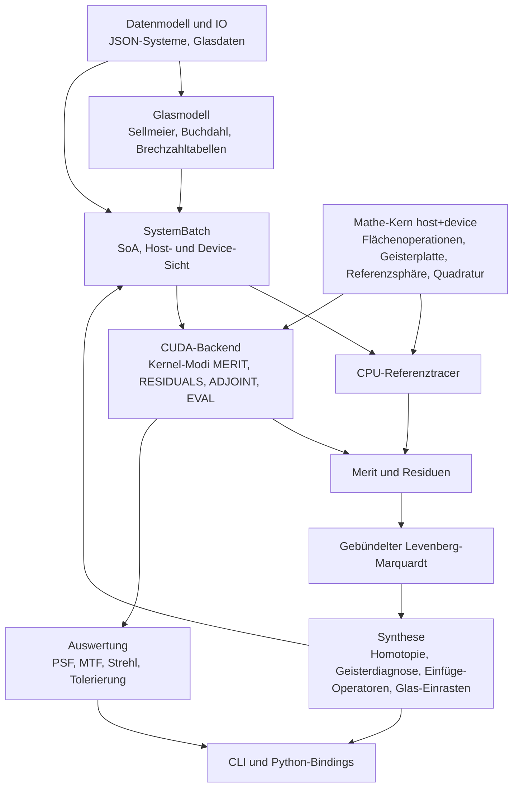

# Architektur

## Schichten



## Module und geplante Pfade

| Modul | Header | Quellen | Meilenstein |
|---|---|---|---|
| Mathe-Kern | `include/mikroptim/math/`, `include/mikroptim/trace/` | header-only | M0, M1, M4 |
| Datenmodell und IO | `include/mikroptim/model/`, `include/mikroptim/io/` | `src/model/`, `src/io/` | M1 |
| Glasmodell | `include/mikroptim/glass/` | `src/glass/` | M1, M6 |
| Pupillenquadratur | `include/mikroptim/pupil/` | header-only | M1 |
| Paraxialoptik | `include/mikroptim/paraxial/` | `src/paraxial/` | M1 |
| SystemBatch | `include/mikroptim/batch/` | `src/batch/` | M2 |
| CPU-Tracer | `include/mikroptim/cpu/` | `src/cpu/` | M1 |
| CUDA-Backend | `include/mikroptim/cuda/` (reines C++) | `src/cuda/` | M2–M8 |
| Merit | `include/mikroptim/merit/` | `src/merit/` | M3, M4 |
| Optimierer | `include/mikroptim/optim/` | `src/optim/`, `src/cuda/` | M3, M5 |
| Synthese | `include/mikroptim/synth/` | `src/synth/` | M6 |
| Auswertung | `include/mikroptim/eval/` | `src/eval/`, `src/cuda/` | M8 |
| CLI | – | `src/cli/` | M1 ff. |
| Python | – | `python/` | M9 |

## Mathe-Kern

Alle Rechnungen, die pro Strahl laufen, liegen header-only im Mathe-Kern, sind `MKO_HD` und über den Zahlentyp `R` templatisiert (ADR-0005). CPU-Tracer und CUDA-Kernel rufen dieselben Funktionen auf. Der sequenzielle Trace über ein System ist eine Funktion

```cpp
template <class R, class SurfaceTable>
MKO_HD TraceStatus trace_ray(const SurfaceTable& sys, int wavelength_index, Ray<R>& ray, TraceRecord<R>* record);
```

`SurfaceTable` ist eine schlanke Sicht (Zeiger und Längen) auf die Flächendaten einer Variante, im Kernel auf Shared Memory. `record` ist optional und speichert Zwischenzustände für den adjungierten Modus und für Strahlhöhen-Reduktionen.

## SystemBatch und Datenlayout

Ein Batch enthält V Varianten mit derselben Topologie (Flächenzahl und Flächentypen). Varianten mit anderer Topologie gehören in einen anderen Batch.

Structure of Arrays im globalen Speicher, Index `[v][s]` bzw. `[v][s][l]`:

| Feld | Typ | Bedeutung |
|---|---|---|
| `type[s]` | uint8 | Flächentyp (gemeinsam für den Batch): Plane, Sphere, GhostPlate |
| `curvature[v][s]` | R | Krümmung c = 1/R |
| `thickness[v][s]` | R | Abstand zum nächsten Scheitel |
| `index[v][s][l]` | R | Brechzahl nach der Fläche bei Wellenlänge l (vorab aus dem Glasmodell) |
| `ghost_coeff[v][g][k]` | R | Koeffizienten der Geisterplatte g |
| `ghost_index[v][g][l]` | R | Brechzahl des virtuellen Glases der Geisterplatte |
| `ghost_norm_radius[g]` | R | Normierungsradius des Dickenprofils |
| `image_distance[v]` | R | Arbeitsabstand (Dicke der letzten Fläche) |
| `field_target[v][f]` | R | ideale Bildhöhe h_f = f_soll · tan θ_f |

Brechzahlen werden pro Variante und Wellenlänge auf dem Host (oder einem kleinen Kernel) berechnet; der Trace-Kernel rechnet keine Dispersionsformeln.

## Kernel-Abbildung

- **Grid:** ein Block pro Tupel (Variante v, Feld f, Wellenlänge l), linearisiert.
- **Block:** 128 Threads (zu tunen in M7). Threads iterieren über die Pupillenstützstellen der Quadratur.
- **Shared Memory:** Flächentabelle der Variante (ca. 1 KB bei 30 Flächen) plus Reduktionspuffer.
- **Pupillenstützstellen** werden im Thread aus dem Index berechnet (Ring i, Speiche j, Gewicht).
- **Versagen:** Strahlen, die eine Fläche verfehlen oder totalreflektieren, laufen maskiert weiter; im Optimierungsmodus erzeugen sie Strafresiduen (weiches Versagen, siehe numerik.md).

## Kernel-Modi

| Modus | Ausgabe | Zweck | Meilenstein |
|---|---|---|---|
| `MERIT` | gewichtete Quadratsumme pro Variante | Liniensuche, Multistart-Screening | M2 |
| `RESIDUALS` | Residuenvektor pro Variante | finite Differenzen, LM | M2 |
| `ADJOINT` | Residuen plus Gradientenzeilen | analytische Jacobi-Matrix | M5 |
| `EVAL` | OPD-Karten auf dichtem Raster, Spotdaten | PSF, MTF, Tolerierung | M8 |

Zusätzlich liefern alle Modi optional pro Variante und Fläche die maximale Strahlhöhe und den maximalen Einfallswinkel (Max-Reduktion) für mechanische Nebenbedingungen.

## Reduktionen

Deterministisch: Baumreduktion im Block mit `__shfl_down_sync` und Shared Memory, Ergebnis pro Block in den globalen Speicher, danach Summation in fester Reihenfolge (zweiter Kernel oder Host). Keine Gleitkomma-Atomics für Ergebniswerte (ADR-0007).

## Speicherbedarf

Residuenmatrix für finite Differenzen: Läufe × (P+1) × Residuen × 8 Byte. Beispiel 1.000 × 91 × 2.500 × 8 B ≈ 1,8 GB. Die Batchgröße wird zur Laufzeit aus `cudaMemGetInfo` bestimmt; reicht der Speicher nicht, werden Läufe in Tranchen verarbeitet.

## Host-API (Skizze)

```cpp
namespace mko::cuda {
class TraceEngine {
public:
    explicit TraceEngine(int device);
    void upload(const SystemBatchHost& batch);                 // Topologie + Varianten
    void run(Mode mode, const TraceSettings& s, TraceOutput& out);
    std::size_t max_variants(const TraceSettings& s) const;    // aus freiem Speicher
};
}
```

Der Header ist reines C++, damit CLI, Optimierer und Python-Bindings ohne nvcc kompilieren.

## Mehrere GPUs (M7)

Varianten werden nach gemessenem Durchsatz auf die Geräte verteilt (P100 und RTX 3090 im selben Rechner oder getrennt). Ergebnisse pro Variante müssen unabhängig von der Verteilung bitgleich sein.

## Verhältnis zu Raytatouille

Mikroptim ist ein eigenständiges Projekt mit eigenem Dateiformat. Ein Adapter zwischen `*.rtt.json` (Raytatouille) und `mikroptim.system/1` ist für M9 vorgesehen (ADR-0008).
