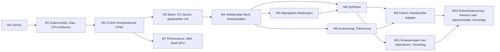

# Meilensteinplan für Agenten

Jede Aufgabe hat eine ID (`M<n>-T<k>`), Abhängigkeiten und Abnahmekriterien. Eine Aufgabe ist ein PR (siehe AGENTS.md). Aufgaben innerhalb eines Meilensteins ohne gegenseitige Abhängigkeit können parallel bearbeitet werden.

## Übersicht

M7 kann ab M2 parallel laufen, wird aber erst gebraucht, wenn die Laufzeiten der Synthese stören. (Bis Oktober 2026 deckte die P100 FP64 ab; seit ADR-0015 rechnen beide Karten FP64 langsam, df64 ist der Produktionsweg.)

---

## M0 – Projektgerüst ✅

Erledigt mit dem ersten Commit: Verzeichnisstruktur, CMake mit Presets (CPU, CUDA), CI (Linux, Windows, CUDA-Kompilierung), Mathe-Kern für Transfer, Sphärenschnitt und Brechung, analytische Tests, CUDA-Smoke-Test, Dokumentation, ADRs, dieser Plan.

---

## M1 – Datenmodell, Glas, CPU-Referenztracer ✅

Erledigt mit den PRs #1–#6, #8 und #10 (Oktober 2026).

Ziel: Ein System aus JSON laden und auf der CPU exakt tracen, mit Paraxialdaten und RMS-Wellenfront.

### M1-T1 – Systembeschreibung einlesen und schreiben
- **Abhängig von:** M0
- **Inhalt:** nlohmann/json per FetchContent (feste Version). Datenmodell `mko::SystemDescription` (Host), Einlesen und Schreiben von `mikroptim.system/1` nach docs/dateiformat.md, Validierung mit Fehlermeldungen inklusive JSON-Pfad.
- **Abnahme:**
  - Roundtrip (lesen → schreiben → lesen) ist für alle Dateien in `data/systems/` verlustfrei.
  - Mindestens 8 Negativtests (fehlende Pflichtfelder, falsche Typen, unbekannte Hauptversion, `stop` nicht an erster Stelle, unbekanntes Glas, ungleiche Längen von Wellenlängen und Gewichten …) mit sinnvoller Meldung.

### M1-T2 – Glaskatalog und Brechzahlen
- **Abhängig von:** M0
- **Inhalt:** `mikroptim.glass/1` laden, Sellmeier auswerten, Brechzahltabelle n[Fläche][Wellenlänge] für ein System erzeugen. Materialien `AIR`, Katalogname, `constant`, `buchdahl`.
- **Abnahme:**
  - n_d (587,56 nm) für N-BK7 = 1,51680, CaF₂ = 1,43385, Quarzglas = 1,45846, jeweils ±1·10⁻⁵.
  - Fehler außerhalb von `range_nm` wird gemeldet.

### M1-T3 – Buchdahl-Fit
- **Abhängig von:** M1-T2
- **Inhalt:** Kleinste-Quadrate-Fit von (n₀, ν₁, ν₂, ν₃) an Sellmeier über 400–700 nm nach numerik.md, Abschnitt 10.
- **Abnahme:** Maximaler Fitfehler mit 3 Koeffizienten < 1·10⁻⁵ für alle Gläser in `basis.json`; Fehler mit 2 Koeffizienten wird berichtet (Test protokolliert ihn).

### M1-T4 – Pupillenquadratur
- **Abhängig von:** M0
- **Inhalt:** Header-only, `MKO_HD`: Gauß-Legendre-Knoten und Gewichte für N ≤ 16 (vorab berechnete Tabellen oder exakte Berechnung auf dem Host), Abbildung Index → (ρ, φ, Gewicht), halbe und volle Pupille, Achsfall.
- **Abnahme:**
  - Mittelwerte aller rotationssymmetrischen Zernike-Polynome bis zur garantierten Ordnung werden exakt integriert (Fehler < 1·10⁻¹⁴); Orthogonalität der Zernike-Polynome R_n^m cos(mφ) bis n = 2N−1 auf der halben Pupille.
  - Summe der Gewichte = 1.

### M1-T5 – Sequenzieller CPU-Trace
- **Abhängig von:** M1-T1, M1-T2
- **Inhalt:** `trace_ray<R>` nach architektur.md (header-only, `MKO_HD`) über eine `SurfaceTable`-Sicht; kollimierte Quelle mit OPL₀ = **p₀**·**d₀** und Punktquelle; Statusmaske; CPU-Tracer als Schleife darüber.
- **Abnahme:**
  - Planplatte (`planplatte_bk7.json`): OPL jedes Strahls gegen geschlossene Formel, Fehler < 1·10⁻¹¹ mm.
  - Einzelfläche: exakter trigonometrischer Strahl (wie in `test_surface_ops.cpp`) über das ganze System-API.
  - Aplanatische Punkte: Punktquelle im Glas (n) im Abstand R/n vom Krümmungsmittelpunkt einer Kugelfläche. Alle gebrochenen Strahlen zeigen, rückwärts verlängert, auf den virtuellen Bildpunkt im Abstand n·R vom Mittelpunkt (Abstand Gerade–Punkt < 1·10⁻¹² mm) für Aperturen bis NA 0,95.
  - Strahlumkehr: Ein durch ein mehrlinsiges System getracter Strahl, rückwärts getract, kehrt auf < 1·10⁻¹⁰ mm zum Start zurück.

### M1-T6 – Paraxialoptik
- **Abhängig von:** M1-T1, M1-T2
- **Inhalt:** y-nu-Trace, Brennweite, Schnittweite, Hauptebenen, Petzvalsumme und -krümmung, paraxiale Pupillenlage.
- **Abnahme:**
  - Dicke Linse: Brennweite nach Linsenmacherformel (Fehler < 1·10⁻¹² relativ); `einzellinse_bk7.json` ergibt f ≈ 101,05 mm, Schnittweite ≈ 99,05 mm.
  - Petzvalsumme gegen Formel in numerik.md.
  - Grenzwert: Achsschnittpunkt realer Strahlen für h → 0 konvergiert gegen die paraxiale Schnittweite.

### M1-T7 – Referenzsphäre, OPD, RMS-Wellenfront
- **Abhängig von:** M1-T4, M1-T5
- **Inhalt:** Referenzsphäre und Kolbenabzug nach numerik.md, Abschnitt 7; RMS-Wellenfront pro Feld und Wellenlänge über die Quadratur.
- **Abnahme:**
  - Aplanatischer Fall (Punktquelle, Referenz im exakten Bildpunkt): RMS-OPD < 1·10⁻¹⁰ mm.
  - Kleine Apertur: sphärische Aberration der Einzellinse stimmt mit der Seidel-Näherung W₀₄₀ auf < 1 % überein (NA ≤ 0,05).
  - Achsial verschobener Referenzpunkt bei einer perfekten Kugelwelle: OPD stimmt mit der exakten geometrischen Formel überein (< 1·10⁻¹² mm).

### M1-T8 – CLI `mikroptim trace`
- **Abhängig von:** M1-T6, M1-T7
- **Inhalt:** `mikroptim trace <system.json>` gibt Paraxialdaten, RMS-Wellenfront (in Wellen) pro Feld und Wellenlänge, Anzahl versagter Strahlen aus. Optional `--json` für maschinenlesbare Ausgabe.
- **Abnahme:** Ausgabe für `einzellinse_bk7.json` in docs/ als Beispiel dokumentiert; Test prüft die JSON-Ausgabe.

---

## M2 – CUDA-Vorwärtskernel FP64 ✅

Umgesetzt mit den PRs #9, #12, #14, #16, #17, #19 (Oktober 2026), getestet auf der RTX 3090. Die Tests auf der Tesla P100 entfallen (ADR-0015); auf der RTX 6000 Ada (herkules3) ist ctest grün (Oktober 2026).

Ziel: Dieselben Ergebnisse wie die CPU, für viele Varianten gleichzeitig.

### M2-T1 – SystemBatch
- **Abhängig von:** M1-T5
- **Inhalt:** SoA-Layout nach architektur.md, Host-Container und Device-Sicht, Upload, Speicherabschätzung, maximale Batchgröße aus `cudaMemGetInfo`.
- **Abnahme:** Unit-Tests für Indexierung und Speicherabschätzung; Upload und Download sind verlustfrei.

### M2-T2 – Kernel `RESIDUALS`
- **Abhängig von:** M2-T1, M1-T7
- **Inhalt:** Grid-Abbildung (Block pro Variante, Feld, Wellenlänge), Systemtabelle im Shared Memory, Pupillenstützstellen im Thread, maskiertes Versagen, Kolbenabzug per Block-Reduktion, Ausgabe des Residuenvektors pro Variante.
- **Abnahme:** |GPU − CPU| ≤ `kCpuGpuFp64` für alle Strahlen von mindestens 1.000 zufällig gestörten Varianten der Testsysteme, auf RTX 3090 und P100.

### M2-T3 – Kernel `MERIT` mit deterministischer Reduktion
- **Abhängig von:** M2-T2
- **Inhalt:** gewichtete Quadratsumme pro Variante, Max-Reduktionen für Strahlhöhe und Einfallswinkel pro Fläche.
- **Abnahme:** Zehn Wiederholungen ergeben bitgleiche Ergebnisse; Merit stimmt mit der Summe der `RESIDUALS`-Ausgabe überein (< 1·10⁻¹³ relativ).

### M2-T4 – Host-API `TraceEngine`
- **Abhängig von:** M2-T2
- **Inhalt:** reiner C++-Header nach architektur.md; Fehlerbehandlung, Gerätewahl, Tranchen bei Speichermangel.
- **Abnahme:** CLI und Tests nutzen ausschließlich diese API; Batch größer als der Speicher wird korrekt in Tranchen verarbeitet (Test mit künstlich begrenztem Speicher).

### M2-T5 – CLI-Integration
- **Abhängig von:** M2-T4
- **Inhalt:** `mikroptim trace --gpu`.
- **Abnahme:** Ausgabe identisch zur CPU-Variante (innerhalb der Toleranz).

### M2-T6 – Benchmark
- **Abhängig von:** M2-T3
- **Inhalt:** `bench/trace_throughput` (Flächenzahl 10–40, Varianten 1–10.000).
- **Abnahme:** Messungen für RTX 3090 und P100 in docs/benchmarks.md. Abweichung von der Schätzung in docs/hardware.md um mehr als Faktor 3 wird im PR erklärt.

---

## M3 – Batch-Varianten, finite-Differenzen-Jacobi, gebündelter LM ✅

Umgesetzt mit den PRs #18, #20, #22, #26, #29 (Oktober 2026); JᵀJ mit eigenem Kernel statt cuBLAS (ADR-0010, vorgeschlagen).

Ziel: Erste Ende-zu-Ende-Optimierung.

### M3-T1 – Variablen und Variantengenerator
- **Abhängig von:** M2-T4
- **Inhalt:** Schema für `variables` in der Systemdatei (Krümmungen, Dicken, Arbeitsabstand; Glas folgt in M6), Abbildung Variablenvektor ↔ Batch, Erzeugung gestörter Varianten.
- **Abnahme:** Roundtrip Vektor → Batch → Vektor; Schema in docs/dateiformat.md dokumentiert.

### M3-T2 – Finite-Differenzen-Jacobi
- **Abhängig von:** M3-T1
- **Inhalt:** zentrale Differenzen, Schrittweitenwahl nach optimierung.md, Jacobi pro Lauf.
- **Abnahme:** Vergleich gegen Richardson-Extrapolation auf einem Testsystem: relative Abweichung < 1·10⁻⁶.

### M3-T3 – Paraxiale Nebenbedingungen und Residuenaufbau
- **Abhängig von:** M1-T6, M3-T1
- **Inhalt:** Brennweite, Abgleichlänge, Arbeitsabstand als Residuen; Paraxialtrace für alle Varianten (Host, parallel).
- **Abnahme:** Unit-Tests pro Nebenbedingung.

### M3-T4 – Gebündelter Levenberg-Marquardt
- **Abhängig von:** M3-T2, M3-T3
- **Inhalt:** cuBLAS `DgemmStridedBatched`, cuSOLVER `potrfBatched`/`potrsBatched`, Marquardt-Skalierung, Nielsen-Dämpfung, Schranken mit aktiver Menge, Abbruchkriterien.
- **Abnahme:**
  - Einzellinse N-BK7 mit fester Brennweite und kleiner Apertur auf minimale sphärische Aberration: Formfaktor q = (c₁+c₂)/(c₁−c₂) im Bereich 0,74 ± 0,05 (Dünnlinsentheorie: q = 2(n²−1)/(n+2)).
  - Ein optimiertes System, alle Variablen um 1 % gestört, findet zurück (Merit relativ < 1·10⁻⁶ über dem Optimum).
  - 1.000 gleichzeitige Läufe liefern bitgleich dieselben Ergebnisse wie dieselben Läufe einzeln.

### M3-T5 – CLI `mikroptim optimize`
- **Abhängig von:** M3-T4
- **Inhalt:** Optimierung einer Systemdatei, Ausgabe des Ergebnisses als neue Systemdatei, Iterationsprotokoll.
- **Abnahme:** Beispiel in docs/ dokumentiert.

---

## M4 – Vollständige Merit und Geisterplatten ✅

Umgesetzt mit den PRs #15, #27, #28, #33, #35, #39 (Oktober 2026).

### M4-T1 – Gewichtete Wellenfrontresiduen
- **Abhängig von:** M3-T4
- **Inhalt:** Feld- und Spektralgewichte, Normierung auf λ_ref, Gewichte √(W_i V_j).
- **Abnahme:** Merit gleich gewichteter Summe der RMS-Werte aus M1-T7 (< 1·10⁻¹² relativ).

### M4-T2 – Weiches Strahlversagen
- **Abhängig von:** M4-T1
- **Inhalt:** nach numerik.md, Abschnitt 11, in allen Optimierungsmodi.
- **Abnahme:** Startsystem, bei dem 30 % der Strahlen versagen, wird ohne manuelles Eingreifen in einen versagensfreien Zustand optimiert; Merit ist entlang einer Geraden durch den Versagensübergang stetig (Test mit fein abgetasteter Linie).

### M4-T3 – Mechanische Nebenbedingungen
- **Abhängig von:** M2-T3, M4-T1
- **Inhalt:** Durchmesser, Mitten- und Randdicke (Pfeilhöhe analytisch), maximaler Einfallswinkel, aus den Max-Reduktionen des Kernels.
- **Abnahme:** Unit-Tests; ein Testlauf hält alle Grenzen ein.

### M4-T4 – Petzval-Nebenbedingung
- **Abhängig von:** M1-T6
- **Abnahme:** Testsystem mit aktiver Nebenbedingung erreicht |κ_P| ≤ κ_max.

### M4-T5 – Flächentyp Geisterplatte
- **Abhängig von:** M1-T5
- **Inhalt:** nach numerik.md, Abschnitt 6, CPU und GPU; Dateiformat für `ghost_plates`.
- **Abnahme:**
  - Lineare Phase Φ = a·y lenkt exakt um Δ(n d_y) = a ab.
  - Gradient des Dickenprofils gegen finite Differenzen (< 1·10⁻¹⁰ relativ).
  - Geisterplatte mit gefitteter idealer Fokussierphase bei NA 0,3: RMS-OPD < 1·10⁻⁶ mm.
  - Paraxiale Brechkraft φ_G nach Formel stimmt mit dem Grenzwert realer Strahlen überein.

### M4-T6 – L1-Strafe und Diagnosebericht
- **Abhängig von:** M4-T5, M3-T4
- **Inhalt:** geglättete L1-Residuen, Gewichte pro Ordnung, Strafgewicht μ, Diagnosebericht nach optimierung.md, Abschnitt 5.
- **Abnahme:**
  - Exaktheit: Ein System, das sein Ziel alleine erreicht, endet mit allen |a| < 1·10⁻⁸ (μ oberhalb der Schwelle).
  - Bedarf: Einzellinse bei NA 0,5 mit Beugungsbegrenzungsziel aktiviert Geisterkoeffizienten; der Diagnosebericht nennt Position, Ordnung und Glastyp.

---

## M5 – Adjungierte Ableitungen

### M5-T1 – Vorwärtsdurchlauf mit Zustandsspeicherung
- **Abhängig von:** M4-T5
- **Inhalt:** `TraceRecord` im Local Memory, optional Checkpointing.

### M5-T2 – Rückwärtsdurchlauf
- **Abhängig von:** M5-T1
- **Inhalt:** lokale Ableitungen jeder Flächenoperation (Transfer, Schnitt, Brechung, Geisterplatte, Referenzsphäre), Gradientenzeile pro Residuum bezüglich aller Variablen, inklusive Kolbenabzug als lineare Projektion.
- **Abnahme:** relative Abweichung zur finite-Differenzen-Jacobi ≤ 1·10⁻⁶ für alle Variablentypen.

### M5-T3 – Integration in LM
- **Abhängig von:** M5-T2
- **Abnahme:** Gleiche Optimierungsergebnisse wie mit finiten Differenzen; Jacobi mindestens 10× schneller für P ≥ 60 auf beiden GPUs.

---

## M6 – Systemsynthese

### M6-T1 – Kontinuierliches Glas als Variable ✅ (#36)
- **Abhängig von:** M1-T3, M3-T4
- **Inhalt:** (n₀, ν₁, ν₂) als Variablen, konvexe Hülle der Katalog-Gläser (normierte Koordinaten), Strafterm außerhalb.
- **Abnahme:** Hüllentests; Optimierung bleibt innerhalb der Hülle.

### M6-T2 – Einfüge-Operatoren A und B
- **Abhängig von:** M4-T6
- **Inhalt:** nach optimierung.md, Abschnitt 6, inklusive Initialisierung aus dem Diagnosebericht.
- **Abnahme:** Merit nach dem Einfügen relativ unverändert (|ΔF| ≤ 1·10⁻¹²). Operator B macht aus einer Einzellinse bei zwei Wellenlängen ein Kittglied, das den Farblängsfehler um mehr als den Faktor 10 reduziert.

### M6-T3 – Homotopie-Controller
- **Abhängig von:** M6-T2
- **Inhalt:** Parameter NA, Feld, Spektrum, μ; Schrittweitensteuerung; Protokoll jedes Schritts.
- **Abnahme:** Ausgehend von einer Linse bei NA 0,3, monochromatisch, entsteht automatisch ein beugungsbegrenztes System bei NA 0,6 auf der Achse.

### M6-T4 – Kandidatenverwaltung
- **Abhängig von:** M6-T3
- **Inhalt:** Strahlsuche über Zweige (Sattelpunkt-Abstiege, Einfügungen), gemeinsame Batches pro Topologie.
- **Abnahme:** Läufe sind mit festem Seed reproduzierbar; Protokoll zeigt den Stammbaum der Kandidaten.

### M6-T5 – Glas-Einrasten ✅ (#38)
- **Abhängig von:** M6-T1
- **Abnahme:** Nach dem Einrasten nur Katalog-Gläser; Merit-Verschlechterung wird berichtet.

### M6-T6 – Lauf auf der Zielspezifikation
- **Abhängig von:** M6-T4, M6-T5
- **Inhalt:** stufenweiser Lauf nach optimierung.md, Abschnitt 7, bis zur vollen Spezifikation aus docs/spezifikation.md.
- **Abnahme:** Bericht unter `docs/ergebnisse/` mit Kandidaten, Linsenzahl, Wellenfrontfehler pro Feld und Wellenlänge, Laufzeit. Forschungsaufgabe ohne festen Zielwert; Vergleich mit den Startsystemen des Maintainers.
- **Patentvergleich ruht** (Entscheidung Maintainer 2026-11-22): Die Patentsysteme sind Platzhalter, keine fertig entwickelten Systeme, und als Referenz unbrauchbar; der Vergleich mit den Startsystemen des Maintainers entfällt bis auf Weiteres (ebenso B4 in M10-T7).

### M6-T7 – Referenzsphäre unabhängig von der letzten Fläche
- **Abhängig von:** M6-T6 (Befunde F11, F12), M11-T4; Konventionsänderung vom Maintainer am 2026-11-19 freigegeben ([ADR-0017](../adr/0017-referenzsphaere-bildpunkt.md))
- **Inhalt:** Referenzsphäre um den idealen Bildpunkt mit Radius bis zur paraxialen Austrittspupille (`image_exit_pupil`) oder unendlich (`image_infinite`), κ als feste Größe des Batches; optionales Feld `reference_sphere` (ohne Feld die alte Konvention `last_surface`, bitgleich); alle Pfade: CPU-Referenzen, RESIDUALS, MERIT, FD- und adjungierte Jacobi, df64, FP32-Vorfilter, EVAL (`--reference infinite`); CLI `--reference-sphere` für `trace`, `optimize`, `synth`; Skript `--referenzsphaere`, `--ohne-f12-schutz`.
- **Abnahme:** analytische Orakel (reine Defokussierung, Falle F12 mit ideal fokussierender Geisterplatte), Unabhängigkeit von einer Hilfsebene hinter dem System, adjungiert gegen Richardson und FD, CPU gegen GPU, alte Konvention bitgleich zu main; Messung mit `--osc-versuch`, Bericht `docs/ergebnisse/m6-t7-referenzsphaere.md`.

### M6-T6b – Lauf auf der Zielspezifikation mit ADR-0017
- **Abhängig von:** M6-T6, M6-T7
- **Inhalt:** M6-T6 mit der Referenzsphäre `image_infinite` wiederholen (Skript-Standard, F12-Schutz aus), Skriptfehler „NA vorgeben“ beheben, Variantenmatrix mit den neuen Mitteln (Farbregel, Sinusbedingung, erzwungenes Einfügen, Start aus dem M6-T6-Zwischenstand); Befunde F1–F13 einordnen; optional M11-T7 an einem neuen Zwischenstand.
- **Abnahme:** Bericht `docs/ergebnisse/m6-t6b-zielspezifikation-adr0017.md` mit Kandidaten, Linsenzahl, Wellenfrontfehler pro Feld und Wellenlänge, Strehl, Laufzeit, Vergleich mit M6-T6 und M6-T7.
- **Stand:** gerechnet (neun Varianten). Ziel nicht erreicht. Bestes beugungsbegrenztes System 9 El., NA 0,5, volles Feld, 546 nm, ≤ 0,033 Wellen (M6-T6-Aufbau unter der neuen Merit); NA 0,855 bei 10 % Feld mit 5 El. beugungsbegrenzt; polychromatisch 405–707 nm bei 27 % Feld ≤ 0,108 Wellen (12 El.), bei vollem Feld ≤ 0,26 Wellen (11 El.). F11/F12 erledigt; neuer Engpass F14: Feldstufe ab der Einzellinse endet bei 27 % Feld. M11-T7: CMA bei allen vier Startwerten besser als `starts`.

### M6-T8 – Gemeinsame Apertur-/Feld-Homotopie und Feldregel
- **Abhängig von:** M6-T3, M6-T7 (Befunde F14/F15 aus M6-T6b)
- **Inhalt:** Ursache von F14 (Feldstufe endet ab der Einzellinse bei 27 % Feld) diagnostizieren; Optionen (Standard aus, bisherige Läufe bitgleich): gemeinsamer Homotopie-Parameter für Apertur und Feld (`--joint-aperture-field`, Bahn NA(t), φ(t) = φ₀ + t^p (φ₁ − φ₀)) und Bedarfskriterium für Feldfehler (Feldregel `--field-rule`: Operator A in der Feldlinsenlage, wenn die Geisterplatten keinen Bedarf zeigen und Feldfehler dominieren); Skript `--gemeinsam`, `--feldregel`, `--ab-p2`, `--bis p2`.
- **Abnahme:** Unit-Tests mit Mock-Homotopie und am optischen Modell, CLI-Test, Bitgleichheit ohne Option; Messung ab der Einzellinse und ab dem NA-0,855-System aus M6-T6b, Bericht `docs/ergebnisse/m6-t8-apertur-feld.md`.
- **Stand:** umgesetzt und gemessen (`--joint-aperture-field`, `--field-rule`, zusätzlich `--insertion-improve` gegen Einfüge-Serien, F16). F14: Feldfehler für die Geisterplatten unsichtbar (blendennah bzw. Normierungsradius 6× zu groß), daher kein Bedarf. Mit Feldregel ab der Einzellinse bei NA 0,5 **100 % Feld**, beugungsbegrenzt (0,039/0,022/0,059 Wellen), aber 25 El.; ab NA 0,855 nur 23 % Feld (NA 0,869, gemeinsam + Feldregel + Verbesserung). F15 nicht bearbeitet.

### M6-T9 – Elementbudget und Rückbau
- **Abhängig von:** M6-T8, M10-T4 (vom Maintainer am 2026-11-20 freigegeben; Befund F16, 25-Linser der Feldregel)
- **Inhalt:** Rückbau-Phase im Homotopie-Controller (Option, Standard aus, ohne Option bitgleich): nach Phasen mit Einfügungen und vor dem Abschluss Elemente versuchsweise über die Rückbau-Homotopie (`collapse_element`, `remove_element`) entfernen, geringster Seidel-Beitrag zuerst, nachoptimieren, nur übernehmen, wenn F_B ≤ ρ·F_max (optional ≤ (1 + ε)·F_B vorher); Elementbudget (Einfügen über N erzwingt vorher einen Rückbau-Versuch); CLI `synth --prune`, `--element-budget N`, `--prune-*`; Skript `--rueckbau`, `--elementbudget`, `--nur-rueckbau`.
- **Abnahme:** Mock-Tests (überflüssiges Element entfernt, notwendiges behalten, Budget), Orakel am optischen Modell (Null-Element: entfernt, Merit unverändert; Linse bleibt), CLI-Test, Bitgleichheit ohne Option; Messung F1 (NA 0,5, volles Feld) und JFV855 (NA 0,87) mit Rückbau, Bericht `docs/ergebnisse/m6-t9-rueckbau.md`.
- **Stand:** umgesetzt und gemessen. Rückbau am realen System (Z2): F1 25 → 9 El. bei NA 0,5 und vollem Feld, 0,012/0,037/0,038 Wellen (ρ = 1: 6 El., ≤ 0,068); JFV855 25 → 5 El. bei NA 0,869 / 23 % Feld, danach öffnet die Feldstufe auf 64 % (11 El.). Mit Geisterplatten bzw. mitten in den Stufen entfernt der Rückbau kaum etwas (F17); Lauf ab der Einzellinse mit Rückbau in allen Stufen nur 58 % Feld.

### M6-T10 – Stufenweise Synthese mit Rückbau am realen System und Rückkehr zu Geisterplatten
- **Abhängig von:** M6-T9, M10-T4 (Befund F17; vom Maintainer am 2026-11-20 freigegeben)
- **Inhalt:** Rückkehr vom realen System (ohne Geisterplatten) zu einem Startsystem der Synthese mit Geisterplatten (`return_to_ghost_plates`: `place_ghost_dictionary` an Lagen aus den paraxialen Strahlhöhen, Plattenspalte fest, Normierungsradius aus den realen Strahlhöhen; `insert --ghost-return`, `synth --start-from-real`); zyklischer Ablauf im Skript (`--zyklus`): Stufe → Z2 → Rückbau am realen System → Rückkehr zu Geisterplatten → nächste Stufe, bis Ziel oder Stillstand.
- **Abnahme:** Merit-Invarianz der Rückkehr, Lagen gegen den Aberrationsbericht, CLI- und Skripttests, ohne Option unverändert; Messung ab dem 5-Linser bei NA 0,869 (M6-T9) und ab dem 9-/6-Linser bei NA 0,5 (volles Feld): Feld, Farbe, Apertur; Bericht `docs/ergebnisse/m6-t10-zyklisch.md` mit Vergleich zu M6-T6b, M6-T8, M6-T9.
- **Stand:** umgesetzt und gemessen ([Bericht](../ergebnisse/m6-t10-zyklisch.md)). Rückkehr zu Geisterplatten merit-invariant (Testsysteme ≤ 1,1·10⁻¹⁵, Messläufe ≤ 1,1·10⁻¹⁰ relativ). Ab dem 9-Linser NA 0,6725 bei vollem Feld (16 El., 0,030/0,071/0,078 Wellen, Rand knapp über λ/14); ab dem 5-Linser bei NA 0,869 Feld 65 % (12 El., wie ohne Platten), Apertur dort Stillstand; Farbe aus den monochromatischen Systemen nicht beugungsbegrenzt (0,5–1,8 Wellen). Rückbau nach den Stufen 0 von 195 Versuchen: Stufen enden an der Schwelle (F17 verallgemeinert); die zurückgekehrten Platten bleiben in den monochromatischen Stufen passiv.

### M6-T11 – Farbstufe der Synthese gezielt verbessern
- **Abhängig von:** M6-T10, M11-T5 (vom Maintainer am 2026-11-22 freigegeben)
- **Inhalt:** Operator B und Farbregel auf die Glas-Rangfolge nach dem spektralen Rest und die Startradien des Glieds umstellen (Option); Farbbedarf erkennen (chromatische Seidel-Terme, Kriterium d) und dann Kittglied-Modul aus der Wissensbasis (Null- bzw. starkes Kittglied, Gläser aus der Vorauswahl, `anomalous_pgf`/`merte_pair`) statt Meniskus, auch wenn die Geisterplatten Operator A empfehlen; Startpunkt der Farbstufe annehmbar (stetige Spektrum-Homotopie ab λ_ref, aus der Diagnose begründet); Rückbau bei Q × Parameter einer Stufe (Skript `--rueckbau-punkt`); alles standardmäßig aus.
- **Abnahme:** Controller-/Operator-Tests mit optischen Orakeln (dünner Achromat aus der Vorauswahl korrigiert die Längsfarbe, Merit-Invarianz des Null-Kittglieds, Einfallswinkel, Schwelle des Kriteriums), CLI- und Skripttests, Bitgleichheit ohne Option; Messung ab den besten monochromatischen Ständen (16-Linser NA 0,6725, 9-Linser NA 0,5, volles Feld; 5-/12-Linser NA 0,869) mit 436–656 nm, Bericht `docs/ergebnisse/m6-t11-farbe.md` mit Vergleich zu M6-T6b, M6-T9, M6-T10.
- **Stand:** umgesetzt und gemessen ([Bericht](../ergebnisse/m6-t11-farbe.md)). Operator B mit Startradien des Glieds an der Einzellinse: RMS 0,0150 → 0,0006 (480/644 nm) bzw. 0,0158 → 0,0053 Wellen (436–656 nm). Diagnose: die monochromatischen Endstände haben 16–24 Wellen chromatischen RMS (Fokusspanne 160–300 µm), lokal nicht mehr korrigierbar (F13; auch mit freien Gläsern ≈ 15 Wellen); ab dort 0,46–18,7 Wellen. Mit „Farbe früh“ ab V3: polychromatisch NA 0,6075 bei 38 % Feld, 16 El., ≤ 0,130 Wellen (Achse ≤ 0,028), höchste polychromatische NA bisher; ab V7 volles Feld NA 0,5 ≤ 0,17 Wellen (19 El.). Farbregel fügt nur noch Kittglieder ein (F9). Rückbau bei 85 % 0/114 (kein Stufenergebnis unter F_max). Ziel nicht erreicht.

### M6-T11b – Werkzeugpflege nach M6-T11 und M10-T7e
- **Abhängig von:** M6-T11, M10-T7e (vom Maintainer am 2026-11-22 freigegeben)
- **Inhalt:** (1) `synth --split-spectrum` und `--split-member-start` (Operator B, M6-T11) werden Standard, abschaltbar mit `--no-split-spectrum`/`--no-split-member-start` (Skript `--ohne-farb-spektrum-rang`, `--ohne-farb-startradien`); (2) `--insertion-improve` gilt auch in der Startphase, mit Spielraum (übernommen, wenn F_B sinkt oder danach ≤ F_max); (3) Referenz der Regel = Median über fünf gestörte Starts in `tools/m10t7_bewertung.py`, Einzellauf daneben, Regel-Läufe B1–B3 neu (ohne Sprachmodell); B4 und der Patentvergleich aus M6-T6 ruhen; (4) `insert_module` verkleinert die aplanatische Schale bei negativem Arbeitsabstand und verwirft das Modul, wenn das nicht reicht.
- **Abnahme:** Orakel-Tests (Mock-Homotopie: Sprung in der Startphase verworfen, Spielraum; Achromat: Startradien-Zweig kleiner als ohne), CLI- und Skripttests, ohne die Optionen bzw. mit `--no-…` bitgleich; Python-Tests der Schale; Regel-Läufe B1–B3 mit fünf gestörten Starts, Abschnitt 14 im [Bewertungsbericht](../ergebnisse/m10-t7-bewertung.md).
- **Stand:** umgesetzt. Spektraler Rang und Startradien Standard von `synth` (wirksam mit Vorauswahl bzw. Farbregel; `--no-…` bitgleich zum alten Stand); `--insertion-improve` in der Startphase mit Spielraum (Orakel: Sprung F_B 2 → 4,5 F_max verworfen); `insert_module` verkleinert die Schale (Dicke × 0,5, bis vier Schritte) bzw. verwirft sie; Referenz der Regel = Median über fünf gestörte Starts: B1 5/5, B2 NA 0,458, B3 NA 0,410 (Einzellauf 0,790 bzw. Ziel; alle 18 Läufe gleich M10-T7e). B4 und der Patentvergleich aus M6-T6 ruhen.

### M6-T12 – Glas-Wörterbuch der Geisterplatten um Flint- und anomale Gläser erweitern
- **Abhängig von:** M6-T11, M11-T5g (vom Maintainer am 2026-11-22 freigegeben; Befund aus M6-T11: monochromatische Läufe bauen nur aus CaF₂, SYN-30, SYN-36 und sind danach nicht farbkorrigierbar)
- **Inhalt:** Wörterbuch der Geisterplatten konfigurierbar erweitern (`extend_ghost_dictionaries`, `synth --ghost-dictionary-extra N`, `--ghost-dictionary-glass`, Skript `--woerterbuch-extra`, Aktion `synth_segment` mit `ghost_dictionary_extra`): Flint- und anomale Gläser aus dem Katalog nach der Rangfolge der Glasvorauswahl (spektraler Rest, `anomalous_pgf`), ohne Option bitgleich; Diagnose und Operatoren (A, B, Einrasten) mit den Zusatzgläsern; Standardgröße aus Messung.
- **Abnahme:** Tests mit optischen Orakeln (Flint-Platte korrigiert die Farbe einer Einzellinse, Flint-Plattenanteil führt zu Flint-Element bzw. Kittglied mit Flint als Zielglas), Merit-Invarianz und Wiederholbarkeit der Erweiterung, Bitgleichheit ohne Option, CLI- und Skripttests; Messung monochromatisch wie M6-T10 (9-Linser-Pfad) mit anschließender Farbstufe und „Farbe früh“ wie F3 aus M6-T11, Bericht `docs/ergebnisse/m6-t12-glaswoerterbuch.md` mit Vergleich zu M6-T10/M6-T11.
- **Stand:** umgesetzt und gemessen ([Bericht](../ergebnisse/m6-t12-glaswoerterbuch.md)). Auswahl SYN-32, CaF₂ (vorhanden), SYN-13, SYN-04; Standardgröße N = 4 (+38 % LM-Zeit). Monochromatisch mit N = 4 endet der Feldregel-Pfad früher (NA 0,445, 24 % Feld, 8 El.), ist aber farbfähig (Fokusspanne g…C 75 statt 298 µm); die Farbstufe danach erreicht 436–656 nm beugungsbegrenzt (0,025/0,068/0,060 Wellen, Strehl ≥ 0,87, 11 El. nach Rückbau; F13 teilweise gelöst). „Farbe früh“ (F3) mit Erweiterung: ähnliche Güte, mehr Feld (41–43 %), weniger NA (0,55–0,575); mit N = 4 nach Rückbau 13 El., Rand 0,110 Wellen. Ziel nicht erreicht.

---

## M7 – Performance

### M7-T1 – Zahlentyp df64 ✅ (#23)
- **Abhängig von:** M2-T3
- **Abnahme:** |df64 − FP64| ≤ `kDf64VsFp64` für alle Tests der Testsuite; Durchsatz auf der RTX 3090 gemessen.

### M7-T2 – FP32-Vorfilterung ✅ (#25)
- **Inhalt:** schneller Pfad zum Aussortieren von Varianten mit massivem Strahlversagen oder schlechter Merit im Multistart.
- **Abnahme:** keine falsch aussortierten Varianten in einem Testsatz (Vergleich mit FP64).

### M7-T3 – Mehrere GPUs ✅ (#30, nur mit einer GPU getestet)
- **Abhängig von:** M2-T4
- **Abnahme:** Ergebnisse pro Variante bitgleich zum Einzel-GPU-Lauf; Verteilung nach gemessenem Durchsatz.

### M7-T4 – Profiling und Tuning ✅ (#46, Teil 2 #89; ohne Nsight-Compute-Zähler, nur RTX 3090)
- **Inhalt:** Nsight Compute, Registerdruck, Belegung, Blockgröße.
- **Abnahme:** Profilberichte und Ergebnisse in docs/benchmarks.md.

---

## M8 – Auswertung und Tolerierung

### M8-T1 – Modus `EVAL` ✅ (#32)
- **Abhängig von:** M4-T1
- **Inhalt:** dichtes kartesisches Pupillenraster, OPD-Karten, Spotdiagramme, Feldkrümmung, Verzeichnung.

### M8-T2 – PSF, MTF, Strehl ✅ (#34)
- **Abhängig von:** M8-T1
- **Inhalt:** skalare Beugung über cuFFT. Hinweis: Bei NA 0,95 ist die skalare Näherung ungenau; ein vektorielles Modell (Richards-Wolf) ist als M8-T5 vorgesehen.
- **Abnahme:** Perfektes System bei kleiner NA: erste Nullstelle der PSF bei 0,61·λ/NA (< 1 %); Strehl gegen Maréchal-Näherung bei kleinen Aberrationen.

### M8-T3 – Dezentrierung und Verkippung
- **Inhalt:** allgemeine Flächentransformationen, volle Pupille (Symmetrie entfällt). Erfordert eine ADR für die Erweiterung der Konventionen.

### M8-T4 – Monte-Carlo-Tolerierung ✅ (#84)
- **Abhängig von:** M8-T2, M8-T3
- **Inhalt:** Toleranzsatz (Radien, Dicken, Brechzahlen, Dezentrierung, Verkippung), Stichproben als Varianten im Batch, Kompensatoren (z. B. Arbeitsabstand).
- **Abnahme:** Verteilung von Strehl und RMS-Wellenfront über 10.000 Stichproben; Ergebnis reproduzierbar mit festem Seed.

### M8-T5 – Vektorielle PSF (optional) ✅ (#37)
- **Inhalt:** Richards-Wolf für hohe NA.
- **Abnahme (in der Umsetzung festgelegt):** kleine NA → skalare PSF mit Abweichung zweiter Ordnung in der NA; NA 0,95 aberrationsfrei gegen unabhängige Quadratur des Richards-Wolf-Integrals (Intensität und Komponenten, Halbwertsbreiten in x und y relativ < 10⁻³) und gegen die geschlossene Form der Energieanteile; Energieerhaltung, Symmetrien (Spiegelung, Drehung der Polarisation), GPU = CPU, Determinismus; Strehl bei kleinen Aberrationen gegen Maréchal (docs/numerik.md, „Vektorielle PSF“).

---

## M9 – Python und Integration

### M9-T1 – Python-Bindings
- **Inhalt:** nanobind; Systeme laden, tracen, optimieren, Ergebnisse als NumPy.
- **Abnahme:** pytest-Suite, Wheel-Build für Linux und Windows.

### M9-T3 – Glasimport (AGF, refractiveindex.info)
- **Abhängig von:** M9-T1
- **Inhalt:** Python-Modul `mikroptim.glass_import` und `python -m mikroptim.glass_import`: AGF-Dateien der Hersteller und YAML-Dateien der Datenbank refractiveindex.info nach `mikroptim.glass/1`; 3-Term-Sellmeier exakt oder als geprüfter Fit, Kontrolle gegen n_d, Reintransmission, Bericht. Glasdateien werden nie committet (data/glass/README.md); die GUI bietet später den Upload und ruft dieses Modul auf.
- **Abnahme:** Tests mit synthetischen Daten (exakte Übernahme, Fit innerhalb der Toleranz, Einschränkung des Bereichs, Kontrolle n_d, Kodierungen, Status, Namen, Luftumrechnung, Transmission, Kommandozeile); der erzeugte Katalog wird vom Leser von Mikroptim angenommen und liefert bei gleichen Koeffizienten bitgleiche Paraxialdaten. Lokaler Plausibilitätslauf über die Herstellergläser der Datenbank refractiveindex.info (Ergebnis im PR).

### M9-T4 – Glasmodelle Sellmeier mit mehr Termen und Polynom
- **Abhängig von:** M9-T3
- **Inhalt:** ADR-0014: Modell `sellmeier` mit 1 … 8 Termen und Konstante, neues Modell `polynomial`; Leser, `Glass::index`, Formeln in `dispersion.hpp`; Glasimport gibt sie exakt aus (`--legacy` für 3-Term-Sellmeier).
- **Abnahme:** 3-Term-Sellmeier bitgleich zur bisherigen Formel; neue Modelle gegen Formeln von Hand; Fehlermeldungen; Glasimport exakt für AGF 1, 2, 4, 6, 9–13 und refractiveindex.info 1–3 (Abweichung < 10⁻¹³); Plausibilitätslauf: Kataloge vom C++-Leser geladen, C++ gegen Python und gegen n_d.

### M9-T2 – Adapter Raytatouille ✅ (#85)
- **Inhalt:** Konvertierung `*.rtt.json` ↔ `mikroptim.system/1` für den unterstützten Teilumfang (sequenziell, koaxial, sphärisch).
- **Abnahme:** Roundtrip für Testsysteme; nicht abbildbare Elemente werden klar gemeldet.

---

## M10 – Entwurfssteuerung: Mensch oder Sprachmodell als Entscheider (Vorschlag)

Entwurf, noch nicht freigegeben. Diagnosen und Aktionen stehen Mensch (GUI, CLI, Python) und lokalem Sprachmodell (Ollama, Instruktions- oder Thinking-Modell) gleichermaßen zur Verfügung. Beschreibung, Schnittstellen und offene Fragen: [entwurfssteuerung.md](../entwurfssteuerung.md); Grundsatz: [ADR-0012](../adr/0012-entwurfswerkzeuge-und-entscheider.md); Schemas unter `data/design/schemas/`.

### M10-T1 – Aberrationsbericht pro Fläche (Seidel)
- **Abhängig von:** M4
- **Inhalt:** paraxiale Rand- und Hauptstrahldaten, Seidel-Beiträge S_I … S_V, C_I, C_II, Sphärochromasie 3. Ordnung und Wellenfrontkoeffizienten pro Dateifläche; C++ (`compute_aberrations`), `mikroptim aberrations`, Python `mikroptim.aberrations` ([numerik.md, Abschnitt 14](../numerik.md#14-aberrationsbericht-m10-t1)).
- **Abnahme:** Σ S_I, S_II, S_III gegen die angepasste getracte Wellenfront bei kleiner Apertur (< 1 %, gemessen ≤ 1,2·10⁻³); S_IV = H² P und Lagrange-Invariante ≤ 10⁻¹³; C_I gegen den paraxialen Farblängsfehler; Sphärochromasie gegen die Differenz zweier Berichte.

### M10-T1b – Aberrationsbericht: alle Ordnungen, Zonenfehler, OSC
- **Abhängig von:** M10-T1
- **Stand:** umgesetzt mit einer exakten additiven Zerlegung aus realen Randstrahlen statt der Formel nach Delano ([numerik.md, Abschnitt 14](../numerik.md#14-aberrationsbericht-m10-t1)).
- **Inhalt:** sphärische Aberration aller Ordnungen pro Fläche nach Delano und Anteil höherer Ordnung (Zhang Gl. 2.6, 2.7), Zonenfehler (ρ = 0,707), Verletzung der Sinusbedingung (OSC, zugleich Merit-Term M11-T4); Formeln vor der Umsetzung aus der Literatur übernehmen (Welford, Delano).
- **Abnahme:** Summe der Flächenbeiträge gegen den getracten Randstrahl; bei NA ≤ 0,05 gegen Σ S_I; OSC = 0 für aplanatische Orakel.

### M10-T2 – Gruppen, Kennzahlen, Klassen
- **Abhängig von:** M10-T1
- **Stand:** umgesetzt; Gruppen, Kennzahlen und Zone in M10-T6a (`mikroptim/design/state.py`), Farb- und Feldklassen in `mikroptim/design/classes.py` mit dem chromatischen Fokusverlauf aus dem Aberrationsbericht.
- **Inhalt:** Gruppenzuordnung, Gruppenbilanzen, Retrofokusfaktor, κ, Etendue und Zone, Farb- und Feldklasse (entwurfssteuerung.md, Abschnitt 3.3).
- **Abnahme:** frei erfundene Testsysteme mit bekannter Antwort.

### M10-T3 – Empfindlichkeiten und Herstellbarkeit
- **Abhängig von:** M8-T3
- **Stand:** umgesetzt (`mikroptim sensitivity`, `Mikroptim::tolerance`, Aktion und Zustandsfeld `sensitivity` in `mikroptim.design`; [optimierung.md, Abschnitt 12](../optimierung.md#12-empfindlichkeiten-und-herstellbarkeit-m10-t3)). Abnahme: Q bei ±δ gegen die Einzelrechnung gestörter Systemdateien nach ADR-0011 bitgleich; Jacobi-Spalten gegen FD (zwei Schrittweiten 7·10⁻⁶, Sekante der Einzelrechnungen 5·10⁻⁶ relativ); invariante Bewegungen ≤ 6·10⁻¹³ Q₀.
- **Inhalt:** Dezentrier- und Kippempfindlichkeit pro Element, Empfindlichkeit aus der Jacobi-Matrix, einfache Herstellbarkeitsprüfungen.
- **Abnahme:** gegen Einzelrechnungen mit ADR-0011 bzw. FD.

### M10-T4 – Executor und neue Operatoren
- **Abhängig von:** M10-T2, M6-T4
- **Stand:** umgesetzt (`include/mikroptim/optim/design_operators.hpp`, `mikroptim insert`, `mikroptim/design/operators.py`; [optimierung.md, Abschnitt 13](../optimierung.md#13-operatoren-der-entwurfssteuerung-m10-t4)). Abnahme: `place_ghost_dictionary` 5 von 7 Fällen bitgleich, sonst ≤ 1,1·10⁻¹⁵ relativ; aplanatische Schale ändert die Gruppensumme der sphärischen Aberration aller Ordnungen um ≤ 1,5·10⁻¹³ relativ; `remove_element` nach `insert_null_meniscus` ergibt das Ausgangssystem (8 Fälle, Spaltdicke ≤ 1 ulp, Merit ≤ 10⁻¹¹).
- **Inhalt:** Aktionsschema, Prüfung der Vorbedingungen, `insert_module`, `remove_element`, `replace_glass`, `replace_group`, `start_from_skeleton`, `place_ghost_dictionary`.
- **Abnahme:** Merit-Invarianz von `place_ghost_dictionary`; aplanatische Vorlage ändert die Gruppensumme der sphärischen Aberration beim Einfügen um < 10⁻³; `remove_element` nach `insert_null_meniscus` ergibt das Ausgangssystem.

### M10-T5 – Wissensbasis und Glasabfrage
- **Abhängig von:** M10-T4, M11-T5
- **Stand:** umgesetzt (`data/design/knowledge/`: 17 Module, 9 Brechkraftverteilungen, 9 Glasregeln; `mikroptim/design/knowledge.py`, `glass_query.py`; Kennzahlen `include/mikroptim/glass/glass_properties.hpp`, `mikroptim glasses --list`; [entwurfssteuerung.md, Abschnitt 5](../entwurfssteuerung.md#5-wissensbasis)). Abnahme: jede Regel, jedes Modul, jede Verteilung mit Quelle (Zahlenschwellen ohne Beleg als Mikroptim-Annahme gekennzeichnet); `glass_query` gegen Bruteforce auf `synthetisch.json` und `basis.json` – alle Einzelregeln, beide Paarregeln mit jedem der 39 Gläser als Bezug, 40 zufällige Filter, Partner der Glasvorauswahl, Transmission – gleiche Listen; Bereichsfilter des Kerns in 400 Zufallsfällen gleich. Dazu die Vorlagen `strong_doublet` und `petzval_group`, `double_gauss` und Glasfilter in allen Glasangaben.
- **Inhalt:** Linsenmodule, Brechkraftverteilungen und Glasregeln als JSON in eigenen Worten mit Quellenangabe; `glass_query`.
- **Abnahme:** Filter gegen Bruteforce auf den Testkatalogen; jede Regel mit Quelle.

### M10-T6a – Grundgerüst `mikroptim.design`
- **Abhängig von:** M10-T1, M9-T1
- **Inhalt:** Python-Unterpaket `mikroptim.design` als dünne Schicht über der Kommandozeile: Zustand `mikroptim.design.state/1` (Paraxialdaten, RMS pro Tupel, Merit und Geisterdiagnose, Gruppenbilanzen aus dem Aberrationsbericht, Etendue-Zone, Retrofokusfaktor), Aktionen `get_surface_table`, `get_ghost_diagnosis`, `evaluate`, `optimize`, `synth_segment`, `snap_glasses`, `free_gaps`, `insert_null_meniscus` (mit Sattelzweigen), `split_lens`, `branch`, `abandon`, `finish`; Kandidatenbaum, Protokoll `mikroptim.design.log/1`, `HumanDecider`, `ReplayDecider`, `python -m mikroptim.design`.
- **Abnahme:** Zustand gegen das Schema; Gruppenbilanzen summieren sich zur Summe des Berichts; Einfügen, Freigeben, Optimieren, Verzweigen; strukturierte Fehler; Wiedereinspielen ergibt identische Kandidaten.

### M10-T6b – Ollama, Regel, Bestätigung
- **Abhängig von:** M10-T6a
- **Stand:** umgesetzt; Bewertung mit echten Modellen auf herkules3 in M10-T7.
- **Inhalt:** `OllamaDecider` (Instruktions- und Thinking-Modelle, Lese-Werkzeuge als Tool-Calls, schema-beschränkte Antwort, Protokoll von Denktext und Prüfsummen), `RuleDecider` (Vergleichsstrategie V3), `ConfirmDecider` (Modell schlägt vor, Mensch bestätigt), Rückfall-Entscheider.
- **Abnahme:** Modellwechsel allein über die Konfiguration; ungültige Modellausgaben werden abgefangen; Wiedereinspielen eines Laufs mit Modell ohne Ollama.

### M10-T6c – Claude-Entscheider
- **Abhängig von:** M10-T6b
- **Stand:** umgesetzt ([ADR-0016](../adr/0016-claude-als-entscheider.md)); echte Läufe in M10-T7.
- **Inhalt:** `ClaudeDecider` über die Claude-API als optionales Extra `mikroptim[claude]`, Modell per Option, Kosten mit Obergrenze, Schutz privater Daten.
- **Abnahme:** Tests mit Attrappe ohne Netz, ohne Schlüssel und ohne installiertes SDK; Wiedereinspielen ohne API; ungültige Antworten, Ablehnung und Budget werden abgefangen.

### M10-T7 – Bewertung
- **Abhängig von:** M10-T6
- **Stand:** Teilergebnis ([Bericht](../ergebnisse/m10-t7-bewertung.md), Skript `tools/m10t7_bewertung.py`): V0, V1, V3 und zwei Ollama-Modelle (qwen3:14b Instruktion, gpt-oss:20b Thinking) auf B1–B3 gerechnet, V2 aus M6-T6 übernommen. B1 erreichen V0, V1, V3 und gpt-oss (kleinster RMS: gpt-oss), B2/B3 (Aperturteil bei 10 % Feld) keine Variante (Controller bleibt bei NA 0,41–0,46 stehen, F3). **Ausstehend:** Claude-Läufe (keine Zugangsdaten in der Umgebung; Befehle im Bericht, Abschnitt 6), V4 (Mensch), B4 (private Systeme, Ort und Format offen). Werkzeugfehler E1–E5 behoben, E6–E8 offen.
- **M10-T7b (Wiederholung mit den Operatoren aus M10-T4):** umgesetzt ([Bericht, Abschnitt 9](../ergebnisse/m10-t7-bewertung.md#9-m10-t7b-wiederholung-mit-den-operatoren-aus-m10-t4)). E6–E8 behoben (E6 im C++-Kern: `meniscus_from_diagnosis` hält die Schranken der Spaltdicke), weitere Werkzeugfehler E9–E13; Regel V3 mit Stufen bei Stillstand (Spalte, aplanatische Schale, Wörterbuch, Null-Meniskus mit Dicke), Variante V3AL (Augmented Lagrangian + Sinusbedingung). Varianten V0RS/V3RS mit Referenzsphäre `image_infinite` (ADR-0017). Ergebnis: B3 erreicht V3RS (NA 0,85, RMS 0,060, 4 Elemente; mit alter Sphäre V3 0,833, alt 0,448), B2 V3RS bis NA 0,79 (alte Sphäre 0,41); kein lokales Modell besser als die Regel. Claude-Läufe, V4, B4 weiter ausstehend.
- **M10-T7c (Entscheidung Maintainer 2026-11-20):** umgesetzt ([Bericht, Abschnitt 10](../ergebnisse/m10-t7-bewertung.md#10-m10-t7c-benchmarks-mit-image_infinite-v3rs-als-referenz)). Benchmarks rechnen standardmäßig mit `reference_sphere: image_infinite`, V3RS ist die Referenz der Regel; alte Konvention als `<V>-alt`, neue Ergebnisse nach `docs/ergebnisse/m10-t7c`; Ollama `--num-ctx` (Standard 65.536, begrenzt auf das Modellmaximum). Keine neuen Läufe.
- **M10-T7c (Claude-Läufe):** umgesetzt ([Bericht, Abschnitt 11](../ergebnisse/m10-t7-bewertung.md#11-m10-t7c-claude-läufe)). Haiku 5.5, Sonnet 5.5 und Opus 5.5 auf B1–B3 (vor und nach den Korrekturen) und V3RS neu gerechnet. Korrekturen: `abandon` beendet die Sitzung nicht mehr, `optimize` mit erweiterter Variablenauswahl, Ausgang von `synth_segment` im Verlauf, `ClaudeDecider` ohne `strict` (API-Grenze 24 optionale Parameter). Offen: Befund E14 (`free_gaps` vor dem ersten Abschnitt führt in einen Start, den `synth` ablehnt).
- **M10-T7d (Freigabe Maintainer 2026-11-20):** umgesetzt ([Bericht, Abschnitt 12](../ergebnisse/m10-t7-bewertung.md#12-m10-t7d-e14-behoben-v3rs-neu-je-drei-claude-läufe)). E14 behoben: `free_gaps` gibt keinen Spalt mit Geisterplatten frei (Test `test_free_gaps_keeps_ghost_plate_gaps_e14`). V3RS neu (B1 Ziel, B2 0,453, B3 0,600; alt 0,790 bzw. Ziel). Je drei Läufe Haiku/Sonnet/Opus 5.5 auf B1–B3 (`--wiederholung`, `--zusammenfassung`): B1 9/9 Ziel, B2/B3 0/9; B2 Opus Median 0,678. Kosten 7,17 $ (kumuliert 19,80 $). Offen: E19 (`start_rejected` knapp über F_max ohne Plattenbedarf), Fragen in 12.5.
- **M10-T7e (Freigabe Maintainer 2026-11-20):** umgesetzt ([Bericht, Abschnitt 13](../ergebnisse/m10-t7-bewertung.md#13-m10-t7e-werkzeugverbesserungen-und-nachmessung)). Operator A senkt im zu kurzen Plattenspalt die Schranke der Teilstücke (`synth --shrink-short-gaps`), `free_gaps` gibt Plattenspalte wieder frei (Test `test_free_gaps_releases_plate_gaps_without_e14`); E19: zweiter Versuch nach `optimize` (`test_synth_segment_retries_after_start_rejected_e19`); `--gestoerte-starts` (`test_perturbed_starts_within_bounds_and_summary`); `insert_module` mit Standardglas und angehobener Dicke (`test_insert_module_default_glass`, `test_insert_module_raises_thickness_to_bound`). Nachmessung: V3RS gestört B1 5/5, B2/B3 0/5 (Median 0,458/0,410); Haiku B1 3/3, B2 1/3 (erstes B2-Ziel), B3 1/3; Opus B2 0/3 (Median 0,945), B3 2/3. Kosten 4,02 $ (kumuliert 23,82 $). Offen: Referenz der Regel als Median gestörter Starts, E19 wirkt selten (Fragen in 13.4).
- **M6-T11b (Freigabe Maintainer 2026-11-22):** Referenz der Regel ist der Median von V3RS über fünf gestörte Starts (`tools/m10t7_bewertung.py` rechnet sie ohne `--gestoerte-starts` mit, Einzellauf daneben); Regel-Läufe B1–B3 neu ([Bericht, Abschnitt 14](../ergebnisse/m10-t7-bewertung.md#14-m6-t11b-referenz-der-regel-als-median-gestörter-starts)).
- **B4 ruht** (Entscheidung Maintainer 2026-11-22): Die Patentsysteme sind Platzhalter, keine fertig entwickelten Systeme, und als Referenz unbrauchbar.
- **Stand M10-T7: abgeschlossen bis auf V4.** V0–V3 auf B1–B3, zwei Ollama-Modelle und drei Claude-Modelle sind gerechnet. **Offen:** V4 (Mensch, mindestens B2); B4 ruht.
- **Inhalt:** Benchmarks B1–B3 (und lokal B4) gegen V0–V4, mehrere Ollama-Modelle (Instruktion und Thinking), insbesondere gegen die regelbasierte Strategie ohne Modell und gegen den Menschen mit denselben Werkzeugen.
- **Abnahme:** Bericht unter `docs/ergebnisse/`.

---

## M11 – Erweiterungen des Optimierers (Vorschlag)

Entwurf, noch nicht freigegeben. Begründung, Formeln und Abnahmen: [optimierung-erweiterungen.md](../optimierung-erweiterungen.md). Empfohlene Reihenfolge: T1a, T1b, T2, T3, dann T4, T5, dann T6, zuletzt T7, T8.

### M11-T1a – Glattes Maximum: Formeln und CPU
- **Abhängig von:** M4-T3
- **Inhalt:** Log-Sum-Exp-Akkumulator (`MKO_HD`), Reduktion auf der CPU, Dateiformat `constraints.extrema_smoothing`, Durchreichen an LM, Jacobi und Merit; GPU-Pfade lehnen die Glättung ab.
- **Abnahme:** Formel gegen direkte Rechnung, Schranken max ≤ smax ≤ max + ln N/β, Grenzwert β → ∞, Dateiformat, mechanische Bedingungen; Befund am Zweilinser dokumentiert.
- **Stand:** umgesetzt.

### M11-T1b – Glattes Maximum: β-Fortsetzung (Kernel zurückgestellt)
- **Abhängig von:** M11-T1a
- **Inhalt:** β als Homotopie-Parameter in Controller und Strahlsuche (`HomotopyPoint::extrema_beta`, `synth --extrema-beta`), optisches Modell setzt `constraints.extrema_smoothing`.
- **Stand:** β-Fortsetzung umgesetzt. Messung am System von M6-T3: keine Verbesserung; Ursache von F10 sind die Randdicken-Bedingungen selbst, nicht das Maximum über Strahlen ([optimierung-erweiterungen.md, Abschnitt 1](../optimierung-erweiterungen.md#1-glattes-maximum-über-strahlen-m11-t1)). Der Kernel (Akkumulator in `wavefront_block.hpp`) ist deshalb zurückgestellt, bis ein System zeigt, dass er nützt.

### M11-T1c – Kriechen an einseitigen Strafen: Stagnationskriterium
- **Abhängig von:** M11-T1b
- **Inhalt:** Ursache eingegrenzt (Modellkriterien greifen am Knick von max(0, g) nicht, F sinkt nur noch unmerklich); Stagnationskriterium im LM (`stall_window`, `stall_tolerance`, `converged_stall`, CLI `--stall`).
- **Abnahme:** System von M6-T3 mit `--stall 20,1e-3`: Ziel erreicht, gleiche Topologie, LM-Zyklen 21.216 → 6.436, Zeit 14,6 → 4,8 s; deterministischer LM-Test des Kriteriums.
- **Stand:** umgesetzt; Standard in `synth` `20,1e-3` (Entscheidung des Maintainers), in `optimize` und `LmOptions` aus. Glättung von max(0, g) nur noch, falls ein System sie braucht.

### M11-T2 – Augmented Lagrangian für einseitige Bedingungen
- **Abhängig von:** M6-T3
- **Inhalt:** Verschiebung θ pro einseitigem Residuum, Fortschreibung nach jedem LM-Lauf, Option im Homotopie-Controller.
- **Abnahme:** Petzval- und Mechanik-Abnahme mit festem, moderatem Gewicht unter den heutigen Toleranzen, nicht mehr LM-Zyklen.
- **Stand:** umgesetzt (`optimize --augmented-lagrangian`, `synth --augmented-lagrangian`, Standard aus; [optimierung.md, Abschnitt 2.6](../optimierung.md#26-augmented-lagrangian-für-einseitige-bedingungen-m11-t2)). Abnahme mit w = Datei · 10⁻⁴ (Petzval: 391 statt 546 LM-Zyklen) bzw. · 10⁻¹ (Mechanik: 56 statt 104), CPU und GPU; das kleinste Gewicht der Fortsetzung ist zu klein. Am System von M6-T3 allein kein Gewinn, mit `--stall 20,1e-3` 2,8-mal weniger Zyklen als die Fortsetzung mit demselben Fenster. Offen: Glas-Hülle, Strahlsuche, Lauf auf der Zielspezifikation.

### M11-T3 – Tangentenprädiktor in der Homotopie
- **Abhängig von:** M6-T3
- **Inhalt:** dx/dp aus JᵀJ und einer FD-Spalte über p, Sicherung über gemeinsame Merit-Auswertung.
- **Abnahme:** Abnahme von M6-T3 mit gleichem Ergebnis und mindestens 30 % weniger LM-Zyklen; deterministisch.
- **Stand:** Sekantenprädiktor umgesetzt (`synth --predictor`, Standard aus). Messung: Startmerit zwei bis drei Größenordnungen kleiner, aber keine Ersparnis an LM-Zyklen (Abschluss durch Stagnationsfenster bzw. Limit); ohne Stagnationsabbruch besseres Endsystem. Abnahmeziel −30 % nicht erreicht ([optimierung-erweiterungen.md, Abschnitt 3](../optimierung-erweiterungen.md#3-tangentenprädiktor-in-der-homotopie-m11-t3)).

### M11-T4 – Sinusbedingung als Residuum
- **Abhängig von:** M4-T3
- **Inhalt:** OSC aus Zonenstrahlen des Achsbündels als trace-abhängiges Zusatzresiduum.
- **Abnahme:** OSC = 0 für aplanatische Orakel; M6-T6-Versuch „Apertur zuerst“ mit deutlich kleinerem RMS bei 7 % und 10 % Feld.
- **Stand:** umgesetzt als Nebenbedingung `sine_condition` (ein Residuum √w · OSC pro Zone, eigener Zonenstrahl auf dem Host; `optimize`/`synth --sine-condition w`). Orakel: zur Blende konzentrische Systeme |OSC| ≤ 4,4·10⁻¹⁶. Versuch „Apertur zuerst auf der Achse“: am Endpunkt der Synthese RMS bei 7/10 % Feld 14,6/20,9 → 0,80/0,80 Wellen; die hohe NA erreicht der Versuch ohne die Falle F12 aber nicht (Stillstand bei NA 0,37 mit und ohne Residuum), nachoptimiert ohne Geisterplatten ist der Unterschied dort klein ([Bericht](../ergebnisse/m11-t4-sinusbedingung.md)).

### M11-T5 – Algebraische Glasvorauswahl ✅ (#101)
- **Abhängig von:** M6-T2
- **Inhalt:** Bewertung von Glaspaaren und -tripeln über Buchdahl-Koeffizienten und Randstrahlhöhen, Anbindung an Operator B.
- **Abnahme:** Zwei Gläser entsprechen dem dünnen Achromat; konstruiertes Tripel gefunden; bester Vorschlag unter den besten fünf nach Raytrace.
- **Stand:** Kern, `mikroptim glasses` und Aktion `glass_preselect` umgesetzt; Orakel (dünner Achromat, konstruiertes Tripel, paraxiale Probe) bestanden. Anbindung an Operator B (M11-T5b) umgesetzt; Farbregel (M11-T5c, `synth --color-rule`) entscheidet B, wenn die Farbe dominiert: Achromat aus der Einzellinse und Einzellinse NA 0,5 polychromatisch erreichen damit das Ziel (vorher `start_rejected`). M11-T5g: Filter der Kandidaten mit der Filterbeschreibung der Glasabfrage (`filter_dispersions`, `glass_preselect` mit `filter`), Startradien des ganzen Glieds (`thin_member_shape`, Biegung S_I = 0 bzw. S_II = 0, Seidel-Summen gegen den Aberrationsbericht ≤ 10⁻¹⁰), Rang nach dem spektralen Rest (`--wavelengths`, `--spectrum`). **Abnahme erfüllt:** dünner Achromat ≤ 10⁻¹², konstruiertes Tripel Rang 1, Bruteforce an einem Kittglied (NA 0,05, 563 Paare der Testkataloge mit beiden Startformen optimiert): bester Vorschlag Rang 1 nach Merit ([numerik.md, Abschnitt 15](../numerik.md#15-algebraische-glasvorauswahl-m11-t5)). Offen außerhalb der Abnahme: Startradien und spektraler Rest in Operator B und der Farbregel, Elementbudget der Farbstufen.

### M11-T6 – Toleranzbewusste Optimierung
- **Abhängig von:** M8-T3
- **Inhalt:** erwartete Merit über feste Störungen als zusätzliche Varianten im Batch.
- **Abnahme:** wählt von zwei nominal gleichwertigen Lösungen die unempfindlichere.
- **Stand:** umgesetzt (`optimize --tolerance-aware α`, Standard aus; `ToleranceAwareBackend` in `Mikroptim::tolerance`, CPU und GPU; [optimierung.md, Abschnitt 14](../optimierung.md#14-toleranzbewusste-optimierung-m11-t6)). Abnahme am Kittblock (Kittfläche zwischen gleichen Gläsern, Brechzahltoleranz ±0,002): Lösungen A (c = 0,05/mm) und B (c = 0) nominal bitgleich, F_tol(A) = 1,09·10⁻² > F_tol(B) = 5,29·10⁻³; ab A läuft die toleranzbewusste Optimierung nach c = −5,9·10⁻⁸ (2 Zyklen), die gewöhnliche bleibt bei A; Monte-Carlo-Tolerierung bestätigt. Kippungsabzug und `synth`: M11-T6b; offen: Kompensatoren pro Störung. Grundsatzentscheidung zu beiden optionalen Merit-Termen (mit M11-T2): [ADR-0018](../adr/0018-optionale-merit-terme.md).

### M11-T6b – Toleranzbewusste Merit mit Kippungsabzug bzw. Bildlage-Kompensator; Anbindung an synth/Strahlsuche
- **Abhängig von:** M11-T6
- **Inhalt:** gestörte Systeme in F_tol nach Abzug von Bildverschiebung und Kippung bewerten (wie Tolerierung und Empfindlichkeiten, [optimierung.md, Abschnitte 11, 12](../optimierung.md#11-monte-carlo-tolerierung-m8-t4)) oder mit Bildlage-Kompensator pro Störung; Option in `synth` und in der Rangfolge der Strahlsuche ([ADR-0018](../adr/0018-optionale-merit-terme.md), bekannte Grenzen).
- **Abnahme:** reine Dezentrierung einer Linse mit Brechkraft, die nur das Bild verschiebt, verschlechtert F_tol nicht; F_tol stimmt mit der Bewertung der Monte-Carlo-Tolerierung überein; ohne Option bitgleich.
- **Stand:** umgesetzt als Kippungsabzug (Teiloption `--tolerance-tilt remove`, Standard `keep` bitgleich; `PistonTiltFit`/`TiltProjection` als gemeinsame Anpassung mit Tolerierung und Empfindlichkeiten, Projektion auf r_s und J_s, Normalgleichungen auf dem Host über `LmBackend::host_jacobians`/`host_residuals`, CPU und GPU; [optimierung.md, Abschnitt 14](../optimierung.md#kippungsabzug-m11-t6b)). Begründung gegen den Bildlage-Kompensator: Die Abnahme verlangt die Bewertung der Tolerierung, und ein Kompensator ist linear dieselbe Projektion mit Variablen pro Störung. Abnahme am Kittblock: Dezentrierung 10 µm der Sammellinse ändert F_tol um 6,2·10⁻⁴ relativ (mit Kippung Faktor 84), Teilsysteme gleich Q der Monte-Carlo-Tolerierung ohne Kompensator (20 Stichproben) bzw. Q± der Empfindlichkeiten bis 1,5·10⁻¹⁵, Gradient gegen FD 2,8·10⁻⁷, ohne Option alle M11-T6-Werte unverändert. `synth --tolerance-aware α` (Standardsatz der realisierten Beschreibung, `system_optimizer`), die Strahlsuche ordnet nach F_tol. Offen: Arbeitsabstand-Kompensator pro Störung, `--global` mit `--tolerance-aware` (gesperrt).

### M11-T7 – Memetische globale Suche
- **Abhängig von:** M7-T2
- **Inhalt:** CMA-ES über normierte Variablen, kurzer gebündelter LM pro Individuum, Vorfilter.
- **Abnahme:** kleinere beste Merit als `perturbed_starts` bei gleicher Zahl von LM-Zyklen.
- **Stand:** umgesetzt (`memetic_search`, eigenes CMA-ES ohne neue Abhängigkeit, `optimize --global cma|starts,…`, Standard aus; [optimierung.md, Abschnitt 15](../optimierung.md#15-memetische-globale-suche-m11-t7)). Lamarck mit Elitismus, FP32-Vorfilter optional, bitgleich reproduzierbar. Mehrlinser (Startwert 1, 1.760 Zyklen): CPU 1,4·10⁻⁴, GPU 7,7·10⁻⁴ gegen 4,5·10⁻² (`perturbed_starts`, gleiche Zyklen pro Lauf) bzw. 1,9·10⁻² (L = 100). Am M6-T6-Zwischenstand a2 nur im Mittel und im besten von vier Startwerten besser (2,8·10⁻³ gegen 3,5·10⁻³), nicht bei jedem Startwert: Der LM kriecht dort an den Knicken der mechanischen Bedingungen (F10).

### M11-T8 – Netz der Minima, Escape-Funktion (Forschung)
- **Abhängig von:** M5-T3
- **Inhalt:** Sattelsuche mit der Dimer-Methode in fester Topologie, Abstieg in beide Richtungen als neue Kandidaten; Escape-Funktion als Alternative.
- **Abnahme:** Zweilinser mit zwei bekannten Minima; Bericht an M6-T6-Zwischenständen.

---

## Querschnittsaufgaben

- CI aktuell halten; GPU-Tests lokal vor jedem Merge von CUDA-Code.
- docs/ und CHANGELOG.md mit jeder Aufgabe pflegen.
- Neue ADR bei jeder grundsätzlichen Entscheidung.
