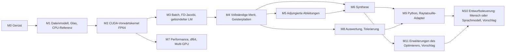

# Meilensteinplan für Agenten

Jede Aufgabe hat eine ID (`M<n>-T<k>`), Abhängigkeiten und Abnahmekriterien. Eine Aufgabe ist ein PR (siehe AGENTS.md). Aufgaben innerhalb eines Meilensteins ohne gegenseitige Abhängigkeit können parallel bearbeitet werden.

## Übersicht

M7 kann ab M2 parallel laufen, wird aber erst gebraucht, wenn die Laufzeiten der Synthese stören. Die P100 deckt FP64 bis dahin ab.

---

## M0 – Projektgerüst ✅

Erledigt mit dem ersten Commit: Verzeichnisstruktur, CMake mit Presets (CPU, CUDA), CI (Linux, Windows, CUDA-Kompilierung), Mathe-Kern für Transfer, Sphärenschnitt und Brechung, analytische Tests, CUDA-Smoke-Test, Dokumentation, ADRs, dieser Plan.

---

## M1 – Datenmodell, Glas, CPU-Referenztracer ✅

Erledigt mit den PRs #1–#6, #8 und #10 (Oktober 2026).

Ziel: Ein System aus JSON laden und auf der CPU exakt tracen, mit Paraxialdaten und RMS-Wellenfront.

### M1-T1 – Systembeschreibung einlesen und schreiben
- **Abhängig von:** M0
- **Inhalt:** nlohmann/json per FetchContent (feste Version). Datenmodell `mko::SystemDescription` (Host), Einlesen und Schreiben von `mikroptim.system/1` nach docs/dateiformat.md, Validierung mit Fehlermeldungen inklusive JSON-Pfad.
- **Abnahme:**
  - Roundtrip (lesen → schreiben → lesen) ist für alle Dateien in `data/systems/` verlustfrei.
  - Mindestens 8 Negativtests (fehlende Pflichtfelder, falsche Typen, unbekannte Hauptversion, `stop` nicht an erster Stelle, unbekanntes Glas, ungleiche Längen von Wellenlängen und Gewichten …) mit sinnvoller Meldung.

### M1-T2 – Glaskatalog und Brechzahlen
- **Abhängig von:** M0
- **Inhalt:** `mikroptim.glass/1` laden, Sellmeier auswerten, Brechzahltabelle n[Fläche][Wellenlänge] für ein System erzeugen. Materialien `AIR`, Katalogname, `constant`, `buchdahl`.
- **Abnahme:**
  - n_d (587,56 nm) für N-BK7 = 1,51680, CaF₂ = 1,43385, Quarzglas = 1,45846, jeweils ±1·10⁻⁵.
  - Fehler außerhalb von `range_nm` wird gemeldet.

### M1-T3 – Buchdahl-Fit
- **Abhängig von:** M1-T2
- **Inhalt:** Kleinste-Quadrate-Fit von (n₀, ν₁, ν₂, ν₃) an Sellmeier über 400–700 nm nach numerik.md, Abschnitt 10.
- **Abnahme:** Maximaler Fitfehler mit 3 Koeffizienten < 1·10⁻⁵ für alle Gläser in `basis.json`; Fehler mit 2 Koeffizienten wird berichtet (Test protokolliert ihn).

### M1-T4 – Pupillenquadratur
- **Abhängig von:** M0
- **Inhalt:** Header-only, `MKO_HD`: Gauß-Legendre-Knoten und Gewichte für N ≤ 16 (vorab berechnete Tabellen oder exakte Berechnung auf dem Host), Abbildung Index → (ρ, φ, Gewicht), halbe und volle Pupille, Achsfall.
- **Abnahme:**
  - Mittelwerte aller rotationssymmetrischen Zernike-Polynome bis zur garantierten Ordnung werden exakt integriert (Fehler < 1·10⁻¹⁴); Orthogonalität der Zernike-Polynome R_n^m cos(mφ) bis n = 2N−1 auf der halben Pupille.
  - Summe der Gewichte = 1.

### M1-T5 – Sequenzieller CPU-Trace
- **Abhängig von:** M1-T1, M1-T2
- **Inhalt:** `trace_ray<R>` nach architektur.md (header-only, `MKO_HD`) über eine `SurfaceTable`-Sicht; kollimierte Quelle mit OPL₀ = **p₀**·**d₀** und Punktquelle; Statusmaske; CPU-Tracer als Schleife darüber.
- **Abnahme:**
  - Planplatte (`planplatte_bk7.json`): OPL jedes Strahls gegen geschlossene Formel, Fehler < 1·10⁻¹¹ mm.
  - Einzelfläche: exakter trigonometrischer Strahl (wie in `test_surface_ops.cpp`) über das ganze System-API.
  - Aplanatische Punkte: Punktquelle im Glas (n) im Abstand R/n vom Krümmungsmittelpunkt einer Kugelfläche. Alle gebrochenen Strahlen zeigen, rückwärts verlängert, auf den virtuellen Bildpunkt im Abstand n·R vom Mittelpunkt (Abstand Gerade–Punkt < 1·10⁻¹² mm) für Aperturen bis NA 0,95.
  - Strahlumkehr: Ein durch ein mehrlinsiges System getracter Strahl, rückwärts getract, kehrt auf < 1·10⁻¹⁰ mm zum Start zurück.

### M1-T6 – Paraxialoptik
- **Abhängig von:** M1-T1, M1-T2
- **Inhalt:** y-nu-Trace, Brennweite, Schnittweite, Hauptebenen, Petzvalsumme und -krümmung, paraxiale Pupillenlage.
- **Abnahme:**
  - Dicke Linse: Brennweite nach Linsenmacherformel (Fehler < 1·10⁻¹² relativ); `einzellinse_bk7.json` ergibt f ≈ 101,05 mm, Schnittweite ≈ 99,05 mm.
  - Petzvalsumme gegen Formel in numerik.md.
  - Grenzwert: Achsschnittpunkt realer Strahlen für h → 0 konvergiert gegen die paraxiale Schnittweite.

### M1-T7 – Referenzsphäre, OPD, RMS-Wellenfront
- **Abhängig von:** M1-T4, M1-T5
- **Inhalt:** Referenzsphäre und Kolbenabzug nach numerik.md, Abschnitt 7; RMS-Wellenfront pro Feld und Wellenlänge über die Quadratur.
- **Abnahme:**
  - Aplanatischer Fall (Punktquelle, Referenz im exakten Bildpunkt): RMS-OPD < 1·10⁻¹⁰ mm.
  - Kleine Apertur: sphärische Aberration der Einzellinse stimmt mit der Seidel-Näherung W₀₄₀ auf < 1 % überein (NA ≤ 0,05).
  - Achsial verschobener Referenzpunkt bei einer perfekten Kugelwelle: OPD stimmt mit der exakten geometrischen Formel überein (< 1·10⁻¹² mm).

### M1-T8 – CLI `mikroptim trace`
- **Abhängig von:** M1-T6, M1-T7
- **Inhalt:** `mikroptim trace <system.json>` gibt Paraxialdaten, RMS-Wellenfront (in Wellen) pro Feld und Wellenlänge, Anzahl versagter Strahlen aus. Optional `--json` für maschinenlesbare Ausgabe.
- **Abnahme:** Ausgabe für `einzellinse_bk7.json` in docs/ als Beispiel dokumentiert; Test prüft die JSON-Ausgabe.

---

## M2 – CUDA-Vorwärtskernel FP64 ✅ (P100 ausstehend)

Umgesetzt mit den PRs #9, #12, #14, #16, #17, #19 (Oktober 2026), getestet auf der RTX 3090. Offen: GPU-Tests und Benchmark auf der Tesla P100 (Befehl in docs/benchmarks.md).

Ziel: Dieselben Ergebnisse wie die CPU, für viele Varianten gleichzeitig.

### M2-T1 – SystemBatch
- **Abhängig von:** M1-T5
- **Inhalt:** SoA-Layout nach architektur.md, Host-Container und Device-Sicht, Upload, Speicherabschätzung, maximale Batchgröße aus `cudaMemGetInfo`.
- **Abnahme:** Unit-Tests für Indexierung und Speicherabschätzung; Upload und Download sind verlustfrei.

### M2-T2 – Kernel `RESIDUALS`
- **Abhängig von:** M2-T1, M1-T7
- **Inhalt:** Grid-Abbildung (Block pro Variante, Feld, Wellenlänge), Systemtabelle im Shared Memory, Pupillenstützstellen im Thread, maskiertes Versagen, Kolbenabzug per Block-Reduktion, Ausgabe des Residuenvektors pro Variante.
- **Abnahme:** |GPU − CPU| ≤ `kCpuGpuFp64` für alle Strahlen von mindestens 1.000 zufällig gestörten Varianten der Testsysteme, auf RTX 3090 und P100.

### M2-T3 – Kernel `MERIT` mit deterministischer Reduktion
- **Abhängig von:** M2-T2
- **Inhalt:** gewichtete Quadratsumme pro Variante, Max-Reduktionen für Strahlhöhe und Einfallswinkel pro Fläche.
- **Abnahme:** Zehn Wiederholungen ergeben bitgleiche Ergebnisse; Merit stimmt mit der Summe der `RESIDUALS`-Ausgabe überein (< 1·10⁻¹³ relativ).

### M2-T4 – Host-API `TraceEngine`
- **Abhängig von:** M2-T2
- **Inhalt:** reiner C++-Header nach architektur.md; Fehlerbehandlung, Gerätewahl, Tranchen bei Speichermangel.
- **Abnahme:** CLI und Tests nutzen ausschließlich diese API; Batch größer als der Speicher wird korrekt in Tranchen verarbeitet (Test mit künstlich begrenztem Speicher).

### M2-T5 – CLI-Integration
- **Abhängig von:** M2-T4
- **Inhalt:** `mikroptim trace --gpu`.
- **Abnahme:** Ausgabe identisch zur CPU-Variante (innerhalb der Toleranz).

### M2-T6 – Benchmark
- **Abhängig von:** M2-T3
- **Inhalt:** `bench/trace_throughput` (Flächenzahl 10–40, Varianten 1–10.000).
- **Abnahme:** Messungen für RTX 3090 und P100 in docs/benchmarks.md. Abweichung von der Schätzung in docs/hardware.md um mehr als Faktor 3 wird im PR erklärt.

---

## M3 – Batch-Varianten, finite-Differenzen-Jacobi, gebündelter LM ✅

Umgesetzt mit den PRs #18, #20, #22, #26, #29 (Oktober 2026); JᵀJ mit eigenem Kernel statt cuBLAS (ADR-0010, vorgeschlagen).

Ziel: Erste Ende-zu-Ende-Optimierung.

### M3-T1 – Variablen und Variantengenerator
- **Abhängig von:** M2-T4
- **Inhalt:** Schema für `variables` in der Systemdatei (Krümmungen, Dicken, Arbeitsabstand; Glas folgt in M6), Abbildung Variablenvektor ↔ Batch, Erzeugung gestörter Varianten.
- **Abnahme:** Roundtrip Vektor → Batch → Vektor; Schema in docs/dateiformat.md dokumentiert.

### M3-T2 – Finite-Differenzen-Jacobi
- **Abhängig von:** M3-T1
- **Inhalt:** zentrale Differenzen, Schrittweitenwahl nach optimierung.md, Jacobi pro Lauf.
- **Abnahme:** Vergleich gegen Richardson-Extrapolation auf einem Testsystem: relative Abweichung < 1·10⁻⁶.

### M3-T3 – Paraxiale Nebenbedingungen und Residuenaufbau
- **Abhängig von:** M1-T6, M3-T1
- **Inhalt:** Brennweite, Abgleichlänge, Arbeitsabstand als Residuen; Paraxialtrace für alle Varianten (Host, parallel).
- **Abnahme:** Unit-Tests pro Nebenbedingung.

### M3-T4 – Gebündelter Levenberg-Marquardt
- **Abhängig von:** M3-T2, M3-T3
- **Inhalt:** cuBLAS `DgemmStridedBatched`, cuSOLVER `potrfBatched`/`potrsBatched`, Marquardt-Skalierung, Nielsen-Dämpfung, Schranken mit aktiver Menge, Abbruchkriterien.
- **Abnahme:**
  - Einzellinse N-BK7 mit fester Brennweite und kleiner Apertur auf minimale sphärische Aberration: Formfaktor q = (c₁+c₂)/(c₁−c₂) im Bereich 0,74 ± 0,05 (Dünnlinsentheorie: q = 2(n²−1)/(n+2)).
  - Ein optimiertes System, alle Variablen um 1 % gestört, findet zurück (Merit relativ < 1·10⁻⁶ über dem Optimum).
  - 1.000 gleichzeitige Läufe liefern bitgleich dieselben Ergebnisse wie dieselben Läufe einzeln.

### M3-T5 – CLI `mikroptim optimize`
- **Abhängig von:** M3-T4
- **Inhalt:** Optimierung einer Systemdatei, Ausgabe des Ergebnisses als neue Systemdatei, Iterationsprotokoll.
- **Abnahme:** Beispiel in docs/ dokumentiert.

---

## M4 – Vollständige Merit und Geisterplatten ✅

Umgesetzt mit den PRs #15, #27, #28, #33, #35, #39 (Oktober 2026).

### M4-T1 – Gewichtete Wellenfrontresiduen
- **Abhängig von:** M3-T4
- **Inhalt:** Feld- und Spektralgewichte, Normierung auf λ_ref, Gewichte √(W_i V_j).
- **Abnahme:** Merit gleich gewichteter Summe der RMS-Werte aus M1-T7 (< 1·10⁻¹² relativ).

### M4-T2 – Weiches Strahlversagen
- **Abhängig von:** M4-T1
- **Inhalt:** nach numerik.md, Abschnitt 11, in allen Optimierungsmodi.
- **Abnahme:** Startsystem, bei dem 30 % der Strahlen versagen, wird ohne manuelles Eingreifen in einen versagensfreien Zustand optimiert; Merit ist entlang einer Geraden durch den Versagensübergang stetig (Test mit fein abgetasteter Linie).

### M4-T3 – Mechanische Nebenbedingungen
- **Abhängig von:** M2-T3, M4-T1
- **Inhalt:** Durchmesser, Mitten- und Randdicke (Pfeilhöhe analytisch), maximaler Einfallswinkel, aus den Max-Reduktionen des Kernels.
- **Abnahme:** Unit-Tests; ein Testlauf hält alle Grenzen ein.

### M4-T4 – Petzval-Nebenbedingung
- **Abhängig von:** M1-T6
- **Abnahme:** Testsystem mit aktiver Nebenbedingung erreicht |κ_P| ≤ κ_max.

### M4-T5 – Flächentyp Geisterplatte
- **Abhängig von:** M1-T5
- **Inhalt:** nach numerik.md, Abschnitt 6, CPU und GPU; Dateiformat für `ghost_plates`.
- **Abnahme:**
  - Lineare Phase Φ = a·y lenkt exakt um Δ(n d_y) = a ab.
  - Gradient des Dickenprofils gegen finite Differenzen (< 1·10⁻¹⁰ relativ).
  - Geisterplatte mit gefitteter idealer Fokussierphase bei NA 0,3: RMS-OPD < 1·10⁻⁶ mm.
  - Paraxiale Brechkraft φ_G nach Formel stimmt mit dem Grenzwert realer Strahlen überein.

### M4-T6 – L1-Strafe und Diagnosebericht
- **Abhängig von:** M4-T5, M3-T4
- **Inhalt:** geglättete L1-Residuen, Gewichte pro Ordnung, Strafgewicht μ, Diagnosebericht nach optimierung.md, Abschnitt 5.
- **Abnahme:**
  - Exaktheit: Ein System, das sein Ziel alleine erreicht, endet mit allen |a| < 1·10⁻⁸ (μ oberhalb der Schwelle).
  - Bedarf: Einzellinse bei NA 0,5 mit Beugungsbegrenzungsziel aktiviert Geisterkoeffizienten; der Diagnosebericht nennt Position, Ordnung und Glastyp.

---

## M5 – Adjungierte Ableitungen

### M5-T1 – Vorwärtsdurchlauf mit Zustandsspeicherung
- **Abhängig von:** M4-T5
- **Inhalt:** `TraceRecord` im Local Memory, optional Checkpointing.

### M5-T2 – Rückwärtsdurchlauf
- **Abhängig von:** M5-T1
- **Inhalt:** lokale Ableitungen jeder Flächenoperation (Transfer, Schnitt, Brechung, Geisterplatte, Referenzsphäre), Gradientenzeile pro Residuum bezüglich aller Variablen, inklusive Kolbenabzug als lineare Projektion.
- **Abnahme:** relative Abweichung zur finite-Differenzen-Jacobi ≤ 1·10⁻⁶ für alle Variablentypen.

### M5-T3 – Integration in LM
- **Abhängig von:** M5-T2
- **Abnahme:** Gleiche Optimierungsergebnisse wie mit finiten Differenzen; Jacobi mindestens 10× schneller für P ≥ 60 auf beiden GPUs.

---

## M6 – Systemsynthese

### M6-T1 – Kontinuierliches Glas als Variable ✅ (#36)
- **Abhängig von:** M1-T3, M3-T4
- **Inhalt:** (n₀, ν₁, ν₂) als Variablen, konvexe Hülle der Katalog-Gläser (normierte Koordinaten), Strafterm außerhalb.
- **Abnahme:** Hüllentests; Optimierung bleibt innerhalb der Hülle.

### M6-T2 – Einfüge-Operatoren A und B
- **Abhängig von:** M4-T6
- **Inhalt:** nach optimierung.md, Abschnitt 6, inklusive Initialisierung aus dem Diagnosebericht.
- **Abnahme:** Merit nach dem Einfügen relativ unverändert (|ΔF| ≤ 1·10⁻¹²). Operator B macht aus einer Einzellinse bei zwei Wellenlängen ein Kittglied, das den Farblängsfehler um mehr als den Faktor 10 reduziert.

### M6-T3 – Homotopie-Controller
- **Abhängig von:** M6-T2
- **Inhalt:** Parameter NA, Feld, Spektrum, μ; Schrittweitensteuerung; Protokoll jedes Schritts.
- **Abnahme:** Ausgehend von einer Linse bei NA 0,3, monochromatisch, entsteht automatisch ein beugungsbegrenztes System bei NA 0,6 auf der Achse.

### M6-T4 – Kandidatenverwaltung
- **Abhängig von:** M6-T3
- **Inhalt:** Strahlsuche über Zweige (Sattelpunkt-Abstiege, Einfügungen), gemeinsame Batches pro Topologie.
- **Abnahme:** Läufe sind mit festem Seed reproduzierbar; Protokoll zeigt den Stammbaum der Kandidaten.

### M6-T5 – Glas-Einrasten ✅ (#38)
- **Abhängig von:** M6-T1
- **Abnahme:** Nach dem Einrasten nur Katalog-Gläser; Merit-Verschlechterung wird berichtet.

### M6-T6 – Lauf auf der Zielspezifikation
- **Abhängig von:** M6-T4, M6-T5
- **Inhalt:** stufenweiser Lauf nach optimierung.md, Abschnitt 7, bis zur vollen Spezifikation aus docs/spezifikation.md.
- **Abnahme:** Bericht unter `docs/ergebnisse/` mit Kandidaten, Linsenzahl, Wellenfrontfehler pro Feld und Wellenlänge, Laufzeit. Forschungsaufgabe ohne festen Zielwert; Vergleich mit den Startsystemen des Maintainers.

---

## M7 – Performance

### M7-T1 – Zahlentyp df64 ✅ (#23)
- **Abhängig von:** M2-T3
- **Abnahme:** |df64 − FP64| ≤ `kDf64VsFp64` für alle Tests der Testsuite; Durchsatz auf der RTX 3090 gemessen.

### M7-T2 – FP32-Vorfilterung ✅ (#25)
- **Inhalt:** schneller Pfad zum Aussortieren von Varianten mit massivem Strahlversagen oder schlechter Merit im Multistart.
- **Abnahme:** keine falsch aussortierten Varianten in einem Testsatz (Vergleich mit FP64).

### M7-T3 – Mehrere GPUs ✅ (#30, nur mit einer GPU getestet)
- **Abhängig von:** M2-T4
- **Abnahme:** Ergebnisse pro Variante bitgleich zum Einzel-GPU-Lauf; Verteilung nach gemessenem Durchsatz.

### M7-T4 – Profiling und Tuning
- **Inhalt:** Nsight Compute, Registerdruck, Belegung, Blockgröße.
- **Abnahme:** Profilberichte und Ergebnisse in docs/benchmarks.md.

---

## M8 – Auswertung und Tolerierung

### M8-T1 – Modus `EVAL` ✅ (#32)
- **Abhängig von:** M4-T1
- **Inhalt:** dichtes kartesisches Pupillenraster, OPD-Karten, Spotdiagramme, Feldkrümmung, Verzeichnung.

### M8-T2 – PSF, MTF, Strehl ✅ (#34)
- **Abhängig von:** M8-T1
- **Inhalt:** skalare Beugung über cuFFT. Hinweis: Bei NA 0,95 ist die skalare Näherung ungenau; ein vektorielles Modell (Richards-Wolf) ist als M8-T5 vorgesehen.
- **Abnahme:** Perfektes System bei kleiner NA: erste Nullstelle der PSF bei 0,61·λ/NA (< 1 %); Strehl gegen Maréchal-Näherung bei kleinen Aberrationen.

### M8-T3 – Dezentrierung und Verkippung
- **Inhalt:** allgemeine Flächentransformationen, volle Pupille (Symmetrie entfällt). Erfordert eine ADR für die Erweiterung der Konventionen.

### M8-T4 – Monte-Carlo-Tolerierung
- **Abhängig von:** M8-T2, M8-T3
- **Inhalt:** Toleranzsatz (Radien, Dicken, Brechzahlen, Dezentrierung, Verkippung), Stichproben als Varianten im Batch, Kompensatoren (z. B. Arbeitsabstand).
- **Abnahme:** Verteilung von Strehl und RMS-Wellenfront über 10.000 Stichproben; Ergebnis reproduzierbar mit festem Seed.

### M8-T5 – Vektorielle PSF (optional) ✅ (#37)
- **Inhalt:** Richards-Wolf für hohe NA.
- **Abnahme (in der Umsetzung festgelegt):** kleine NA → skalare PSF mit Abweichung zweiter Ordnung in der NA; NA 0,95 aberrationsfrei gegen unabhängige Quadratur des Richards-Wolf-Integrals (Intensität und Komponenten, Halbwertsbreiten in x und y relativ < 10⁻³) und gegen die geschlossene Form der Energieanteile; Energieerhaltung, Symmetrien (Spiegelung, Drehung der Polarisation), GPU = CPU, Determinismus; Strehl bei kleinen Aberrationen gegen Maréchal (docs/numerik.md, „Vektorielle PSF“).

---

## M9 – Python und Integration

### M9-T1 – Python-Bindings
- **Inhalt:** nanobind; Systeme laden, tracen, optimieren, Ergebnisse als NumPy.
- **Abnahme:** pytest-Suite, Wheel-Build für Linux und Windows.

### M9-T3 – Glasimport (AGF, refractiveindex.info)
- **Abhängig von:** M9-T1
- **Inhalt:** Python-Modul `mikroptim.glass_import` und `python -m mikroptim.glass_import`: AGF-Dateien der Hersteller und YAML-Dateien der Datenbank refractiveindex.info nach `mikroptim.glass/1`; 3-Term-Sellmeier exakt oder als geprüfter Fit, Kontrolle gegen n_d, Reintransmission, Bericht. Glasdateien werden nie committet (data/glass/README.md); die GUI bietet später den Upload und ruft dieses Modul auf.
- **Abnahme:** Tests mit synthetischen Daten (exakte Übernahme, Fit innerhalb der Toleranz, Einschränkung des Bereichs, Kontrolle n_d, Kodierungen, Status, Namen, Luftumrechnung, Transmission, Kommandozeile); der erzeugte Katalog wird vom Leser von Mikroptim angenommen und liefert bei gleichen Koeffizienten bitgleiche Paraxialdaten. Lokaler Plausibilitätslauf über die Herstellergläser der Datenbank refractiveindex.info (Ergebnis im PR).

### M9-T4 – Glasmodelle Sellmeier mit mehr Termen und Polynom
- **Abhängig von:** M9-T3
- **Inhalt:** ADR-0014: Modell `sellmeier` mit 1 … 8 Termen und Konstante, neues Modell `polynomial`; Leser, `Glass::index`, Formeln in `dispersion.hpp`; Glasimport gibt sie exakt aus (`--legacy` für 3-Term-Sellmeier).
- **Abnahme:** 3-Term-Sellmeier bitgleich zur bisherigen Formel; neue Modelle gegen Formeln von Hand; Fehlermeldungen; Glasimport exakt für AGF 1, 2, 4, 6, 9–13 und refractiveindex.info 1–3 (Abweichung < 10⁻¹³); Plausibilitätslauf: Kataloge vom C++-Leser geladen, C++ gegen Python und gegen n_d.

### M9-T2 – Adapter Raytatouille
- **Inhalt:** Konvertierung `*.rtt.json` ↔ `mikroptim.system/1` für den unterstützten Teilumfang (sequenziell, koaxial, sphärisch).
- **Abnahme:** Roundtrip für Testsysteme; nicht abbildbare Elemente werden klar gemeldet.

---

## M10 – Entwurfssteuerung: Mensch oder Sprachmodell als Entscheider (Vorschlag)

Entwurf, noch nicht freigegeben. Diagnosen und Aktionen stehen Mensch (GUI, CLI, Python) und lokalem Sprachmodell (Ollama, Instruktions- oder Thinking-Modell) gleichermaßen zur Verfügung. Beschreibung, Schnittstellen und offene Fragen: [entwurfssteuerung.md](../entwurfssteuerung.md); Grundsatz: [ADR-0012](../adr/0012-entwurfswerkzeuge-und-entscheider.md); Schemas unter `data/design/schemas/`.

### M10-T1 – Aberrationsbericht pro Fläche (Seidel)
- **Abhängig von:** M4
- **Inhalt:** paraxiale Rand- und Hauptstrahldaten, Seidel-Beiträge S_I … S_V, C_I, C_II, Sphärochromasie 3. Ordnung und Wellenfrontkoeffizienten pro Dateifläche; C++ (`compute_aberrations`), `mikroptim aberrations`, Python `mikroptim.aberrations` ([numerik.md, Abschnitt 14](../numerik.md#14-aberrationsbericht-m10-t1)).
- **Abnahme:** Σ S_I, S_II, S_III gegen die angepasste getracte Wellenfront bei kleiner Apertur (< 1 %, gemessen ≤ 1,2·10⁻³); S_IV = H² P und Lagrange-Invariante ≤ 10⁻¹³; C_I gegen den paraxialen Farblängsfehler; Sphärochromasie gegen die Differenz zweier Berichte.

### M10-T1b – Aberrationsbericht: alle Ordnungen, Zonenfehler, OSC
- **Abhängig von:** M10-T1
- **Stand:** umgesetzt mit einer exakten additiven Zerlegung aus realen Randstrahlen statt der Formel nach Delano ([numerik.md, Abschnitt 14](../numerik.md#14-aberrationsbericht-m10-t1)).
- **Inhalt:** sphärische Aberration aller Ordnungen pro Fläche nach Delano und Anteil höherer Ordnung (Zhang Gl. 2.6, 2.7), Zonenfehler (ρ = 0,707), Verletzung der Sinusbedingung (OSC, zugleich Merit-Term M11-T4); Formeln vor der Umsetzung aus der Literatur übernehmen (Welford, Delano).
- **Abnahme:** Summe der Flächenbeiträge gegen den getracten Randstrahl; bei NA ≤ 0,05 gegen Σ S_I; OSC = 0 für aplanatische Orakel.

### M10-T2 – Gruppen, Kennzahlen, Klassen
- **Abhängig von:** M10-T1
- **Stand:** umgesetzt; Gruppen, Kennzahlen und Zone in M10-T6a (`mikroptim/design/state.py`), Farb- und Feldklassen in `mikroptim/design/classes.py` mit dem chromatischen Fokusverlauf aus dem Aberrationsbericht.
- **Inhalt:** Gruppenzuordnung, Gruppenbilanzen, Retrofokusfaktor, κ, Etendue und Zone, Farb- und Feldklasse (entwurfssteuerung.md, Abschnitt 3.3).
- **Abnahme:** frei erfundene Testsysteme mit bekannter Antwort.

### M10-T3 – Empfindlichkeiten und Herstellbarkeit
- **Abhängig von:** M8-T3
- **Inhalt:** Dezentrier- und Kippempfindlichkeit pro Element, Empfindlichkeit aus der Jacobi-Matrix, einfache Herstellbarkeitsprüfungen.
- **Abnahme:** gegen Einzelrechnungen mit ADR-0011 bzw. FD.

### M10-T4 – Executor und neue Operatoren
- **Abhängig von:** M10-T2, M6-T4
- **Inhalt:** Aktionsschema, Prüfung der Vorbedingungen, `insert_module`, `remove_element`, `replace_glass`, `replace_group`, `start_from_skeleton`, `place_ghost_dictionary`.
- **Abnahme:** Merit-Invarianz von `place_ghost_dictionary`; aplanatische Vorlage ändert die Gruppensumme der sphärischen Aberration beim Einfügen um < 10⁻³; `remove_element` nach `insert_null_meniscus` ergibt das Ausgangssystem.

### M10-T5 – Wissensbasis und Glasabfrage
- **Abhängig von:** M10-T4, M11-T5
- **Inhalt:** Linsenmodule, Brechkraftverteilungen und Glasregeln als JSON in eigenen Worten mit Quellenangabe; `glass_query`.
- **Abnahme:** Filter gegen Bruteforce auf den Testkatalogen; jede Regel mit Quelle.

### M10-T6a – Grundgerüst `mikroptim.design`
- **Abhängig von:** M10-T1, M9-T1
- **Inhalt:** Python-Unterpaket `mikroptim.design` als dünne Schicht über der Kommandozeile: Zustand `mikroptim.design.state/1` (Paraxialdaten, RMS pro Tupel, Merit und Geisterdiagnose, Gruppenbilanzen aus dem Aberrationsbericht, Etendue-Zone, Retrofokusfaktor), Aktionen `get_surface_table`, `get_ghost_diagnosis`, `evaluate`, `optimize`, `synth_segment`, `snap_glasses`, `free_gaps`, `insert_null_meniscus` (mit Sattelzweigen), `split_lens`, `branch`, `abandon`, `finish`; Kandidatenbaum, Protokoll `mikroptim.design.log/1`, `HumanDecider`, `ReplayDecider`, `python -m mikroptim.design`.
- **Abnahme:** Zustand gegen das Schema; Gruppenbilanzen summieren sich zur Summe des Berichts; Einfügen, Freigeben, Optimieren, Verzweigen; strukturierte Fehler; Wiedereinspielen ergibt identische Kandidaten.

### M10-T6b – Ollama, Regel, Bestätigung
- **Abhängig von:** M10-T6a
- **Stand:** umgesetzt; Bewertung mit echten Modellen auf herkules3 in M10-T7.
- **Inhalt:** `OllamaDecider` (Instruktions- und Thinking-Modelle, Lese-Werkzeuge als Tool-Calls, schema-beschränkte Antwort, Protokoll von Denktext und Prüfsummen), `RuleDecider` (Vergleichsstrategie V3), `ConfirmDecider` (Modell schlägt vor, Mensch bestätigt), Rückfall-Entscheider.
- **Abnahme:** Modellwechsel allein über die Konfiguration; ungültige Modellausgaben werden abgefangen; Wiedereinspielen eines Laufs mit Modell ohne Ollama.

### M10-T7 – Bewertung
- **Abhängig von:** M10-T6
- **Inhalt:** Benchmarks B1–B3 (und lokal B4) gegen V0–V4, mehrere Ollama-Modelle (Instruktion und Thinking), insbesondere gegen die regelbasierte Strategie ohne Modell und gegen den Menschen mit denselben Werkzeugen.
- **Abnahme:** Bericht unter `docs/ergebnisse/`.

---

## M11 – Erweiterungen des Optimierers (Vorschlag)

Entwurf, noch nicht freigegeben. Begründung, Formeln und Abnahmen: [optimierung-erweiterungen.md](../optimierung-erweiterungen.md). Empfohlene Reihenfolge: T1a, T1b, T2, T3, dann T4, T5, dann T6, zuletzt T7, T8.

### M11-T1a – Glattes Maximum: Formeln und CPU
- **Abhängig von:** M4-T3
- **Inhalt:** Log-Sum-Exp-Akkumulator (`MKO_HD`), Reduktion auf der CPU, Dateiformat `constraints.extrema_smoothing`, Durchreichen an LM, Jacobi und Merit; GPU-Pfade lehnen die Glättung ab.
- **Abnahme:** Formel gegen direkte Rechnung, Schranken max ≤ smax ≤ max + ln N/β, Grenzwert β → ∞, Dateiformat, mechanische Bedingungen; Befund am Zweilinser dokumentiert.
- **Stand:** umgesetzt.

### M11-T1b – Glattes Maximum: β-Fortsetzung (Kernel zurückgestellt)
- **Abhängig von:** M11-T1a
- **Inhalt:** β als Homotopie-Parameter in Controller und Strahlsuche (`HomotopyPoint::extrema_beta`, `synth --extrema-beta`), optisches Modell setzt `constraints.extrema_smoothing`.
- **Stand:** β-Fortsetzung umgesetzt. Messung am System von M6-T3: keine Verbesserung; Ursache von F10 sind die Randdicken-Bedingungen selbst, nicht das Maximum über Strahlen ([optimierung-erweiterungen.md, Abschnitt 1](../optimierung-erweiterungen.md#1-glattes-maximum-über-strahlen-m11-t1)). Der Kernel (Akkumulator in `wavefront_block.hpp`) ist deshalb zurückgestellt, bis ein System zeigt, dass er nützt.

### M11-T1c – Kriechen an einseitigen Strafen: Stagnationskriterium
- **Abhängig von:** M11-T1b
- **Inhalt:** Ursache eingegrenzt (Modellkriterien greifen am Knick von max(0, g) nicht, F sinkt nur noch unmerklich); Stagnationskriterium im LM (`stall_window`, `stall_tolerance`, `converged_stall`, CLI `--stall`).
- **Abnahme:** System von M6-T3 mit `--stall 20,1e-3`: Ziel erreicht, gleiche Topologie, LM-Zyklen 21.216 → 6.436, Zeit 14,6 → 4,8 s; deterministischer LM-Test des Kriteriums.
- **Stand:** umgesetzt; Standard aus. Offen: Entscheidung über den Standard in `synth`, Glättung von max(0, g) nur noch, falls ein System sie braucht.

### M11-T2 – Augmented Lagrangian für einseitige Bedingungen
- **Abhängig von:** M6-T3
- **Inhalt:** Verschiebung θ pro einseitigem Residuum, Fortschreibung nach jedem LM-Lauf, Option im Homotopie-Controller.
- **Abnahme:** Petzval- und Mechanik-Abnahme mit festem, moderatem Gewicht unter den heutigen Toleranzen, nicht mehr LM-Zyklen.

### M11-T3 – Tangentenprädiktor in der Homotopie
- **Abhängig von:** M6-T3
- **Inhalt:** dx/dp aus JᵀJ und einer FD-Spalte über p, Sicherung über gemeinsame Merit-Auswertung.
- **Abnahme:** Abnahme von M6-T3 mit gleichem Ergebnis und mindestens 30 % weniger LM-Zyklen; deterministisch.

### M11-T4 – Sinusbedingung als Residuum
- **Abhängig von:** M4-T3
- **Inhalt:** OSC aus Zonenstrahlen des Achsbündels als trace-abhängiges Zusatzresiduum.
- **Abnahme:** OSC = 0 für aplanatische Orakel; M6-T6-Versuch „Apertur zuerst“ mit deutlich kleinerem RMS bei 7 % und 10 % Feld.

### M11-T5 – Algebraische Glasvorauswahl
- **Abhängig von:** M6-T2
- **Inhalt:** Bewertung von Glaspaaren und -tripeln über Buchdahl-Koeffizienten und Randstrahlhöhen, Anbindung an Operator B.
- **Abnahme:** Zwei Gläser entsprechen dem dünnen Achromat; konstruiertes Tripel gefunden; bester Vorschlag unter den besten fünf nach Raytrace.

### M11-T6 – Toleranzbewusste Optimierung
- **Abhängig von:** M8-T3
- **Inhalt:** erwartete Merit über feste Störungen als zusätzliche Varianten im Batch.
- **Abnahme:** wählt von zwei nominal gleichwertigen Lösungen die unempfindlichere.

### M11-T7 – Memetische globale Suche
- **Abhängig von:** M7-T2
- **Inhalt:** CMA-ES über normierte Variablen, kurzer gebündelter LM pro Individuum, Vorfilter.
- **Abnahme:** kleinere beste Merit als `perturbed_starts` bei gleicher Zahl von LM-Zyklen.

### M11-T8 – Netz der Minima, Escape-Funktion (Forschung)
- **Abhängig von:** M5-T3
- **Inhalt:** Sattelsuche mit der Dimer-Methode in fester Topologie, Abstieg in beide Richtungen als neue Kandidaten; Escape-Funktion als Alternative.
- **Abnahme:** Zweilinser mit zwei bekannten Minima; Bericht an M6-T6-Zwischenständen.

---

## Querschnittsaufgaben

- CI aktuell halten; GPU-Tests lokal vor jedem Merge von CUDA-Code.
- docs/ und CHANGELOG.md mit jeder Aufgabe pflegen.
- Neue ADR bei jeder grundsätzlichen Entscheidung.
